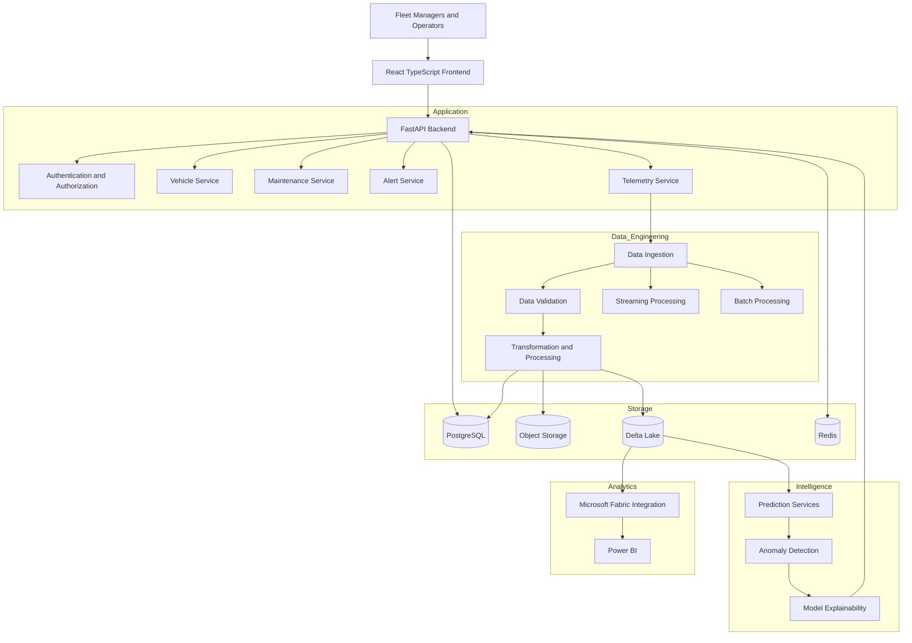

# AutoPulse AI — System Architecture

**Document ID:** AP-ARCH-007  
**Version:** 1.0  
**Status:** Proposed Architecture  
**Product:** AutoPulse AI  
**Architecture Style:** Modular, API-Driven, Data-Centric Architecture

---

# 1. Architecture Vision

AutoPulse AI will be designed as a scalable automotive intelligence platform supporting fleet management, vehicle telemetry, maintenance operations, predictive analytics, and operational reporting.

The architecture must support:

1. Mixed vehicle fleets.
2. Connected vehicle telemetry.
3. Manual and batch data ingestion.
4. Historical vehicle data.
5. Vehicle inventory management.
6. Maintenance and work-order management.
7. Data quality and validation.
8. Predictive maintenance.
9. Anomaly detection.
10. Enterprise reporting and analytics.

The system should support an initial modular deployment while allowing individual services to scale independently as product requirements grow.

# 2. Architecture Principles

## 2.1 Modularity

Separate frontend, backend, data processing, AI/ML, and storage responsibilities.

## 2.2 API-First Design

Expose application functionality through documented APIs.

## 2.3 Data Quality

Validate incoming records before they become trusted analytical information.

## 2.4 Scalability

Support growing vehicle populations, telemetry volumes, and analytical workloads.

## 2.5 Security

Apply authentication, authorization, encryption, and audit logging.

## 2.6 Explainable Intelligence

Distinguish observed vehicle conditions from model-generated predictions.

## 2.7 Technology Independence

Avoid unnecessary dependencies on a single cloud provider or vehicle manufacturer.

# 3. High-Level Architecture

The platform consists of seven logical layers:

1. Presentation Layer
2. API and Application Layer
3. Business Services Layer
4. Data Ingestion and Engineering Layer
5. AI/ML Intelligence Layer
6. Data Storage Layer
7. Infrastructure and Security Layer

## 3.1 Architecture Diagram



The diagram represents logical responsibilities. It does not require every component to be deployed as a separate microservice.

# 4. Presentation Layer

## Technology

- React
- TypeScript
- Vite
- Tailwind CSS
- shadcn/ui
- Recharts
- Lucide React
- React Router
- TanStack Query

## Responsibilities

- User interaction.
- Fleet dashboards.
- Vehicle inventory.
- Telemetry visualization.
- Maintenance management.
- Alert management.
- Predictive intelligence visualization.
- Reporting and analytics.

## Frontend Architecture

```text
frontend/
├── src/
│   ├── app/
│   │   ├── App.tsx
│   │   ├── router.tsx
│   │   └── providers/
│   │
│   ├── components/
│   │   ├── ui/
│   │   ├── layout/
│   │   ├── charts/
│   │   └── shared/
│   │
│   ├── features/
│   │   ├── overview/
│   │   ├── vehicles/
│   │   ├── telemetry/
│   │   ├── maintenance/
│   │   ├── intelligence/
│   │   ├── analytics/
│   │   ├── alerts/
│   │   └── settings/
│   │
│   ├── services/
│   ├── hooks/
│   ├── types/
│   ├── utils/
│   └── styles/
│
├── public/
├── tests/
├── package.json
└── vite.config.ts
```

## Frontend Communication

The frontend communicates with backend services through HTTPS REST APIs.

Use:
- JSON request and response formats.
- Centralized API client.
- Request validation.
- Error handling.
- Authentication tokens or secure sessions.
- Server-side pagination for large datasets.

WebSockets or Server-Sent Events can be introduced when real-time updates are required.

# 5. Backend Application Layer

## Recommended Technology

- Python 3.12+
- FastAPI
- Pydantic
- SQLAlchemy
- Alembic
- PostgreSQL
- Redis
- Pytest

## Responsibilities

1. Business logic.
2. Request validation.
3. Authentication.
4. Authorization.
5. Vehicle management.
6. Maintenance workflows.
7. Alert management.
8. Telemetry access.
9. Prediction access.
10. Reporting APIs.

## Backend Architecture

```text
backend/
├── app/
│   ├── main.py
│   │
│   ├── api/
│   │   ├── routes/
│   │   │   ├── auth.py
│   │   │   ├── vehicles.py
│   │   │   ├── telemetry.py
│   │   │   ├── maintenance.py
│   │   │   ├── work_orders.py
│   │   │   ├── alerts.py
│   │   │   ├── intelligence.py
│   │   │   └── analytics.py
│   │
│   ├── core/
│   │   ├── config.py
│   │   ├── security.py
│   │   └── permissions.py
│   │
│   ├── models/
│   ├── schemas/
│   ├── services/
│   ├── repositories/
│   ├── middleware/
│   ├── integrations/
│   └── utils/
│
├── migrations/
├── tests/
├── requirements.txt
└── Dockerfile
```

## Initial Deployment Strategy

Start with a modular monolith.

Keep business domains logically separated within one backend application.

This reduces operational complexity during initial development.

Consider independently deployed services only when workload, scaling, or organizational requirements justify them.

# 6. Business Domain Services

## 6.1 Vehicle Management Service

Responsibilities:
- Register vehicles.
- Update vehicle specifications.
- Manage fleet assignments.
- Track operational status.
- Retrieve vehicle history.

## 6.2 Telemetry Service

Responsibilities:
- Receive telemetry records.
- Validate measurements.
- Retrieve historical readings.
- Support time-series queries.
- Identify missing or invalid observations.

## 6.3 Maintenance Service

Responsibilities:
- Create work orders.
- Schedule maintenance.
- Track maintenance history.
- Manage technician assignments.
- Record service expenditure.

## 6.4 Alert Service

Responsibilities:
- Generate operational alerts.
- Track severity.
- Assign alerts.
- Record investigation notes.
- Manage resolution workflows.

## 6.5 Intelligence Service

Responsibilities:
- Retrieve model predictions.
- Calculate validated risk estimates.
- Detect anomalies.
- Provide prediction explanations.
- Track model versions.

# 7. Data Ingestion Architecture

AutoPulse AI will support two primary ingestion strategies.

## 7.1 Connected Data Ingestion

Potential sources:
- Vehicle telematics devices.
- Fleet management platforms.
- OEM APIs.
- GPS systems.
- Diagnostic systems.
- Sensor platforms.

Proposed flow:

```text
Vehicle / Device
      |
      v
Telematics Integration
      |
      v
Ingestion API or Message Broker
      |
      v
Schema Validation
      |
      v
Raw Event Storage
      |
      v
Transformation
      |
      v
Curated Telemetry
      |
      v
Analytics and AI/ML
```

## 7.2 Batch Data Ingestion

Supported input formats:
- CSV.
- JSON.
- Excel.
- Parquet.
- API-based historical imports.

Proposed flow:

```text
Uploaded File / External Source
          |
          v
File Validation
          |
          v
Raw Data Storage
          |
          v
Schema Mapping
          |
          v
Data Cleansing
          |
          v
Business Validation
          |
          v
Curated Dataset
```

## 7.3 Data Ingestion Requirements

Every ingestion process should capture:

- Source identifier.
- Source type.
- Ingestion timestamp.
- Event timestamp, where applicable.
- Processing status.
- Record count.
- Rejected record count.
- Validation results.
- Error details.
- Processing batch identifier.

## 7.4 Idempotency

Repeated ingestion must not unintentionally create duplicate records.

Use:
- Source event identifiers.
- Source-specific unique keys.
- Idempotency keys.
- Deduplication rules.
- Batch tracking.

The exact uniqueness rules will be finalized with the data contracts.

# 8. Data Engineering Architecture

## Proposed Technologies

- Python.
- SQL.
- PySpark.
- Apache Spark.
- Delta Lake.
- Microsoft Fabric.
- Fabric Data Factory.
- Fabric Notebooks.

These technologies are proposed options. The first implementation should avoid operating multiple overlapping processing platforms without a clear need.

## 8.1 Medallion Architecture

### Bronze Layer

Purpose: Preserve source information.

Responsibilities:
- Raw ingestion.
- Source metadata.
- Original record preservation.
- Ingestion tracking.
- Historical retention.

### Silver Layer

Purpose: Produce standardized and validated records.

Responsibilities:
- Schema standardization.
- Data type validation.
- Normalization.
- Deduplication.
- Missing-value handling.
- Referential validation.
- Business-rule checks.

### Gold Layer

Purpose: Provide analytical and business-ready datasets.

Potential datasets:
- Fleet Performance.
- Vehicle Health.
- Maintenance Performance.
- Telemetry Analytics.
- Fleet Utilization.
- Predictive Maintenance Results.

## 8.2 Processing Strategies

Batch processing:
- Historical imports.
- Periodic synchronization.
- Large transformations.
- Reporting datasets.

Streaming processing:
- Connected telemetry.
- Frequent vehicle events.
- Operational alert triggers.

Streaming infrastructure should be selected after expected throughput and latency requirements are established.

# 9. Data Storage Architecture

## 9.1 PostgreSQL

Primary operational database.

Stores:
- Users.
- Organizations.
- Fleet information.
- Vehicle records.
- Work orders.
- Maintenance history.
- Alerts.
- Operational configurations.
- Prediction metadata.

## 9.2 Object Storage

Stores:
- Original uploaded files.
- Historical imports.
- Raw telemetry files.
- Data exports.
- Model artifacts, where appropriate.

Potential providers:
- Azure Blob Storage.
- Azure Data Lake Storage Gen2.
- S3-compatible object storage.

## 9.3 Delta Lake

Used for analytical datasets and historical processing where justified.

Potential contents:
- Bronze telemetry.
- Silver telemetry.
- Gold fleet datasets.
- Model training datasets.
- Historical analytics.

## 9.4 Redis

Optional supporting infrastructure for:
- Caching.
- Temporary application state.
- Rate limiting.
- Background job coordination.

Redis must not be treated as the authoritative source of operational records.

# 10. AI/ML Architecture

## Technology

- Python.
- Pandas.
- NumPy.
- Scikit-learn.
- XGBoost, if justified.
- PyTorch, if justified.
- MLflow.
- SHAP, where appropriate.

## 10.1 Predictive Maintenance

Objective:

Estimate the likelihood of a defined maintenance event within a specified future time horizon.

Potential inputs:
- Vehicle age.
- Mileage.
- Operating hours.
- Maintenance history.
- Diagnostic events.
- Sensor measurements.
- Usage patterns.

Possible outputs:
- Risk category.
- Estimated probability.
- Prediction horizon.
- Contributing factors.
- Model version.
- Prediction timestamp.

The target event, prediction horizon, and training labels must be defined before model development.

## 10.2 Anomaly Detection

Potential approaches:
- Statistical thresholds.
- Isolation Forest.
- Time-series anomaly detection.
- Autoencoders, if sufficient data is available.

Use cases:
- Unusual operating patterns.
- Unexpected sensor readings.
- Abnormal temperature patterns.
- Unexpected fuel consumption.

## 10.3 Explainability

Each prediction should provide:
- Relevant input observations.
- Contributing features.
- Model version.
- Data quality indicators.
- Confidence or uncertainty information.

A model explanation must not be presented as proof of mechanical failure.

## 10.4 Model Lifecycle

```text
Data Collection
      |
      v
Data Validation
      |
      v
Feature Engineering
      |
      v
Model Training
      |
      v
Model Evaluation
      |
      v
Model Registry
      |
      v
Model Deployment
      |
      v
Prediction API
      |
      v
Monitoring and Retraining
```

Model promotion must require documented evaluation and approval.

# 11. API Architecture

Use REST APIs with versioning.

Base path:

`/api/v1`

## Initial API Domains

### Authentication

- POST /api/v1/auth/login
- POST /api/v1/auth/logout
- POST /api/v1/auth/refresh
- GET /api/v1/auth/me

### Vehicles

- GET /api/v1/vehicles
- POST /api/v1/vehicles
- GET /api/v1/vehicles/{vehicle_id}
- PATCH /api/v1/vehicles/{vehicle_id}
- DELETE /api/v1/vehicles/{vehicle_id}

Deletion should use controlled archival or deactivation where historical records must be preserved.

### Telemetry

- POST /api/v1/telemetry/ingest
- GET /api/v1/telemetry
- GET /api/v1/vehicles/{vehicle_id}/telemetry
- GET /api/v1/telemetry/quality

### Maintenance

- GET /api/v1/maintenance
- POST /api/v1/maintenance
- GET /api/v1/maintenance/{maintenance_id}
- PATCH /api/v1/maintenance/{maintenance_id}

### Work Orders

- GET /api/v1/work-orders
- POST /api/v1/work-orders
- GET /api/v1/work-orders/{work_order_id}
- PATCH /api/v1/work-orders/{work_order_id}

### Alerts

- GET /api/v1/alerts
- POST /api/v1/alerts
- GET /api/v1/alerts/{alert_id}
- PATCH /api/v1/alerts/{alert_id}

### Intelligence

- GET /api/v1/intelligence/summary
- GET /api/v1/intelligence/vehicles/{vehicle_id}
- GET /api/v1/intelligence/predictions
- GET /api/v1/intelligence/models

### Analytics

- GET /api/v1/analytics/fleet
- GET /api/v1/analytics/availability
- GET /api/v1/analytics/maintenance
- GET /api/v1/analytics/utilization

These are initial endpoint proposals, not finalized API contracts.

# 12. Security Architecture

## 12.1 Authentication

Proposed options:
- OAuth 2.0.
- OpenID Connect.
- Managed identity provider.

For the initial application, use a maintained authentication provider rather than building custom password-management infrastructure.

## 12.2 Authorization

Implement role-based access control.

Initial roles:

| Role | Responsibilities |
|---|---|
| Super Admin | Platform administration |
| Fleet Admin | Fleet configuration |
| Fleet Manager | Fleet operations |
| Maintenance Manager | Maintenance workflows |
| Technician | Assigned work orders |
| Analyst | Analytics and reporting |
| Viewer | Read-only access |

Authorization must be enforced by the backend.

## 12.3 Data Protection

Requirements:
- HTTPS.
- Encryption at rest.
- Secure secret management.
- Environment-specific configuration.
- Input validation.
- SQL injection prevention.
- Rate limiting.
- Audit logging.
- Secure file uploads.
- Backup and recovery procedures.

## 12.4 Multi-Tenant Isolation

If the platform serves multiple fleet organizations:

- Every organization-owned record must have tenant ownership.
- Backend queries must enforce tenant boundaries.
- Authorization must prevent cross-tenant access.
- Database constraints and tests must verify isolation.
- Administrative access must be explicitly controlled.

Tenant isolation must be implemented before onboarding multiple independent organizations.

# 13. Infrastructure and Deployment

## Initial Development Environment

Frontend:
- Vite development server.

Backend:
- FastAPI.
- Uvicorn.

Database:
- PostgreSQL.

Optional:
- Redis.
- Docker Compose.

## Proposed Production Options

Frontend:
- Azure Static Web Apps.
- Azure App Service.
- Equivalent managed web hosting.

Backend:
- Azure Container Apps.
- Azure App Service.
- Container-based deployment.

Database:
- Azure Database for PostgreSQL.
- Equivalent managed PostgreSQL.

Storage:
- Azure Blob Storage.
- Azure Data Lake Storage Gen2.

Analytics:
- Microsoft Fabric.

These are candidate deployment services, not mandatory commitments.

## Environment Separation

Maintain:

1. Development.
2. Testing.
3. Staging.
4. Production.

Do not use production credentials in development environments.

# 14. CI/CD Architecture

Use GitHub Actions.

Pipeline:

```text
Developer Push
      |
      v
GitHub Repository
      |
      v
Code Quality Checks
      |
      v
Automated Tests
      |
      v
Build Artifacts
      |
      v
Security Checks
      |
      v
Deployment Approval
      |
      v
Staging Deployment
      |
      v
Production Deployment
```

Required checks:
- TypeScript compilation.
- ESLint.
- Python linting.
- Backend unit tests.
- Frontend tests.
- API integration tests.
- Dependency security scanning.
- Build validation.

Production deployment should require appropriate approval.

# 15. Monitoring and Observability

Monitor:

## Application
- API response times.
- Error rates.
- Request volume.
- Authentication failures.

## Data Engineering
- Pipeline execution.
- Processing duration.
- Failed batches.
- Rejected records.
- Data freshness.
- Duplicate rates.

## AI/ML
- Prediction volume.
- Model latency.
- Model version.
- Prediction distribution.
- Data drift.
- Model performance when ground truth becomes available.

## Infrastructure
- CPU.
- Memory.
- Storage.
- Database connections.
- Network errors.

Use structured logs and correlation identifiers to trace requests across application components.

# 16. Reliability and Performance

Define measurable service-level objectives before production launch.

Initial targets for discussion:

| Area | Proposed target |
|---|---|
| Dashboard API | p95 under 2 seconds |
| Standard API | p95 under 1 second |
| Application availability | 99.5% monthly |
| Data freshness | Defined by source and ingestion mode |
| Backup | Automated and monitored |
| Recovery | Documented RPO/RTO |

These are design targets, not existing performance guarantees.

Optimize using:
- Database indexing.
- Query optimization.
- Pagination.
- Caching.
- Incremental processing.
- Background jobs.
- Appropriate data partitioning.

# 17. Testing Architecture

## Frontend
- Component testing.
- Interaction testing.
- Responsive testing.
- Accessibility testing.
- End-to-end testing.

## Backend
- Unit testing.
- API testing.
- Integration testing.
- Authorization testing.
- Validation testing.

## Data Engineering
- Schema testing.
- Data quality testing.
- Reconciliation.
- Deduplication.
- Incremental processing.
- Pipeline recovery.

## AI/ML
- Data leakage checks.
- Model validation.
- Baseline comparison.
- Prediction evaluation.
- Explainability checks.
- Drift monitoring.

# 18. Architecture Decision Records

The following decisions should be tracked explicitly.

| ID | Decision | Initial Direction | Status |
|---|---|---|---|
| ADR-001 | Application architecture | Modular monolith | Proposed |
| ADR-002 | Frontend framework | React + TypeScript | Proposed |
| ADR-003 | Backend framework | FastAPI | Proposed |
| ADR-004 | Operational database | PostgreSQL | Proposed |
| ADR-005 | Data architecture | Medallion | Proposed |
| ADR-006 | Analytics platform | Fabric integration | Proposed |
| ADR-007 | Authentication | OIDC provider | Pending selection |
| ADR-008 | Telemetry messaging | Event broker if needed | Pending |
| ADR-009 | AI model serving | Python API service | Proposed |
| ADR-010 | Cloud deployment | Azure candidate | Pending |

# 19. Open Architecture Questions

Before finalizing the architecture, determine:

1. Expected initial number of vehicles.
2. Expected telemetry events per vehicle per day.
3. Required telemetry update frequency.
4. Availability of OEM or telematics integrations.
5. Whether users will upload historical datasets.
6. Whether the first release needs real-time alerts.
7. Whether the application will initially support one organization or multiple tenants.
8. Whether Microsoft Fabric will be used in the first release.
9. Expected geographical deployment region.
10. Budget and infrastructure constraints.

Do not assume real-time connectivity or OEM integration is available until a source is confirmed.

# 20. Architecture Acceptance Criteria

The architecture is ready for detailed implementation planning when:

- Frontend and backend responsibilities are defined.
- Application modules are separated.
- Data ingestion approaches are documented.
- Operational and analytical storage responsibilities are clear.
- AI/ML integration is defined.
- Initial APIs are identified.
- Security requirements are documented.
- Deployment options are evaluated.
- Testing and monitoring strategies are established.
- Open technical decisions are tracked.

# 21. Next Deliverable

**08-database-design.md**

The next document will cover:

- Entity Relationship Diagram.
- Core entities.
- Vehicle and fleet relationships.
- Telemetry data modeling.
- Maintenance records.
- Work orders.
- Alerts.
- User and organization relationships.
- Operational database design.
- Analytical data model.
- Indexing and partitioning.
- Data retention.
- Referential integrity.

The database design will remain provisional until the outstanding telemetry and fleet requirements are clarified.

**End of document.**
