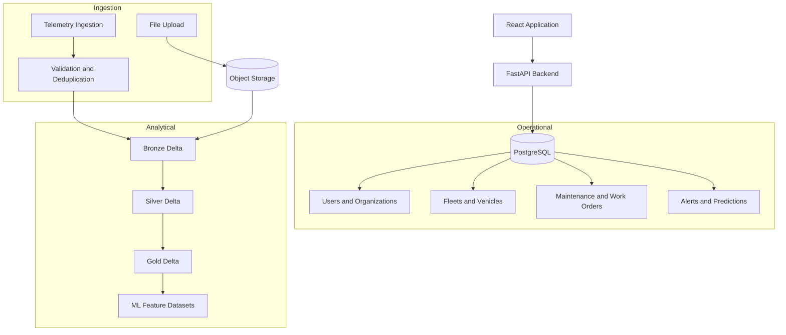
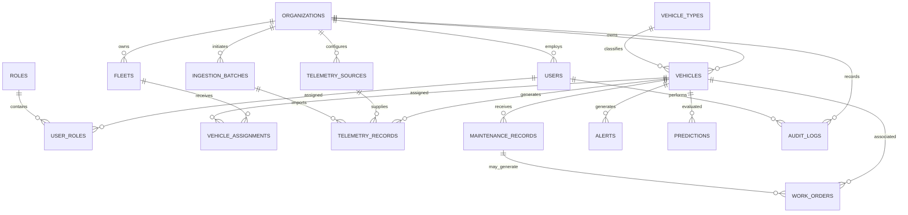

# AutoPulse AI — Database Design

**Document ID:** AP-DB-008  
**Version:** 1.0  
**Status:** Proposed Database Design  
**Database:** PostgreSQL  
**Analytical Storage:** Delta Lake / Microsoft Fabric  
**Architecture:** Relational + Analytical Data Architecture

---

# 1. Database Design Objectives

The AutoPulse AI database will provide a reliable foundation for fleet operations, vehicle management, telemetry analytics, maintenance tracking, and predictive intelligence.

The database must support:

1. Multiple fleet organizations.
2. Mixed vehicle categories.
3. Vehicle registration and inventory.
4. Vehicle operational status.
5. Connected telemetry records.
6. Manual and batch data imports.
7. Maintenance scheduling.
8. Work-order management.
9. Operational alerts.
10. Predictive maintenance results.
11. User roles and permissions.
12. Historical reporting and analytics.

The design separates operational application data from high-volume analytical data.

# 2. Database Architecture

## 2.1 Operational Database

Technology: PostgreSQL.

Purpose:
- Application transactions.
- User management.
- Fleet management.
- Vehicle inventory.
- Maintenance records.
- Work orders.
- Alerts.
- Prediction metadata.

## 2.2 Analytical Storage

Technology: Delta Lake.

Purpose:
- Historical telemetry.
- Large-scale transformations.
- Fleet performance analytics.
- Feature engineering.
- Machine-learning datasets.
- Historical predictions.

## 2.3 Object Storage

Purpose:
- Uploaded CSV files.
- Excel files.
- JSON datasets.
- Raw telemetry exports.
- Data processing artifacts.

## 2.4 Database Architecture Diagram



# 3. Database Design Principles

## 3.1 Primary Keys

Use UUID identifiers for major business entities.

Example:

`organization_id UUID PRIMARY KEY`

## 3.2 Foreign Keys

Enforce relationships between related entities.

Examples:
- Vehicle belongs to an organization.
- Vehicle may belong to a fleet.
- Work order belongs to a vehicle.
- Maintenance record references a vehicle.
- Alert references a vehicle where applicable.

## 3.3 Multi-Tenant Data Isolation

Every organization-owned business record must be associated with an organization.

Use `organization_id` to enforce tenant boundaries.

The backend must validate tenant ownership on every relevant request.

PostgreSQL Row-Level Security may provide an additional layer of protection.

## 3.4 Timestamps

Use UTC timestamps.

Recommended fields:

- created_at
- updated_at
- deleted_at, where soft deletion is appropriate.

## 3.5 Auditability

Important operational changes should be traceable.

Maintain:
- Created by.
- Updated by.
- Creation timestamp.
- Modification timestamp.
- Audit events for sensitive changes.

# 4. Entity Relationship Model

## 4.1 Core Entities

The initial relational model includes:

| Entity | Purpose |
|---|---|
| organizations | Customer organizations |
| users | Application users |
| roles | Access roles |
| user_roles | User-role assignments |
| fleets | Fleet groups |
| vehicles | Vehicle inventory |
| vehicle_types | Vehicle classifications |
| vehicle_assignments | Fleet assignment history |
| telemetry_sources | Data source registration |
| ingestion_batches | Import tracking |
| telemetry_records | Operational telemetry references |
| maintenance_records | Maintenance history |
| work_orders | Maintenance operations |
| alerts | Operational alerts |
| predictions | AI/ML prediction results |
| audit_logs | Activity history |

# 5. Entity Relationship Diagram



The diagram represents the proposed core relationships. Detailed constraints and optional relationships will be finalized during implementation.

# 6. Table Specifications

## 6.1 organizations

Purpose: Store customer organization information.

| Column | Type | Constraint |
|---|---|---|
| organization_id | UUID | Primary Key |
| organization_name | VARCHAR(200) | NOT NULL |
| organization_code | VARCHAR(50) | UNIQUE |
| industry | VARCHAR(100) | Optional |
| contact_email | VARCHAR(255) | Optional |
| status | VARCHAR(30) | NOT NULL |
| created_at | TIMESTAMPTZ | NOT NULL |
| updated_at | TIMESTAMPTZ | NOT NULL |

## 6.2 users

Purpose: Store application user profiles.

| Column | Type | Constraint |
|---|---|---|
| user_id | UUID | Primary Key |
| organization_id | UUID | Foreign Key |
| external_auth_id | VARCHAR(255) | Unique per provider |
| full_name | VARCHAR(200) | NOT NULL |
| email | VARCHAR(255) | NOT NULL |
| status | VARCHAR(30) | NOT NULL |
| created_at | TIMESTAMPTZ | NOT NULL |
| updated_at | TIMESTAMPTZ | NOT NULL |

Authentication credentials should be managed by an established identity provider rather than stored as plaintext passwords.

## 6.3 roles

Purpose: Define application access roles.

| Column | Type | Constraint |
|---|---|---|
| role_id | UUID | Primary Key |
| role_name | VARCHAR(100) | UNIQUE |
| description | TEXT | Optional |
| created_at | TIMESTAMPTZ | NOT NULL |

Initial roles:

- Super Admin.
- Fleet Admin.
- Fleet Manager.
- Maintenance Manager.
- Technician.
- Analyst.
- Viewer.

## 6.4 user_roles

Purpose: Associate users with roles.

| Column | Type | Constraint |
|---|---|---|
| user_role_id | UUID | Primary Key |
| user_id | UUID | Foreign Key |
| role_id | UUID | Foreign Key |
| organization_id | UUID | Foreign Key |
| assigned_at | TIMESTAMPTZ | NOT NULL |

Use a unique constraint on the appropriate organization, user, and role combination.

## 6.5 fleets

Purpose: Organize vehicles into operational fleets.

| Column | Type | Constraint |
|---|---|---|
| fleet_id | UUID | Primary Key |
| organization_id | UUID | Foreign Key |
| fleet_name | VARCHAR(200) | NOT NULL |
| fleet_code | VARCHAR(100) | Optional |
| description | TEXT | Optional |
| operational_region | VARCHAR(150) | Optional |
| status | VARCHAR(30) | NOT NULL |
| created_at | TIMESTAMPTZ | NOT NULL |
| updated_at | TIMESTAMPTZ | NOT NULL |

## 6.6 vehicle_types

Purpose: Maintain standardized vehicle classifications.

| Column | Type | Constraint |
|---|---|---|
| vehicle_type_id | UUID | Primary Key |
| type_name | VARCHAR(100) | UNIQUE |
| description | TEXT | Optional |
| created_at | TIMESTAMPTZ | NOT NULL |

Initial classifications:

- Passenger Car.
- Light Commercial Vehicle.
- Heavy Commercial Vehicle.
- Bus.
- Truck.
- Electric Vehicle.
- Hybrid Vehicle.
- Other.

Vehicle propulsion type should be modeled separately from vehicle class.

## 6.7 vehicles

Purpose: Store vehicle inventory and specifications.

| Column | Type | Constraint |
|---|---|---|
| vehicle_id | UUID | Primary Key |
| organization_id | UUID | Foreign Key |
| vehicle_type_id | UUID | Foreign Key |
| registration_number | VARCHAR(50) | NOT NULL |
| vin | VARCHAR(50) | Optional |
| manufacturer | VARCHAR(100) | Optional |
| model | VARCHAR(100) | Optional |
| model_year | SMALLINT | Optional |
| propulsion_type | VARCHAR(30) | Optional |
| fuel_type | VARCHAR(30) | Optional |
| purchase_date | DATE | Optional |
| mileage | NUMERIC(14,2) | Optional |
| mileage_unit | VARCHAR(20) | Optional |
| operational_status | VARCHAR(30) | NOT NULL |
| created_at | TIMESTAMPTZ | NOT NULL |
| updated_at | TIMESTAMPTZ | NOT NULL |

Registration uniqueness must be enforced within the appropriate organization and jurisdiction.

VIN uniqueness rules should account for vehicles with unavailable or nonstandard identifiers.

## 6.8 vehicle_assignments

Purpose: Maintain fleet assignment history.

| Column | Type | Constraint |
|---|---|---|
| assignment_id | UUID | Primary Key |
| organization_id | UUID | Foreign Key |
| vehicle_id | UUID | Foreign Key |
| fleet_id | UUID | Foreign Key |
| assigned_at | TIMESTAMPTZ | NOT NULL |
| unassigned_at | TIMESTAMPTZ | Optional |
| assigned_by | UUID | Foreign Key |
| created_at | TIMESTAMPTZ | NOT NULL |

This allows a vehicle to move between fleets without losing its assignment history.

## 6.9 telemetry_sources

Purpose: Register vehicle data sources.

| Column | Type | Constraint |
|---|---|---|
| source_id | UUID | Primary Key |
| organization_id | UUID | Foreign Key |
| source_name | VARCHAR(150) | NOT NULL |
| source_type | VARCHAR(50) | NOT NULL |
| provider_name | VARCHAR(150) | Optional |
| connection_status | VARCHAR(30) | NOT NULL |
| configuration_reference | VARCHAR(255) | Optional |
| created_at | TIMESTAMPTZ | NOT NULL |

Do not store API credentials directly in this table. Use a secure secrets manager.

## 6.10 ingestion_batches

Purpose: Track data imports and ingestion operations.

| Column | Type | Constraint |
|---|---|---|
| batch_id | UUID | Primary Key |
| organization_id | UUID | Foreign Key |
| source_id | UUID | Foreign Key |
| file_name | VARCHAR(255) | Optional |
| storage_reference | TEXT | Optional |
| ingestion_type | VARCHAR(30) | NOT NULL |
| processing_status | VARCHAR(30) | NOT NULL |
| total_records | BIGINT | DEFAULT 0 |
| accepted_records | BIGINT | DEFAULT 0 |
| rejected_records | BIGINT | DEFAULT 0 |
| started_at | TIMESTAMPTZ | Optional |
| completed_at | TIMESTAMPTZ | Optional |
| error_summary | TEXT | Optional |
| created_at | TIMESTAMPTZ | NOT NULL |

## 6.11 telemetry_records

Purpose: Store selected operational telemetry observations or references to analytical telemetry.

| Column | Type | Constraint |
|---|---|---|
| telemetry_id | UUID | Primary Key |
| organization_id | UUID | Foreign Key |
| vehicle_id | UUID | Foreign Key |
| source_id | UUID | Foreign Key |
| batch_id | UUID | Foreign Key |
| source_event_id | VARCHAR(255) | Optional |
| metric_name | VARCHAR(100) | NOT NULL |
| metric_value | DOUBLE PRECISION | Optional |
| metric_unit | VARCHAR(30) | Optional |
| event_timestamp | TIMESTAMPTZ | NOT NULL |
| ingestion_timestamp | TIMESTAMPTZ | NOT NULL |
| quality_status | VARCHAR(30) | NOT NULL |

Examples of potential metrics:

- Speed.
- Engine temperature.
- Fuel level.
- Battery voltage.
- Odometer reading.
- GPS coordinates.
- Diagnostic events.

The final telemetry model must follow actual source data contracts.

For high-volume time-series telemetry, use a separate analytical or time-series storage strategy instead of forcing all events into the operational PostgreSQL database.

## 6.12 maintenance_records

Purpose: Store completed and historical maintenance activities.

| Column | Type | Constraint |
|---|---|---|
| maintenance_id | UUID | Primary Key |
| organization_id | UUID | Foreign Key |
| vehicle_id | UUID | Foreign Key |
| maintenance_type | VARCHAR(100) | NOT NULL |
| description | TEXT | Optional |
| service_date | DATE | NOT NULL |
| mileage_at_service | NUMERIC(14,2) | Optional |
| service_provider | VARCHAR(200) | Optional |
| service_cost | NUMERIC(14,2) | Optional |
| currency_code | CHAR(3) | Optional |
| created_at | TIMESTAMPTZ | NOT NULL |

## 6.13 work_orders

Purpose: Track maintenance and repair operations.

| Column | Type | Constraint |
|---|---|---|
| work_order_id | UUID | Primary Key |
| organization_id | UUID | Foreign Key |
| vehicle_id | UUID | Foreign Key |
| maintenance_id | UUID | Optional Foreign Key |
| assigned_user_id | UUID | Optional Foreign Key |
| title | VARCHAR(200) | NOT NULL |
| description | TEXT | Optional |
| priority | VARCHAR(30) | NOT NULL |
| status | VARCHAR(30) | NOT NULL |
| scheduled_date | TIMESTAMPTZ | Optional |
| completed_at | TIMESTAMPTZ | Optional |
| estimated_cost | NUMERIC(14,2) | Optional |
| actual_cost | NUMERIC(14,2) | Optional |
| created_at | TIMESTAMPTZ | NOT NULL |
| updated_at | TIMESTAMPTZ | NOT NULL |

## 6.14 alerts

Purpose: Store operational and maintenance alerts.

| Column | Type | Constraint |
|---|---|---|
| alert_id | UUID | Primary Key |
| organization_id | UUID | Foreign Key |
| vehicle_id | UUID | Optional Foreign Key |
| alert_type | VARCHAR(100) | NOT NULL |
| severity | VARCHAR(30) | NOT NULL |
| title | VARCHAR(200) | NOT NULL |
| description | TEXT | Optional |
| status | VARCHAR(30) | NOT NULL |
| assigned_user_id | UUID | Optional Foreign Key |
| triggered_at | TIMESTAMPTZ | NOT NULL |
| resolved_at | TIMESTAMPTZ | Optional |
| created_at | TIMESTAMPTZ | NOT NULL |

## 6.15 predictions

Purpose: Store AI/ML inference results.

| Column | Type | Constraint |
|---|---|---|
| prediction_id | UUID | Primary Key |
| organization_id | UUID | Foreign Key |
| vehicle_id | UUID | Foreign Key |
| model_name | VARCHAR(150) | NOT NULL |
| model_version | VARCHAR(50) | NOT NULL |
| prediction_type | VARCHAR(100) | NOT NULL |
| predicted_value | JSONB | NOT NULL |
| confidence_score | NUMERIC(8,6) | Optional |
| prediction_horizon | VARCHAR(100) | Optional |
| feature_reference | TEXT | Optional |
| prediction_timestamp | TIMESTAMPTZ | NOT NULL |
| created_at | TIMESTAMPTZ | NOT NULL |

Predictions must preserve the model version and relevant input references for reproducibility.

Confidence scores must only be populated when their statistical meaning is defined and validated.

## 6.16 audit_logs

Purpose: Record important application activities.

| Column | Type | Constraint |
|---|---|---|
| audit_id | UUID | Primary Key |
| organization_id | UUID | Foreign Key |
| user_id | UUID | Optional Foreign Key |
| action | VARCHAR(150) | NOT NULL |
| entity_type | VARCHAR(100) | NOT NULL |
| entity_id | UUID | Optional |
| old_values | JSONB | Optional |
| new_values | JSONB | Optional |
| ip_address | INET | Optional |
| created_at | TIMESTAMPTZ | NOT NULL |

Avoid storing passwords, authentication tokens, or unnecessary sensitive information in audit records.

# 7. Database Relationships

## Organization Relationships

One organization can have:
- Multiple users.
- Multiple fleets.
- Multiple vehicles.
- Multiple telemetry sources.
- Multiple ingestion batches.
- Multiple operational records.

## Fleet Relationships

One fleet can have multiple vehicles over time.

Vehicle assignment history is maintained separately.

## Vehicle Relationships

One vehicle can have:
- Multiple telemetry observations.
- Multiple maintenance records.
- Multiple work orders.
- Multiple alerts.
- Multiple predictions.
- Multiple fleet assignment records.

## Prediction Relationships

A prediction belongs to a vehicle and organization.

A prediction must reference its model version and prediction timestamp.

# 8. Data Normalization Strategy

The operational database should generally follow Third Normal Form (3NF).

Requirements:

- Avoid duplicate organization information.
- Separate users and roles.
- Separate fleet and vehicle entities.
- Separate maintenance history and work orders.
- Maintain standardized vehicle classifications.
- Use foreign keys for relationships.
- Avoid storing repeating values in individual columns.

JSONB should be reserved for genuinely flexible attributes and structured prediction outputs, not used as a substitute for relational modeling.

# 9. Indexing Strategy

Recommended initial indexes:

| Table | Index |
|---|---|
| users | organization_id, email |
| fleets | organization_id, fleet_name |
| vehicles | organization_id, registration_number |
| vehicles | organization_id, vin |
| vehicle_assignments | vehicle_id, assigned_at |
| telemetry_records | vehicle_id, event_timestamp |
| telemetry_records | organization_id, event_timestamp |
| ingestion_batches | organization_id, created_at |
| maintenance_records | vehicle_id, service_date |
| work_orders | organization_id, status |
| work_orders | vehicle_id, scheduled_date |
| alerts | organization_id, status |
| alerts | organization_id, triggered_at |
| predictions | vehicle_id, prediction_timestamp |
| audit_logs | organization_id, created_at |

Use composite indexes based on actual application queries.

Avoid creating unnecessary indexes because they increase storage and write overhead.

# 10. Partitioning Strategy

High-volume telemetry may require time-based partitioning.

Potential strategy:

- Monthly partitions initially.
- Daily partitions if volume requires them.
- Retention policies based on customer requirements.
- Historical analytical data maintained in Delta Lake.

Do not partition every operational table.

Partitioning decisions must be based on actual record volumes and query patterns.

# 11. Data Quality Rules

## Vehicle Data

- Vehicle identifier must be unique within its defined scope.
- Vehicle type must reference a valid classification.
- Model year must be reasonable.
- Mileage cannot be negative.
- Registration number must follow applicable validation rules.

## Telemetry Data

- Vehicle must exist.
- Source must be registered.
- Event timestamp must be valid.
- Metric name must be recognized or explicitly allowed.
- Measurement units must be defined.
- Duplicate source events must be handled.
- Invalid measurements must be quarantined or flagged.

## Maintenance Data

- Vehicle must exist.
- Service date must be valid.
- Cost cannot be negative.
- Currency must be identified when cost is supplied.

## Prediction Data

- Vehicle must exist.
- Model version must be recorded.
- Prediction timestamp must be present.
- Prediction output must conform to its defined schema.
- Predictions must be distinguishable from verified operational facts.

# 12. Data Retention Strategy

Retention periods will be configurable based on:

- Customer agreements.
- Operational requirements.
- Applicable regulations.
- Storage costs.
- Analytical requirements.

Proposed categories:

| Data Category | Retention Approach |
|---|---|
| User records | Account lifecycle policy |
| Vehicle records | Historical preservation |
| Maintenance records | Customer-defined retention |
| Work orders | Historical preservation |
| Alerts | Configurable retention |
| Telemetry | Tiered storage and retention |
| Predictions | Versioned historical records |
| Audit logs | Security retention policy |

Deletion and archival policies must preserve necessary audit and historical relationships.

# 13. PostgreSQL Implementation Standards

Use:

- SQLAlchemy ORM.
- Alembic migrations.
- PostgreSQL UUID.
- TIMESTAMPTZ.
- NUMERIC for financial values.
- JSONB for flexible structured attributes.
- Foreign key constraints.
- Check constraints.
- Unique constraints.
- Database transactions.

Use parameterized queries and least-privilege database access.

# 14. Proposed Database Folder Structure

```text
backend/
├── app/
│   ├── models/
│   │   ├── organization.py
│   │   ├── user.py
│   │   ├── role.py
│   │   ├── fleet.py
│   │   ├── vehicle.py
│   │   ├── telemetry.py
│   │   ├── maintenance.py
│   │   ├── work_order.py
│   │   ├── alert.py
│   │   ├── prediction.py
│   │   └── audit_log.py
│   │
│   └── repositories/
│
├── migrations/
│   └── versions/
│
└── tests/
    ├── test_organizations.py
    ├── test_vehicles.py
    ├── test_fleets.py
    ├── test_telemetry.py
    └── test_maintenance.py
```

# 15. Database Testing Strategy

Test the following:

1. Primary key uniqueness.
2. Foreign key integrity.
3. Organization-level isolation.
4. Vehicle registration uniqueness.
5. Fleet assignment history.
6. Telemetry duplicate handling.
7. Invalid measurement rejection.
8. Maintenance record validation.
9. Work-order status transitions.
10. Prediction version tracking.
11. Audit log creation.
12. Database migration rollback and upgrade.

Use realistic synthetic data for development and testing.

# 16. Open Database Design Questions

The following decisions remain open:

1. What is the expected number of vehicles in the first deployment?
2. How frequently will connected vehicles transmit telemetry?
3. Which telemetry standards or OEM APIs will be supported?
4. Will GPS coordinates be stored at high frequency?
5. Which vehicle diagnostic signals are available?
6. Will maintenance be recorded manually, imported, or both?
7. Should a vehicle belong to only one active fleet at a time?
8. Will multiple organizations share the same platform?
9. What are the customer-specific data retention requirements?
10. What is the expected analytical data volume?

These questions must be answered before finalizing production database migrations.

# 17. Database Design Acceptance Criteria

The database design is ready for implementation planning when:

- Core entities are defined.
- Relationships are documented.
- Primary and foreign keys are identified.
- Tenant ownership is established.
- Data normalization is documented.
- Indexing strategy is proposed.
- Telemetry storage is separated appropriately.
- Data quality rules are documented.
- Retention policies are considered.
- Open decisions are tracked.
- ER relationships are reviewed.

# 18. Next Deliverable

**09-api-specification.md**

The next document will define:

- REST API standards.
- Endpoint specifications.
- Request and response schemas.
- Authentication requirements.
- Authorization rules.
- Pagination and filtering.
- Error response standards.
- API validation.
- Integration contracts.
- OpenAPI documentation.
- API testing requirements.

**End of document.**
