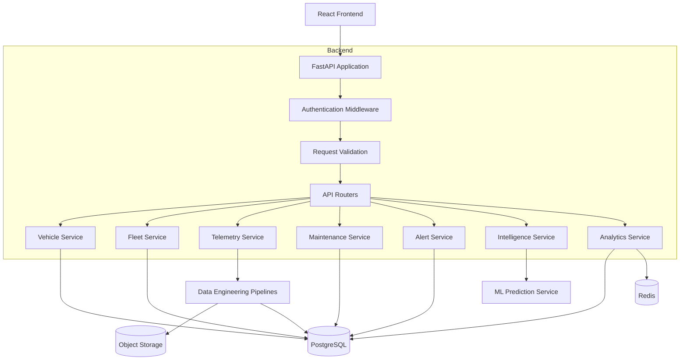

# AutoPulse AI — API Specification

**Document ID:** AP-API-009  
**Version:** 1.0  
**Status:** Proposed API Contract  
**Backend:** Python + FastAPI  
**API Style:** REST  
**API Format:** JSON  
**API Version:** v1  
**Authentication:** OAuth 2.0 / OpenID Connect

---

# 1. API Design Objectives

The AutoPulse AI API provides a standardized communication layer between:

- React frontend.
- Backend application services.
- PostgreSQL database.
- Telemetry ingestion pipelines.
- Data engineering workflows.
- AI/ML prediction services.
- External vehicle and fleet integrations.

The API must support:

1. Fleet and organization management.
2. Vehicle registration and inventory.
3. Vehicle telemetry ingestion.
4. Historical telemetry retrieval.
5. Maintenance management.
6. Work-order management.
7. Operational alerts.
8. Predictive maintenance.
9. Fleet analytics.
10. Data import management.
11. User authentication and authorization.
12. Administrative operations.

# 2. API Architecture

## 2.1 Base URL

Development:

`http://localhost:8000/api/v1`

Production:

`https://api.autopulse.ai/api/v1`

The production hostname is a proposed example and must be configured when infrastructure is selected.

## 2.2 API Communication

- Protocol: HTTPS in deployed environments.
- Request format: JSON.
- Response format: JSON.
- Character encoding: UTF-8.
- Date format: ISO 8601.
- Timezone: UTC.
- API versioning: URL-based.

## 2.3 API Architecture Diagram



# 3. API Standards

## 3.1 HTTP Methods

| Method | Purpose |
|---|---|
| GET | Retrieve information |
| POST | Create records or initiate operations |
| PUT | Replace a resource |
| PATCH | Partially update a resource |
| DELETE | Delete or deactivate a resource |

## 3.2 HTTP Status Codes

| Code | Meaning |
|---|---|
| 200 | Successful request |
| 201 | Resource created |
| 202 | Request accepted for asynchronous processing |
| 204 | Successful request without response body |
| 400 | Invalid request |
| 401 | Authentication required |
| 403 | Permission denied |
| 404 | Resource not found |
| 409 | Resource conflict |
| 422 | Validation error |
| 429 | Rate limit exceeded |
| 500 | Internal server error |
| 503 | Service temporarily unavailable |

## 3.3 Response Standards

Successful response:

```json
{
  "success": true,
  "message": "Vehicle retrieved successfully",
  "data": {
    "vehicle_id": "550e8400-e29b-41d4-a716-446655440000",
    "registration_number": "AP09AB1234",
    "manufacturer": "Example Motors",
    "operational_status": "active"
  }
}
```

Error response:

```json
{
  "success": false,
  "error": {
    "code": "VEHICLE_NOT_FOUND",
    "message": "The requested vehicle was not found",
    "details": []
  },
  "request_id": "req-123456"
}
```

Validation error:

```json
{
  "success": false,
  "error": {
    "code": "VALIDATION_ERROR",
    "message": "One or more fields are invalid",
    "details": [
      {
        "field": "registration_number",
        "message": "This field is required"
      }
    ]
  }
}
```

# 4. Authentication APIs

All protected endpoints require an authenticated user.

Authentication should be delegated to an OIDC-compatible identity provider.

The backend validates access tokens and resolves the user's organization and permissions.

## 4.1 Get Current User

**GET** `/auth/me`

Purpose:
Retrieve authenticated user information.

Response:

```json
{
  "success": true,
  "data": {
    "user_id": "user-uuid",
    "full_name": "Fleet Administrator",
    "email": "admin@example.com",
    "organization_id": "organization-uuid",
    "roles": ["FLEET_ADMIN"],
    "status": "active"
  }
}
```

## 4.2 Logout

**POST** `/auth/logout`

Purpose:
Initiate logout through the configured identity provider or revoke the applicable session.

## 4.3 Refresh Token

**POST** `/auth/refresh`

Purpose:
Refresh an authenticated session where supported by the selected identity provider.

Token handling must follow the provider's security recommendations.

# 5. Organization APIs

Base path: `/organizations`

| Method | Endpoint | Purpose |
|---|---|---|
| GET | `/organizations/me` | Get current organization |
| PATCH | `/organizations/me` | Update organization details |
| GET | `/organizations/me/users` | List organization users |
| GET | `/organizations/me/settings` | Retrieve organization settings |

Organization membership and permissions must be validated server-side.

# 6. Fleet Management APIs

Base path: `/fleets`

## 6.1 Create Fleet

**POST** `/fleets`

Request:

```json
{
  "fleet_name": "North Region Fleet",
  "fleet_code": "NRF-001",
  "description": "Regional commercial vehicle fleet",
  "operational_region": "North Region"
}
```

Response:

```json
{
  "success": true,
  "message": "Fleet created successfully",
  "data": {
    "fleet_id": "fleet-uuid",
    "fleet_name": "North Region Fleet",
    "status": "active"
  }
}
```

## 6.2 List Fleets

**GET** `/fleets`

Query parameters:

- page
- page_size
- search
- status
- sort_by
- sort_order

Example:

`GET /fleets?page=1&page_size=20&status=active`

## 6.3 Retrieve Fleet

**GET** `/fleets/{fleet_id}`

Returns:
- Fleet details.
- Vehicle count.
- Operational summary.
- Assignment information.

## 6.4 Update Fleet

**PATCH** `/fleets/{fleet_id}`

Supports partial updates to fleet metadata.

## 6.5 Fleet Vehicles

**GET** `/fleets/{fleet_id}/vehicles`

Returns vehicles assigned to the fleet.

## 6.6 Assign Vehicle

**POST** `/fleets/{fleet_id}/vehicles`

Request:

```json
{
  "vehicle_id": "vehicle-uuid",
  "assigned_at": "2026-11-12T12:00:00Z"
}
```

The service must validate that the vehicle and fleet belong to the same organization.

## 6.7 Remove Vehicle Assignment

**DELETE** `/fleets/{fleet_id}/vehicles/{vehicle_id}`

This operation closes the active assignment rather than deleting assignment history.

# 7. Vehicle Management APIs

Base path: `/vehicles`

## 7.1 Register Vehicle

**POST** `/vehicles`

Request:

```json
{
  "vehicle_type_id": "vehicle-type-uuid",
  "registration_number": "AP09AB1234",
  "vin": "EXAMPLEVIN12345678",
  "manufacturer": "Example Motors",
  "model": "Fleet X",
  "model_year": 2025,
  "propulsion_type": "hybrid",
  "fuel_type": "petrol",
  "mileage": 12500,
  "mileage_unit": "km"
}
```

Response:

```json
{
  "success": true,
  "message": "Vehicle registered successfully",
  "data": {
    "vehicle_id": "vehicle-uuid",
    "registration_number": "AP09AB1234",
    "operational_status": "active"
  }
}
```

The organization ID must come from the authenticated user's authorized context, not an unrestricted client-supplied field.

## 7.2 List Vehicles

**GET** `/vehicles`

Query parameters:

| Parameter | Purpose |
|---|---|
| page | Page number |
| page_size | Records per page |
| search | Registration, VIN, manufacturer |
| fleet_id | Fleet filter |
| vehicle_type_id | Vehicle classification |
| operational_status | Operational status |
| propulsion_type | Vehicle propulsion |
| manufacturer | Manufacturer filter |
| sort_by | Sorting field |
| sort_order | asc or desc |

Example:

`GET /vehicles?page=1&page_size=25&operational_status=active`

## 7.3 Get Vehicle Details

**GET** `/vehicles/{vehicle_id}`

Response should include:
- Vehicle specifications.
- Fleet assignment.
- Current operational status.
- Latest available telemetry timestamp.
- Maintenance summary.
- Active alert count.

## 7.4 Update Vehicle

**PATCH** `/vehicles/{vehicle_id}`

Request:

```json
{
  "mileage": 15000,
  "operational_status": "active"
}
```

## 7.5 Deactivate Vehicle

**DELETE** `/vehicles/{vehicle_id}`

Use controlled deactivation or archival.

Do not physically delete historical vehicle records that are referenced by maintenance, telemetry, or audit data.

## 7.6 Vehicle History

**GET** `/vehicles/{vehicle_id}/history`

Returns relevant historical information:

- Fleet assignments.
- Maintenance.
- Work orders.
- Alerts.
- Predictions.

# 8. Telemetry APIs

Base path: `/telemetry`

Telemetry ingestion must support connected sources and manually imported datasets.

## 8.1 Ingest Telemetry

**POST** `/telemetry/ingest`

Request:

```json
{
  "source_id": "source-uuid",
  "vehicle_id": "vehicle-uuid",
  "source_event_id": "event-12345",
  "event_timestamp": "2026-11-12T11:30:00Z",
  "metrics": [
    {
      "metric_name": "engine_temperature",
      "metric_value": 88.5,
      "metric_unit": "celsius"
    },
    {
      "metric_name": "vehicle_speed",
      "metric_value": 65.0,
      "metric_unit": "km/h"
    },
    {
      "metric_name": "fuel_level",
      "metric_value": 72.0,
      "metric_unit": "percent"
    }
  ]
}
```

Response:

```json
{
  "success": true,
  "message": "Telemetry accepted for processing",
  "data": {
    "ingestion_id": "ingestion-uuid",
    "processing_status": "accepted",
    "accepted_metrics": 3
  }
}
```

Use idempotency keys or source event identifiers to prevent duplicate processing.

## 8.2 Retrieve Telemetry

**GET** `/telemetry`

Parameters:
- vehicle_id
- source_id
- metric_name
- start_time
- end_time
- page
- page_size

## 8.3 Vehicle Telemetry

**GET** `/vehicles/{vehicle_id}/telemetry`

Returns historical telemetry for a selected vehicle.

## 8.4 Latest Telemetry

**GET** `/vehicles/{vehicle_id}/telemetry/latest`

Returns the latest available observations.

The response must include the event timestamp and indicate data freshness.

## 8.5 Telemetry Quality

**GET** `/telemetry/quality`

Returns:
- Total records processed.
- Accepted records.
- Rejected records.
- Duplicate records.
- Missing values.
- Invalid measurements.
- Data freshness.

## 8.6 Telemetry Ingestion Status

**GET** `/telemetry/ingestion/{ingestion_id}`

Returns the current ingestion state.

Possible states:
- Pending.
- Processing.
- Completed.
- Partially Completed.
- Failed.

# 9. Data Import APIs

Base path: `/imports`

## 9.1 Upload Dataset

**POST** `/imports/upload`

Content type: `multipart/form-data`

Supported initial formats:
- CSV.
- JSON.
- XLSX.
- Parquet.

Request fields:
- file
- source_id
- dataset_type

Response:

```json
{
  "success": true,
  "message": "File uploaded successfully",
  "data": {
    "batch_id": "batch-uuid",
    "processing_status": "pending",
    "file_name": "vehicle_telemetry.csv"
  }
}
```

## 9.2 Validate Dataset

**POST** `/imports/{batch_id}/validate`

Initiates schema and data quality validation.

## 9.3 Process Dataset

**POST** `/imports/{batch_id}/process`

Starts the approved ingestion and transformation workflow.

## 9.4 Retrieve Import Results

**GET** `/imports/{batch_id}`

Returns:
- Batch status.
- Total records.
- Accepted records.
- Rejected records.
- Validation results.
- Processing errors.

## 9.5 Download Error Report

**GET** `/imports/{batch_id}/errors`

Provides a downloadable report of rejected records, subject to authorization.

# 10. Maintenance APIs

Base path: `/maintenance`

## 10.1 Create Maintenance Record

**POST** `/maintenance`

Request:

```json
{
  "vehicle_id": "vehicle-uuid",
  "maintenance_type": "preventive",
  "description": "Scheduled engine inspection",
  "service_date": "2026-11-12",
  "mileage_at_service": 15000,
  "service_provider": "Example Service Center",
  "service_cost": 250.00,
  "currency_code": "USD"
}
```

## 10.2 List Maintenance Records

**GET** `/maintenance`

Parameters:
- vehicle_id
- maintenance_type
- start_date
- end_date
- page
- page_size

## 10.3 Retrieve Maintenance Record

**GET** `/maintenance/{maintenance_id}`

## 10.4 Update Maintenance Record

**PATCH** `/maintenance/{maintenance_id}`

## 10.5 Vehicle Maintenance History

**GET** `/vehicles/{vehicle_id}/maintenance`

Returns chronological maintenance history.

# 11. Work Order APIs

Base path: `/work-orders`

## 11.1 Create Work Order

**POST** `/work-orders`

Request:

```json
{
  "vehicle_id": "vehicle-uuid",
  "title": "Inspect engine temperature anomaly",
  "description": "Investigate repeated elevated temperature readings",
  "priority": "high",
  "scheduled_date": "2026-11-14T09:00:00Z"
}
```

## 11.2 List Work Orders

**GET** `/work-orders`

Filters:
- vehicle_id
- status
- priority
- assigned_user_id
- scheduled_date
- page
- page_size

## 11.3 Retrieve Work Order

**GET** `/work-orders/{work_order_id}`

## 11.4 Update Work Order

**PATCH** `/work-orders/{work_order_id}`

Example:

```json
{
  "status": "in_progress",
  "assigned_user_id": "user-uuid"
}
```

## 11.5 Complete Work Order

**POST** `/work-orders/{work_order_id}/complete`

Request:

```json
{
  "actual_cost": 275.00,
  "completion_notes": "Inspection completed",
  "completed_at": "2026-11-14T11:30:00Z"
}
```

The backend must enforce permitted status transitions and preserve completion history.

# 12. Alert Management APIs

Base path: `/alerts`

## 12.1 Create Alert

**POST** `/alerts`

Request:

```json
{
  "vehicle_id": "vehicle-uuid",
  "alert_type": "maintenance",
  "severity": "warning",
  "title": "Maintenance attention required",
  "description": "Vehicle requires inspection"
}
```

## 12.2 List Alerts

**GET** `/alerts`

Parameters:
- vehicle_id
- severity
- status
- alert_type
- start_time
- end_time
- page
- page_size

## 12.3 Retrieve Alert

**GET** `/alerts/{alert_id}`

## 12.4 Update Alert

**PATCH** `/alerts/{alert_id}`

Supports:
- Status updates.
- Assignment.
- Investigation notes, if supported by the final alert model.

## 12.5 Resolve Alert

**POST** `/alerts/{alert_id}/resolve`

Request:

```json
{
  "resolution_notes": "Vehicle inspected and issue addressed"
}
```

# 13. Predictive Intelligence APIs

Base path: `/intelligence`

These APIs expose predictions generated by validated AI/ML models.

## 13.1 Fleet Intelligence Summary

**GET** `/intelligence/summary`

Returns:
- Number of vehicles evaluated.
- Risk distribution.
- Active prediction count.
- Anomaly count.
- Model information.
- Data freshness.

## 13.2 Vehicle Intelligence

**GET** `/intelligence/vehicles/{vehicle_id}`

Returns available intelligence information for a vehicle.

## 13.3 Generate Prediction

**POST** `/intelligence/predictions`

Request:

```json
{
  "vehicle_id": "vehicle-uuid",
  "prediction_type": "maintenance_risk",
  "prediction_horizon": "30_days"
}
```

Response:

```json
{
  "success": true,
  "message": "Prediction request accepted",
  "data": {
    "prediction_request_id": "prediction-request-uuid",
    "status": "pending"
  }
}
```

The actual prediction may be asynchronous.

## 13.4 Retrieve Prediction

**GET** `/intelligence/predictions/{prediction_id}`

Response:

```json
{
  "success": true,
  "data": {
    "prediction_id": "prediction-uuid",
    "vehicle_id": "vehicle-uuid",
    "prediction_type": "maintenance_risk",
    "risk_category": "medium",
    "prediction_horizon": "30_days",
    "model_name": "maintenance-risk-model",
    "model_version": "1.0",
    "prediction_timestamp": "2026-11-12T12:00:00Z",
    "explanation": {
      "contributing_factors": [
        "Historical maintenance frequency",
        "Recent telemetry anomalies"
      ]
    }
  }
}
```

The response is illustrative. Actual risk categories, probabilities, and explanation fields depend on model validation.

## 13.5 List Predictions

**GET** `/intelligence/predictions`

Parameters:
- vehicle_id
- prediction_type
- model_version
- start_time
- end_time
- page
- page_size

## 13.6 Model Registry

**GET** `/intelligence/models`

Returns approved model metadata.

# 14. Fleet Analytics APIs

Base path: `/analytics`

## 14.1 Fleet Overview

**GET** `/analytics/fleet`

Returns:
- Total vehicles.
- Active vehicles.
- Inactive vehicles.
- Vehicles under maintenance.
- Active alerts.
- Fleet distribution.

## 14.2 Vehicle Availability

**GET** `/analytics/availability`

Parameters:
- start_date
- end_date
- fleet_id

## 14.3 Maintenance Analytics

**GET** `/analytics/maintenance`

Returns:
- Maintenance expenditure.
- Maintenance frequency.
- Work-order status distribution.
- Maintenance trends.

## 14.4 Vehicle Utilization

**GET** `/analytics/utilization`

Returns:
- Vehicle usage.
- Distance travelled, if available.
- Operating hours, if available.
- Utilization trends.

## 14.5 Telemetry Analytics

**GET** `/analytics/telemetry`

Returns:
- Metric trends.
- Observation counts.
- Data quality.
- Time-based summaries.

All analytics responses must identify their reporting period and data freshness.

# 15. Dashboard API

Base path: `/dashboard`

## 15.1 Dashboard Overview

**GET** `/dashboard/overview`

Purpose:

Provide the information required by the AutoPulse AI primary dashboard.

Proposed response:

```json
{
  "success": true,
  "data": {
    "fleet_summary": {
      "total_vehicles": 250,
      "active_vehicles": 218,
      "under_maintenance": 12
    },
    "alert_summary": {
      "critical": 2,
      "warning": 8,
      "informational": 14
    },
    "maintenance_summary": {
      "open_work_orders": 16,
      "completed_this_month": 32
    },
    "data_freshness": {
      "latest_telemetry": "2026-11-12T12:00:00Z"
    }
  }
}
```

All values above are sample data, not actual fleet statistics.

# 16. Pagination Standards

Use page-based pagination for standard list endpoints.

Example:

`GET /vehicles?page=1&page_size=20`

Response:

```json
{
  "success": true,
  "data": [],
  "pagination": {
    "page": 1,
    "page_size": 20,
    "total_records": 100,
    "total_pages": 5
  }
}
```

For very large telemetry datasets, introduce cursor-based pagination using a stable ordering such as event timestamp and record identifier.

Set reasonable maximum page sizes.

# 17. Filtering and Sorting Standards

Use consistent query parameter conventions.

Examples:

```text
?status=active
?priority=high
?vehicle_id=vehicle-uuid
?start_date=2026-11-01
?end_date=2026-11-12
?sort_by=created_at
?sort_order=desc
```

Only allow explicitly supported sorting fields.

All filtering must respect organization-level access restrictions.

# 18. API Security

## Authentication

Use OIDC/OAuth 2.0 access tokens.

## Authorization

Implement role-based access control.

## Tenant Isolation

Derive organization context from validated identity and membership information.

Never trust a client-provided organization ID as proof of access.

## Additional Security Controls

- HTTPS.
- Rate limiting.
- Input validation.
- Parameterized database queries.
- CORS restrictions.
- Secure file uploads.
- Request size limits.
- Audit logging.
- Secrets management.
- Token expiration.
- Sensitive data redaction.

## API Permissions

| API Domain | Fleet Admin | Fleet Manager | Technician | Analyst | Viewer |
|---|---|---|---|---|---|
| Fleet | Manage | View | View | View | View |
| Vehicles | Manage | Manage | View | View | View |
| Telemetry | View | View | View | View | View |
| Maintenance | Manage | Manage | Assigned tasks | View | View |
| Work Orders | Manage | Manage | Assigned tasks | View | View |
| Alerts | Manage | Manage | Assigned tasks | View | View |
| Intelligence | View | View | View | View | View |
| Analytics | View | View | Limited | View | View |

This is an initial permission matrix. Exact create, update, assignment, and export permissions must be defined in the authorization implementation.

# 19. FastAPI Implementation Structure

```text
backend/
├── app/
│   ├── main.py
│   │
│   ├── api/
│   │   ├── dependencies.py
│   │   └── v1/
│   │       ├── router.py
│   │       ├── auth.py
│   │       ├── organizations.py
│   │       ├── fleets.py
│   │       ├── vehicles.py
│   │       ├── telemetry.py
│   │       ├── imports.py
│   │       ├── maintenance.py
│   │       ├── work_orders.py
│   │       ├── alerts.py
│   │       ├── intelligence.py
│   │       ├── analytics.py
│   │       └── dashboard.py
│   │
│   ├── schemas/
│   ├── services/
│   ├── repositories/
│   ├── models/
│   ├── core/
│   ├── middleware/
│   └── integrations/
│
├── tests/
├── migrations/
├── requirements.txt
└── Dockerfile
```

# 20. FastAPI Coding Standards

Example router:

```python
from fastapi import APIRouter, Depends, HTTPException
from sqlalchemy.orm import Session

from app.core.database import get_db
from app.schemas.vehicle import VehicleCreate
from app.services.vehicle_service import VehicleService

router = APIRouter(
    prefix="/vehicles",
    tags=["Vehicles"]
)


@router.post("/", status_code=201)
def create_vehicle(
    payload: VehicleCreate,
    db: Session = Depends(get_db)
):
    service = VehicleService(db)

    try:
        vehicle = service.create_vehicle(payload)
        return {
            "success": True,
            "message": "Vehicle registered successfully",
            "data": vehicle
        }
    except ValueError as exc:
        raise HTTPException(
            status_code=422,
            detail=str(exc)
        )
```

Implementation requirements:

- Use Pydantic request and response schemas.
- Keep business logic in service classes.
- Keep database operations in repositories.
- Enforce authentication and authorization through dependencies.
- Use consistent exception handling.
- Avoid returning internal database objects directly.
- Add structured logging and request correlation IDs.

This example illustrates the structure; production implementation must include organization scoping and appropriate response models.

# 21. OpenAPI Documentation

FastAPI should automatically expose:

- Swagger UI: `/docs`
- ReDoc: `/redoc`
- OpenAPI schema: `/openapi.json`

Documentation must include:

- Endpoint descriptions.
- Request models.
- Response models.
- Authentication requirements.
- Error responses.
- Example payloads.
- Query parameters.

Use OpenAPI-generated client types where useful for frontend/backend consistency.

# 22. API Testing Strategy

## Unit Tests

Test:
- Business logic.
- Validation.
- Service methods.
- Permission checks.

## Integration Tests

Test:
- PostgreSQL integration.
- Database transactions.
- Organization isolation.
- Data ingestion.
- External integrations.

## API Tests

Test:
- HTTP methods.
- Status codes.
- Response schemas.
- Error responses.
- Pagination.
- Filtering.
- Authentication.

## Security Tests

Test:
- Unauthorized requests.
- Cross-tenant access.
- Role violations.
- Invalid tokens.
- Rate limiting.
- Malformed uploads.

## Performance Tests

Evaluate:
- Vehicle list queries.
- Dashboard APIs.
- Telemetry retrieval.
- Analytics endpoints.
- Concurrent requests.

# 23. API Acceptance Criteria

The API specification is ready for implementation planning when:

- API domains are defined.
- Endpoints are documented.
- HTTP methods are assigned.
- Request examples are provided.
- Response formats are standardized.
- Error handling is defined.
- Authentication is specified.
- Authorization requirements are documented.
- Tenant isolation is addressed.
- Pagination and filtering are standardized.
- API testing requirements are established.

# 24. Open API Design Questions

Before finalizing implementation:

1. Which external telematics providers will be integrated?
2. Will ingestion use HTTP, message queues, or both?
3. What telemetry ingestion frequency is required?
4. Should telemetry ingestion be synchronous or asynchronous?
5. Which identity provider will be selected?
6. Will the first release support real-time dashboard updates?
7. Which APIs should be available to external customers?
8. What are the API rate limits?
9. Will API integrations require customer-specific credentials?
10. Which endpoints need bulk ingestion or export?

# 25. Next Deliverable

**10-data-engineering-architecture.md**

The next document will cover:

- Source-system integration.
- Data ingestion patterns.
- Batch and streaming architecture.
- Bronze, Silver, and Gold implementation.
- PySpark processing.
- Delta Lake.
- Microsoft Fabric integration.
- Data quality frameworks.
- Incremental processing.
- Pipeline orchestration.
- Data lineage.
- Reconciliation.
- Monitoring.
- Data engineering testing.

**End of document.**
