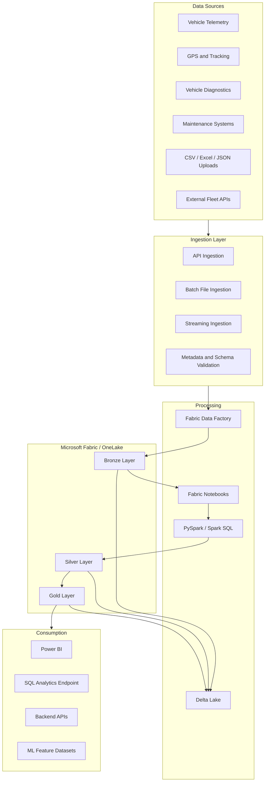
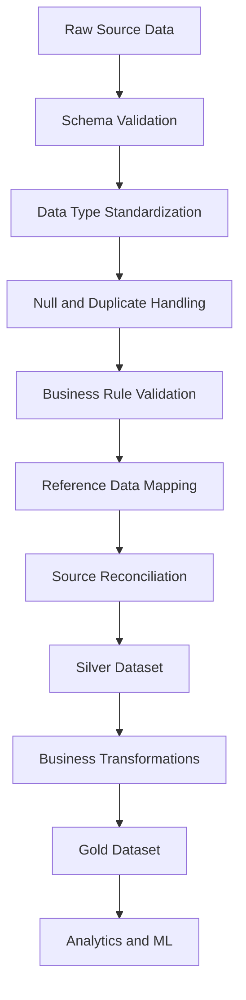

# AutoPulse AI — Data Engineering Architecture

**Document ID:** AP-DATA-010  
**Version:** 1.0  
**Status:** Proposed Architecture  
**Product:** AutoPulse AI  
**Industry:** Automotive and Fleet Management

---

# 1. Purpose

This document defines the data engineering architecture for AutoPulse AI.

The platform will collect, ingest, validate, transform, store, and serve vehicle and fleet information for operational analytics, reporting, and predictive intelligence.

The architecture must support:

- Connected vehicle telemetry.
- Manually uploaded vehicle datasets.
- Multiple vehicle categories.
- Multiple fleets and organizations.
- Historical and incremental data processing.
- Data quality and reconciliation.
- Predictive maintenance datasets.
- Operational and analytical reporting.

The platform will use a scalable lakehouse architecture with Microsoft Fabric and OneLake as the proposed primary data platform.

# 2. Data Engineering Objectives

1. Establish reliable ingestion from multiple sources.
2. Preserve original source information.
3. Standardize vehicle and telemetry data.
4. Implement reusable transformation frameworks.
5. Maintain data quality and traceability.
6. Support incremental and historical processing.
7. Create analytics-ready Gold datasets.
8. Support machine-learning feature generation.
9. Optimize processing costs and performance.
10. Establish monitoring and operational controls.

# 3. High-Level Data Architecture



# 4. Data Source Architecture

AutoPulse AI will support multiple source categories.

## 4.1 Connected Vehicle Sources

Potential sources:

- Vehicle telematics devices.
- On-board diagnostics (OBD-II).
- GPS tracking devices.
- Fleet monitoring systems.
- Manufacturer-provided APIs.
- Vehicle diagnostic systems.

Potential information:

| Data Category | Example Attributes |
|---|---|
| Vehicle identification | VIN, registration |
| Location | Latitude, longitude |
| Engine | Temperature, RPM |
| Performance | Speed, acceleration |
| Fuel | Fuel level, consumption |
| Battery | Voltage, state of charge |
| Diagnostics | Diagnostic trouble codes |
| Usage | Mileage, operating hours |

Actual availability depends on the vehicle, device, manufacturer, and integration agreement.

## 4.2 Manual Data Sources

Initial supported formats:

- CSV
- XLSX
- JSON
- Parquet

Example datasets:

- Vehicle inventory.
- Fleet assignments.
- Maintenance history.
- Service records.
- Fuel consumption.
- Historical mileage.
- Vehicle inspection reports.

## 4.3 External API Sources

External integration candidates:

- Telematics providers.
- Fleet management software.
- GPS providers.
- Maintenance management platforms.

Provider selection remains an open product discovery decision.

# 5. Data Ingestion Architecture

AutoPulse AI will use two primary ingestion strategies.

## 5.1 Batch Ingestion

Use batch ingestion for:

- Historical vehicle records.
- Maintenance records.
- Fleet inventory.
- Excel and CSV uploads.
- Periodic external data extracts.

Proposed workflow:

1. Receive source file.
2. Validate file extension and size.
3. Generate ingestion batch ID.
4. Store original file in OneLake.
5. Capture source metadata.
6. Validate file structure.
7. Execute transformation pipeline.
8. Record accepted and rejected records.
9. Update processing status.
10. Publish validated data to downstream layers.

## 5.2 Streaming Ingestion

Use streaming ingestion for connected vehicle information when supported by the selected infrastructure.

Potential technologies:

- HTTP ingestion APIs.
- Azure Event Hubs.
- Fabric Real-Time Intelligence.
- Message-based ingestion.

Proposed workflow:

1. Receive telemetry event.
2. Authenticate the source.
3. Validate vehicle and source identifiers.
4. Apply schema validation.
5. Detect duplicate events.
6. Persist raw event.
7. Process telemetry.
8. Publish normalized observations.
9. Update monitoring and alert workflows.

Streaming infrastructure is a proposed capability, not a mandatory initial implementation dependency.

## 5.3 Ingestion Metadata

Every ingestion batch must capture:

| Field | Description |
|---|---|
| ingestion_id | Unique batch identifier |
| source_id | Originating source |
| source_name | Source description |
| file_name | Original file name |
| ingestion_type | Batch or streaming |
| received_at | Ingestion timestamp |
| processing_status | Current state |
| total_records | Records received |
| accepted_records | Valid records |
| rejected_records | Invalid records |
| duplicate_records | Duplicate records |
| error_message | Processing error details |

# 6. Medallion Architecture

The platform will follow three major data layers.

## 6.1 Bronze Layer — Raw Data

Purpose:

Preserve original source information with minimal transformation.

Responsibilities:

- Store original records.
- Preserve source attributes.
- Capture ingestion metadata.
- Record ingestion timestamps.
- Maintain source traceability.
- Support replay and reprocessing.

Example tables:

```text
bronze/
├── vehicle_inventory_raw
├── vehicle_telemetry_raw
├── gps_events_raw
├── diagnostic_events_raw
├── maintenance_records_raw
├── fleet_assignments_raw
└── ingestion_metadata
```

Design principles:

- Preserve source payloads.
- Avoid destructive transformations.
- Maintain ingestion batch identifiers.
- Capture source timestamps.
- Enable historical recovery.

## 6.2 Silver Layer — Cleansed and Standardized Data

Purpose:

Convert raw records into validated, standardized datasets.

Responsibilities:

- Schema standardization.
- Data type conversion.
- Timestamp normalization.
- Null handling.
- Duplicate detection.
- Data validation.
- Reference mapping.
- Data reconciliation.
- Invalid record isolation.

Example tables:

```text
silver/
├── vehicles
├── vehicle_telemetry
├── vehicle_locations
├── vehicle_diagnostics
├── maintenance_records
├── fleet_assignments
├── vehicle_status_history
└── data_quality_results
```

Example transformation:

Raw speed:

```text
"65.5"
"65.50"
"invalid"
```

Silver speed:

```text
65.5
65.5
Rejected
```

Standardized data must include measurement units and source references.

## 6.3 Gold Layer — Business-Ready Data

Purpose:

Create trusted datasets for dashboards, reporting, operational analytics, and machine learning.

Example tables:

```text
gold/
├── dim_vehicle
├── dim_fleet
├── dim_date
├── dim_organization
├── fact_vehicle_telemetry
├── fact_vehicle_maintenance
├── fact_vehicle_utilization
├── fact_vehicle_alerts
├── fact_maintenance_cost
├── agg_fleet_performance
├── agg_vehicle_health
└── ml_vehicle_features
```

Gold layer responsibilities:

- Business-level calculations.
- Dimensional modeling.
- KPI standardization.
- Aggregations.
- Historical trend analysis.
- ML feature preparation.

# 7. Data Processing Framework

## 7.1 Technology Stack

| Component | Technology |
|---|---|
| Programming | Python |
| Data processing | PySpark |
| Query language | SQL / Spark SQL |
| Lakehouse | Microsoft Fabric |
| Storage | OneLake |
| Table format | Delta Lake |
| Orchestration | Fabric Data Factory |
| Transformation | Fabric Notebooks |
| Reporting | Power BI |
| Version control | Git |
| Data validation | PySpark + reusable validation rules |

## 7.2 Transformation Sequence



# 8. PySpark Transformation Standards

Use reusable PySpark transformations.

Example:

```python
from pyspark.sql import functions as F

def standardize_vehicle_telemetry(df):

    return (
        df
        .withColumn(
            "vehicle_id",
            F.trim(F.col("vehicle_id"))
        )
        .withColumn(
            "event_timestamp",
            F.to_timestamp("event_timestamp")
        )
        .withColumn(
            "speed",
            F.col("speed").cast("double")
        )
        .withColumn(
            "engine_temperature",
            F.col("engine_temperature").cast("double")
        )
        .withColumn(
            "ingested_at",
            F.current_timestamp()
        )
    )
```

This is an illustrative transformation. Production code must validate units, timestamp formats, required fields, source-specific schemas, and invalid records before publication.

## 8.1 Reusable Processing Modules

Organize transformation logic into reusable modules:

```text
data_engineering/
├── ingestion/
│   ├── batch_ingestion.py
│   ├── api_ingestion.py
│   └── streaming_ingestion.py
│
├── transformations/
│   ├── vehicle_transformation.py
│   ├── telemetry_transformation.py
│   ├── maintenance_transformation.py
│   └── fleet_transformation.py
│
├── quality/
│   ├── schema_validation.py
│   ├── duplicate_detection.py
│   ├── completeness_checks.py
│   └── business_rule_checks.py
│
├── gold/
│   ├── fleet_metrics.py
│   ├── vehicle_health.py
│   └── maintenance_analytics.py
│
├── monitoring/
│   ├── pipeline_logging.py
│   └── quality_monitoring.py
│
└── common/
    ├── configuration.py
    └── logging.py
```

# 9. Data Quality Framework

Data quality must be implemented across ingestion, transformation, and consumption.

## 9.1 Quality Dimensions

| Dimension | Validation |
|---|---|
| Completeness | Required values populated |
| Uniqueness | Duplicate records detected |
| Validity | Values match expected formats |
| Consistency | Standardized units and definitions |
| Accuracy | Reconciliation against source |
| Referential integrity | Valid vehicle and fleet references |
| Timeliness | Data freshness within expectations |

## 9.2 Example Validation Rules

Vehicle:

- Vehicle identifier is mandatory.
- Registration number follows configured rules.
- Model year is within an approved range.
- Vehicle type exists in reference data.

Telemetry:

- Vehicle identifier exists.
- Event timestamp is valid.
- Metric name is recognized.
- Measurement unit is supported.
- Numeric measurements pass configured validation.
- Duplicate source events are identified.

Maintenance:

- Vehicle exists.
- Service date is valid.
- Maintenance type is recognized.
- Cost and currency are valid.
- Historical records are preserved.

## 9.3 Rejected Records

Invalid records must be isolated rather than silently discarded.

```text
quality/
├── rejected_vehicle_records
├── rejected_telemetry_records
├── rejected_maintenance_records
└── quality_exception_log
```

Every rejection should capture:

- Record identifier.
- Source identifier.
- Batch identifier.
- Failed validation rule.
- Error description.
- Processing timestamp.

# 10. Incremental Processing Strategy

The platform should avoid repeatedly processing all historical data.

Recommended techniques:

1. Watermark-based incremental ingestion.
2. Source event identifiers.
3. Batch identifiers.
4. Delta Lake MERGE operations.
5. Change detection.
6. Partition pruning.
7. Controlled historical backfills.

Example:

```sql
MERGE INTO silver.vehicle_telemetry AS target
USING staging.vehicle_telemetry AS source
ON target.source_id = source.source_id
AND target.source_event_id = source.source_event_id

WHEN MATCHED THEN UPDATE SET
    target.event_timestamp = source.event_timestamp,
    target.metric_value = source.metric_value,
    target.updated_at = CURRENT_TIMESTAMP()

WHEN NOT MATCHED THEN INSERT (
    source_id,
    source_event_id,
    vehicle_id,
    event_timestamp,
    metric_name,
    metric_value,
    updated_at
)
VALUES (
    source.source_id,
    source.source_event_id,
    source.vehicle_id,
    source.event_timestamp,
    source.metric_name,
    source.metric_value,
    CURRENT_TIMESTAMP()
);
```

The actual merge key must be validated against source event uniqueness and correction behavior.

# 11. Data Modeling Strategy

Gold datasets will use dimensional modeling where appropriate.

## 11.1 Dimensions

- dim_vehicle
- dim_fleet
- dim_organization
- dim_date
- dim_vehicle_type
- dim_maintenance_type
- dim_location

## 11.2 Fact Tables

- fact_vehicle_telemetry
- fact_vehicle_maintenance
- fact_vehicle_utilization
- fact_vehicle_alerts
- fact_work_orders

## 11.3 Slowly Changing Dimensions

Use appropriate historical tracking for changing business attributes.

Examples:

- Vehicle fleet assignment.
- Vehicle ownership.
- Vehicle classification.
- Fleet organizational structure.

Type 1 and Type 2 approaches should be selected based on the business requirement.

# 12. Data Lineage and Traceability

Each processed dataset must retain sufficient information to trace records to their origin.

Recommended metadata:

- source_id
- source_record_id
- ingestion_id
- source_event_id
- ingestion_timestamp
- transformation_timestamp
- pipeline_run_id
- schema_version
- processing_status

Lineage must support:

- Source-to-Bronze traceability.
- Bronze-to-Silver transformation.
- Silver-to-Gold transformation.
- Quality exception investigation.
- Historical reprocessing.
- ML feature provenance.

# 13. Machine Learning Data Preparation

The data engineering platform must support downstream predictive intelligence.

Potential feature categories:

| Category | Example Features |
|---|---|
| Vehicle usage | Mileage, operating hours |
| Telemetry | Temperature, RPM, voltage |
| Maintenance | Service frequency, days since service |
| Diagnostics | Diagnostic event frequency |
| Utilization | Operating time, distance |
| Historical patterns | Rolling averages and trends |

Potential ML dataset:

```text
gold.ml_vehicle_features
```

Potential future ML use cases:

1. Predictive maintenance.
2. Vehicle health scoring.
3. Anomaly detection.
4. Fleet utilization forecasting.
5. Maintenance cost forecasting.

Important:

Feature definitions, prediction labels, target horizons, and evaluation methodology must be established before model training.

Avoid target leakage by ensuring features use only information available at prediction time.

# 14. Pipeline Orchestration

Use Microsoft Fabric Data Factory to orchestrate processing workflows.

Proposed pipeline structure:

```text
PL_01_Source_Ingestion
PL_02_Bronze_Processing
PL_03_Silver_Transformation
PL_04_Data_Quality
PL_05_Gold_Transformation
PL_06_ML_Feature_Preparation
PL_07_Analytics_Refresh
PL_08_Reconciliation
```

Pipeline execution sequence:

1. Trigger ingestion.
2. Validate source metadata.
3. Write Bronze data.
4. Execute Silver transformations.
5. Run data quality checks.
6. Publish valid records.
7. Execute Gold transformations.
8. Update analytics datasets.
9. Record pipeline status.
10. Send failure notifications.

Use dependency-based execution and configurable retries.

# 15. Monitoring and Observability

Monitor both technical and business-level data operations.

## Pipeline Metrics

- Pipeline execution duration.
- Success rate.
- Failure rate.
- Records processed.
- Throughput.
- Retry count.
- Processing latency.

## Data Quality Metrics

- Completeness percentage.
- Duplicate rate.
- Rejection rate.
- Validation failure count.
- Referential integrity failures.

## Business Metrics

- Active vehicles receiving telemetry.
- Vehicles with stale telemetry.
- Maintenance records processed.
- Fleet data coverage.
- Prediction dataset availability.

Establish configurable thresholds and alerts.

# 16. Security and Governance

Apply security at every layer.

## Data Security

- Organization-level data isolation.
- Role-based access control.
- Encryption at rest and in transit.
- Managed identity where supported.
- Secrets stored in approved secret-management services.
- Restricted access to raw data.

## Data Governance

- Dataset ownership.
- Data classification.
- Schema versioning.
- Data dictionary.
- Retention policies.
- Lineage documentation.
- Access auditing.

Do not expose vehicle location or sensitive operational data to unauthorized organizations.

# 17. Performance Optimization

Use the following techniques where appropriate:

- Incremental processing.
- Partition pruning.
- Predicate pushdown.
- Efficient joins.
- Broadcast joins for suitable small reference datasets.
- Delta Lake optimization.
- Appropriate file sizes.
- Avoid unnecessary shuffles.
- Reusable intermediate datasets.
- Query plan analysis.
- Controlled concurrency.

Partition large telemetry datasets by appropriate event-date granularity after measuring actual query and ingestion patterns.

Avoid over-partitioning small datasets.

# 18. Testing Strategy

## Unit Testing

Validate:

- Transformation functions.
- Schema checks.
- Business rules.
- Data type conversions.
- Duplicate detection.

## Integration Testing

Validate:

- OneLake ingestion.
- Delta Lake writes.
- Pipeline dependencies.
- Database integration.
- API-to-lakehouse workflows.

## Data Quality Testing

Validate:

- Required fields.
- Null handling.
- Duplicate handling.
- Referential integrity.
- Reconciliation.
- Invalid records.

## Performance Testing

Validate:

- Large telemetry ingestion.
- Historical backfills.
- Incremental processing.
- Complex aggregations.
- Concurrent workloads.

## Regression Testing

Ensure schema or transformation changes do not unexpectedly alter existing business metrics.

# 19. Deployment Architecture

Proposed environments:

```text
Development
    |
    v
Testing
    |
    v
Staging
    |
    v
Production
```

Each environment must maintain:

- Separate configuration.
- Appropriate access permissions.
- Controlled secrets.
- Versioned pipelines.
- Versioned notebooks.
- Schema migration controls.
- Deployment approvals.

Use Git integration and CI/CD where supported by the selected Microsoft Fabric capabilities.

# 20. Implementation Roadmap

## Phase 1 — Foundation

- Set up Microsoft Fabric workspace.
- Configure OneLake.
- Establish environment structure.
- Create Bronze, Silver, Gold organization.
- Configure Git integration.
- Define metadata standards.

## Phase 2 — Initial Data Ingestion

- Create synthetic vehicle inventory.
- Create synthetic maintenance data.
- Create synthetic telemetry data.
- Implement CSV ingestion.
- Implement source metadata tracking.
- Persist raw datasets.

## Phase 3 — Transformation Framework

- Implement PySpark transformations.
- Standardize vehicle attributes.
- Normalize telemetry.
- Implement duplicate detection.
- Implement validation rules.
- Build rejected-record handling.

## Phase 4 — Gold Data Products

- Create vehicle dimensions.
- Create fleet dimensions.
- Create telemetry facts.
- Create maintenance facts.
- Build fleet performance aggregations.
- Validate analytical metrics.

## Phase 5 — Advanced Data Engineering

- Implement incremental processing.
- Implement reconciliation.
- Add pipeline monitoring.
- Optimize Delta Lake operations.
- Establish historical backfills.
- Implement lineage.

## Phase 6 — Analytics and AI Integration

- Connect Gold datasets to Power BI.
- Prepare ML feature datasets.
- Connect backend analytics APIs.
- Validate downstream consumption.

# 21. Initial MVP Data Scope

The first implementation should remain manageable.

Start with these five datasets:

1. Vehicle inventory.
2. Fleet information.
3. Vehicle telemetry.
4. Maintenance records.
5. Fleet assignments.

Use synthetic data initially.

Do not depend on actual manufacturer or telematics integrations until source availability is established.

# 22. Open Architecture Decisions

The following require confirmation before production implementation:

1. Microsoft Fabric capacity and licensing.
2. Actual telemetry provider.
3. Streaming versus scheduled batch requirements.
4. Expected daily record volume.
5. Data retention requirements.
6. Supported vehicle types and measurement standards.
7. Cloud deployment and regional requirements.
8. Identity provider.
9. External API integration requirements.
10. Data access and customer isolation requirements.

# 23. Acceptance Criteria

The data engineering architecture is ready for implementation when:

- Source categories are identified.
- Ingestion patterns are documented.
- Medallion architecture is defined.
- Transformation standards are established.
- Data quality framework is specified.
- Incremental processing strategy is documented.
- Gold data products are identified.
- Lineage requirements are established.
- Monitoring and security requirements are documented.
- MVP datasets are agreed upon.
- Deployment and testing strategies are defined.

---

# 24. Next Deliverable

**11-data-quality-and-governance.md**

The next document will establish:

- Data quality framework.
- Validation rules and severity levels.
- Data contracts.
- Schema evolution.
- Reconciliation framework.
- Exception management.
- Data lineage.
- Data ownership.
- Retention and governance.
- Quality dashboards.
- Automated testing standards.

**End of Document.**
