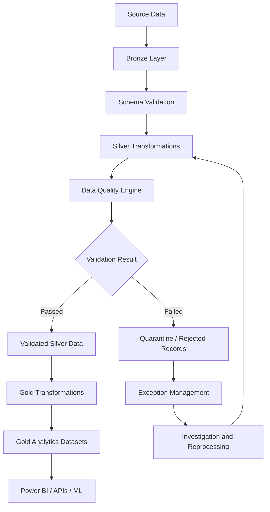
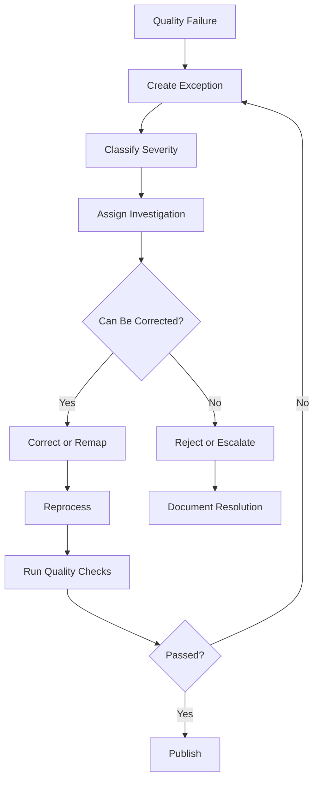

# AutoPulse AI — Data Quality and Governance Framework

**Document ID:** AP-DQ-011  
**Version:** 1.0  
**Status:** Proposed Design  
**Product:** AutoPulse AI  
**Industry:** Automotive and Fleet Management  
**Architecture:** Microsoft Fabric + OneLake + Delta Lake

---

# 1. Purpose

This document defines the data quality, validation, governance, and traceability framework for AutoPulse AI.

The objective is to ensure that all data used by the platform is reliable, consistent, explainable, secure, and suitable for operational analytics and predictive intelligence.

The framework covers:

- Vehicle inventory data.
- Fleet and organizational information.
- Vehicle telemetry.
- GPS and location information.
- Diagnostic events.
- Maintenance records.
- Operational and analytical datasets.
- Machine-learning feature datasets.

# 2. Data Quality Objectives

AutoPulse AI must establish the following capabilities:

1. Validate incoming data before processing.
2. Identify incomplete and inconsistent records.
3. Detect duplicate records.
4. Standardize formats, timestamps, and measurement units.
5. Validate relationships between vehicles, fleets, and organizations.
6. Maintain source-to-target reconciliation.
7. Isolate invalid records.
8. Track quality metrics across data pipelines.
9. Prevent unreliable data from reaching Gold datasets.
10. Maintain complete data lineage and auditability.

# 3. Data Quality Architecture

The data quality framework will operate across the Medallion Architecture.



## 3.1 Bronze Layer

Responsibilities:

- Preserve original source data.
- Capture ingestion metadata.
- Record source identifiers.
- Track ingestion timestamps.
- Validate basic file and payload integrity.
- Maintain historical source records.

No source record should be silently discarded.

## 3.2 Silver Layer

Responsibilities:

- Validate data types.
- Standardize measurement units.
- Normalize timestamps.
- Identify duplicates.
- Validate business rules.
- Check referential integrity.
- Isolate invalid records.
- Record quality results.

## 3.3 Gold Layer

Responsibilities:

- Publish trusted business datasets.
- Enforce business metric definitions.
- Prevent invalid records from contaminating analytical outputs.
- Maintain dataset freshness.
- Support downstream analytical and ML workloads.

# 4. Data Quality Dimensions

The platform will implement seven core quality dimensions.

| Dimension | Definition | Example |
|---|---|---|
| Completeness | Required information is available | Vehicle ID populated |
| Uniqueness | Duplicate records are controlled | Unique telemetry event |
| Validity | Values satisfy defined rules | Valid timestamp |
| Consistency | Data follows common definitions | Standardized speed units |
| Accuracy | Data agrees with trusted references | Reconciled mileage |
| Integrity | Relationships are valid | Vehicle belongs to valid fleet |
| Timeliness | Data arrives within expected windows | Recent telemetry |

# 5. Dataset-Level Validation Rules

## 5.1 Vehicle Inventory

Dataset: `silver.vehicles`

| Field | Validation | Severity |
|---|---|---|
| vehicle_id | Mandatory and unique within organization | Critical |
| organization_id | Must reference valid organization | Critical |
| fleet_id | Must reference valid fleet when assigned | High |
| VIN | Validate format where applicable | High |
| manufacturer | Mandatory | Medium |
| model | Mandatory | Medium |
| model_year | Must be within configured range | Medium |
| vehicle_type | Must exist in reference data | High |
| registration_number | Validate configured format | Medium |
| created_at | Valid timestamp | High |

Additional rules:

- Vehicle identifiers must not be reused across different active vehicles within the same organization.
- VIN uniqueness must be checked where VIN is available and applicable.
- Vehicle ownership and fleet assignment changes must preserve history.
- Unknown vehicle classifications must be flagged.

## 5.2 Fleet Information

Dataset: `silver.fleets`

| Field | Validation | Severity |
|---|---|---|
| fleet_id | Mandatory and unique within organization | Critical |
| organization_id | Valid organization reference | Critical |
| fleet_name | Mandatory | High |
| fleet_status | Valid configured status | Medium |
| created_at | Valid timestamp | High |

Additional rules:

- Every fleet must belong to an organization.
- Fleet status must follow approved reference values.
- Inactive fleets must not receive new assignments unless explicitly permitted.

## 5.3 Vehicle Telemetry

Dataset: `silver.vehicle_telemetry`

| Field | Validation | Severity |
|---|---|---|
| source_event_id | Mandatory when provided by source | High |
| vehicle_id | Valid vehicle reference | Critical |
| event_timestamp | Valid timestamp | Critical |
| metric_name | Supported metric | High |
| metric_value | Valid numeric representation | High |
| unit | Supported measurement unit | High |
| source_id | Recognized source | High |
| organization_id | Valid organization reference | Critical |

Additional rules:

- Speed cannot be negative.
- RPM cannot be negative.
- Engine temperature must follow configurable plausibility limits.
- GPS latitude must be between -90 and 90.
- GPS longitude must be between -180 and 180.
- Battery measurements must use a defined measurement scale.
- Event timestamps must be normalized to UTC while preserving source timezone metadata where available.
- Duplicate source events must be detected.
- Out-of-order events must be identified without automatically assuming they are invalid.

Important: Telemetry thresholds must be vehicle- and sensor-specific. Universal thresholds must not be assumed for all vehicle types.

## 5.4 Maintenance Records

Dataset: `silver.maintenance_records`

| Field | Validation | Severity |
|---|---|---|
| maintenance_id | Mandatory unique identifier | Critical |
| vehicle_id | Valid vehicle reference | Critical |
| service_date | Valid timestamp or date | High |
| maintenance_type | Valid reference value | High |
| maintenance_cost | Non-negative numeric value | High |
| currency | Valid currency code | High |
| service_provider | Optional according to source | Low |
| description | Optional descriptive field | Low |

Additional rules:

- Maintenance dates must be valid.
- Cost must not be negative.
- Currency must be explicit.
- Corrected historical records must retain source traceability.
- Multiple maintenance events on the same date are allowed.

## 5.5 Fleet Assignments

Dataset: `silver.fleet_assignments`

Validation requirements:

- Vehicle reference exists.
- Fleet reference exists.
- Organization ownership is consistent.
- Assignment start date is valid.
- Assignment end date is not earlier than start date.
- Overlapping assignments are flagged unless explicitly allowed.
- Historical assignments are preserved.

# 6. Data Quality Severity Framework

Every validation failure must receive a severity classification.

| Severity | Description | Action |
|---|---|---|
| Critical | Invalidates record identity or ownership | Reject record |
| High | Significant business or analytical risk | Quarantine or block publication |
| Medium | Non-critical quality issue | Flag and monitor |
| Low | Minor optional-field issue | Record warning |

## 6.1 Quality Processing Outcomes

**ACCEPTED**

All mandatory validation rules pass.

**ACCEPTED_WITH_WARNINGS**

Mandatory checks pass, but non-critical issues exist.

**QUARANTINED**

The record requires investigation before downstream use.

**REJECTED**

The record cannot be safely processed.

**REPROCESSING**

A previously quarantined or rejected record is undergoing controlled reprocessing.

# 7. Data Quality Metrics

The platform must calculate measurable quality indicators.

## 7.1 Completeness

Formula:

Completeness % = Populated required fields / Total required fields × 100

## 7.2 Uniqueness

Uniqueness % = Unique records / Total records × 100

## 7.3 Validity

Validity % = Records passing validity rules / Total evaluated records × 100

## 7.4 Referential Integrity

Referential Integrity % = Records with valid relationships / Total relationship checks × 100

## 7.5 Timeliness

Timeliness % = Records received within expected freshness window / Total evaluated records × 100

## 7.6 Rejection Rate

Rejection Rate % = Rejected records / Total received records × 100

## 7.7 Example Quality Dashboard

| Metric | Example Target |
|---|---:|
| Vehicle ID completeness | 100% |
| Mandatory field completeness | ≥ 99% |
| Telemetry schema validity | ≥ 99% |
| Referential integrity | 100% |
| Duplicate event rate | Monitored by source |
| Pipeline success rate | ≥ 99% |
| Data freshness | Source-specific SLA |

These are proposed initial targets, not measured results. Targets must be calibrated using actual source behavior and operational requirements.

# 8. Data Contracts

A data contract defines the structure, expectations, and rules governing an incoming dataset.

Every source integration should have a documented contract.

## 8.1 Contract Components

Each contract must define:

- Dataset name.
- Source system.
- Schema version.
- Required fields.
- Optional fields.
- Data types.
- Measurement units.
- Timestamp conventions.
- Primary or natural keys.
- Expected delivery frequency.
- Validation rules.
- Data ownership.
- Retention requirements.

## 8.2 Example Telemetry Data Contract

```json
{
  "dataset": "vehicle_telemetry",
  "version": "1.0",
  "source": "telematics_provider",
  "format": "json",
  "required_fields": [
    "vehicle_id",
    "event_timestamp",
    "metric_name",
    "metric_value",
    "unit"
  ],
  "optional_fields": [
    "source_event_id",
    "latitude",
    "longitude"
  ],
  "timestamp_standard": "UTC",
  "quality_checks": [
    "required_fields",
    "valid_timestamp",
    "valid_vehicle_reference",
    "supported_metric",
    "valid_measurement_unit"
  ]
}
```

# 9. Schema Evolution Management

Source systems may change their data structures over time.

The platform must support controlled schema evolution.

## 9.1 Schema Changes

| Change | Recommended Handling |
|---|---|
| New optional field | Controlled acceptance |
| New mandatory field | Contract review |
| Data type change | Compatibility assessment |
| Field removal | Breaking change review |
| Field rename | Versioned migration |
| Measurement unit change | Explicit conversion |
| New metric | Reference-data update |

## 9.2 Versioning

Example:

```text
vehicle_telemetry_v1
vehicle_telemetry_v2
vehicle_telemetry_v3
```

Use versioned contracts and controlled migrations rather than allowing uncontrolled schema changes.

Breaking changes must be tested before production deployment.

# 10. Reusable PySpark Validation Framework

Implement validation as reusable functions rather than writing isolated checks in every notebook.

## 10.1 Required Field Validation

```python
from pyspark.sql import functions as F

def validate_required_fields(df, fields):

    conditions = [
        F.col(field).isNotNull()
        for field in fields
    ]

    valid_condition = conditions[0]

    for condition in conditions[1:]:
        valid_condition = valid_condition & condition

    valid_df = df.filter(valid_condition)
    invalid_df = df.filter(~valid_condition)

    return valid_df, invalid_df
```

## 10.2 Duplicate Detection

```python
from pyspark.sql import functions as F

def detect_duplicates(df, key_columns):

    duplicate_keys = (
        df.groupBy(*key_columns)
        .count()
        .filter(F.col("count") > 1)
        .select(*key_columns)
    )

    duplicates = df.join(
        duplicate_keys,
        on=key_columns,
        how="inner"
    )

    return duplicates
```

A deterministic survivor-selection rule must be defined before removing duplicates.

## 10.3 Vehicle Telemetry Validation

```python
from pyspark.sql import functions as F

def validate_telemetry(df):

    valid_condition = (
        F.col("vehicle_id").isNotNull()
        & F.col("event_timestamp").isNotNull()
        & F.col("metric_name").isNotNull()
        & F.col("metric_value").isNotNull()
        & (F.col("metric_value") >= 0)
    )

    valid_df = df.filter(valid_condition)

    invalid_df = df.filter(
        ~valid_condition
    )

    return valid_df, invalid_df
```

This is a starter example. Production validation must use metric-specific rules, unit-aware limits, supported schemas, and source-specific event identifiers.

## 10.4 Quality Score Calculation

```python
from pyspark.sql import functions as F

def calculate_completeness(df, required_fields):

    total_rows = df.count()

    if total_rows == 0:
        return 0.0

    total_checks = total_rows * len(required_fields)

    populated_checks = sum(
        df.filter(
            F.col(field).isNotNull()
        ).count()
        for field in required_fields
    )

    return (
        populated_checks / total_checks
    ) * 100
```

For large production datasets, implement these calculations using distributed aggregations rather than repeated full-table counts.

# 11. Exception Management Framework

Invalid data must be traceable and recoverable.

## 11.1 Exception Table

Proposed table:

`silver.data_quality_exceptions`

| Field | Description |
|---|---|
| exception_id | Unique exception identifier |
| dataset_name | Affected dataset |
| record_id | Source record identifier |
| ingestion_id | Ingestion batch |
| rule_id | Failed validation rule |
| severity | Critical, High, Medium, Low |
| error_message | Explanation |
| source_payload | Original payload or secure reference |
| detected_at | Detection timestamp |
| resolution_status | Current status |
| resolved_at | Resolution timestamp |
| resolution_notes | Resolution details |

## 11.2 Exception Lifecycle



## 11.3 Exception Status Values

- OPEN
- UNDER_REVIEW
- CORRECTION_REQUIRED
- REPROCESSING
- RESOLVED
- REJECTED
- CLOSED

# 12. Source-to-Target Reconciliation

Reconciliation verifies that data transformations preserve expected records and values.

## 12.1 Reconciliation Dimensions

- Total record count.
- Accepted record count.
- Rejected record count.
- Duplicate count.
- Distinct vehicle count.
- Minimum and maximum event timestamps.
- Aggregated measurement totals.
- Financial totals for maintenance records.

## 12.2 Example Reconciliation

| Metric | Bronze | Silver |
|---|---:|---:|
| Total records | 10,000 | 9,800 |
| Accepted records | — | 9,800 |
| Rejected records | — | 150 |
| Duplicate records | — | 50 |

The reconciliation must explain all record movements.

The example numbers are illustrative.

Records must not disappear between processing stages without a documented disposition.

# 13. Data Lineage

Every analytical record must have sufficient lineage information.

Recommended metadata:

- source_system
- source_id
- source_record_id
- ingestion_id
- pipeline_run_id
- schema_version
- source_timestamp
- ingestion_timestamp
- transformation_timestamp
- processing_status

Lineage must support:

1. Source identification.
2. Transformation tracking.
3. Quality investigation.
4. Historical replay.
5. Business metric verification.
6. ML feature provenance.

# 14. Data Governance

## 14.1 Governance Roles

| Role | Responsibility |
|---|---|
| Data Owner | Accountable for dataset usage and business meaning |
| Data Steward | Maintains definitions and quality rules |
| Data Engineer | Implements ingestion and transformation |
| Analytics Engineer | Maintains analytical models |
| ML Engineer | Validates feature data |
| Platform Administrator | Controls platform configuration and access |

These are proposed responsibilities; one individual may hold multiple roles in an MVP.

## 14.2 Data Classification

Proposed classifications:

**PUBLIC**

Approved information suitable for public access.

**INTERNAL**

Operational information restricted to authorized users.

**CONFIDENTIAL**

Sensitive fleet, commercial, or operational information.

**RESTRICTED**

Sensitive location, identity, credentials, or other information requiring stronger access controls.

## 14.3 Data Access

Implement:

- Role-based access control.
- Organization-level data isolation.
- Least-privilege permissions.
- Controlled access to raw data.
- Auditable access.
- Secure API authorization.

A user belonging to one organization must not access another organization's fleet records without explicit authorization.

# 15. Data Retention and Lifecycle

Retention policies must be configurable by dataset and source.

| Dataset | Retention Consideration |
|---|---|
| Raw telemetry | Historical analytics and storage cost |
| Vehicle inventory | Ownership and operational history |
| GPS records | Privacy and operational requirements |
| Maintenance history | Warranty and service requirements |
| Quality exceptions | Investigation and audit requirements |
| Pipeline logs | Operational troubleshooting |

Retention periods must be decided with customer, contractual, regulatory, and operational requirements.

Deletion and archival workflows must account for downstream copies and derived datasets.

# 16. Automated Data Quality Testing

Use automated tests at multiple levels.

## 16.1 Unit Tests

Test:

- Required field validation.
- Data type conversion.
- Duplicate detection.
- Unit normalization.
- Business rules.
- Timestamp parsing.

## 16.2 Integration Tests

Test:

- Bronze ingestion.
- Silver transformations.
- Delta Lake writes.
- Quality exception creation.
- Gold publication.
- Reprocessing workflows.

## 16.3 Regression Tests

Ensure:

- Existing metrics remain consistent.
- Schema changes do not break downstream models.
- Historical records remain traceable.
- Quality rules produce expected outcomes.

## 16.4 Sample Test Cases

| Test | Expected Result |
|---|---|
| Missing vehicle ID | Critical failure |
| Invalid timestamp | Rejected or quarantined |
| Negative speed | Failed metric validation |
| Unknown fleet ID | Referential integrity failure |
| Duplicate event ID | Duplicate detected |
| Valid telemetry event | Accepted |
| Unsupported measurement unit | Validation failure |
| Corrected rejected record | Reprocessed successfully |

# 17. Data Quality Monitoring Dashboard

A Power BI dashboard should provide visibility into data reliability.

## Dashboard 1 — Overall Quality

- Overall quality score.
- Dataset completeness.
- Validity percentage.
- Rejection rate.
- Duplicate rate.
- Quality trend.

## Dashboard 2 — Dataset Quality

- Quality score by dataset.
- Failed validation rules.
- Data volume by source.
- Schema validation results.
- Freshness indicators.

## Dashboard 3 — Exception Management

- Open exceptions.
- Exceptions by severity.
- Exceptions by source.
- Average resolution time.
- Reprocessing success rate.

## Dashboard 4 — Pipeline Reliability

- Pipeline execution status.
- Processing duration.
- Failed runs.
- Retry counts.
- Records processed.
- Data freshness.

# 18. Implementation Roadmap

## Phase 1 — Quality Standards

- Define quality dimensions.
- Establish severity levels.
- Define dataset contracts.
- Document mandatory fields.
- Establish metric definitions.

## Phase 2 — Validation Framework

- Create reusable PySpark validation functions.
- Implement required-field checks.
- Implement schema checks.
- Implement duplicate detection.
- Implement reference validation.

## Phase 3 — Exception Management

- Create exception Delta table.
- Implement quarantine workflows.
- Record validation failures.
- Build controlled reprocessing.

## Phase 4 — Reconciliation

- Implement Bronze-to-Silver reconciliation.
- Implement Silver-to-Gold reconciliation.
- Validate record counts.
- Validate aggregate metrics.
- Track unexplained discrepancies.

## Phase 5 — Governance

- Establish data ownership.
- Define classification.
- Implement access controls.
- Document lineage.
- Define retention policies.

## Phase 6 — Monitoring and Testing

- Build quality metrics.
- Create Power BI quality dashboard.
- Implement automated tests.
- Establish quality thresholds.
- Test failure and recovery scenarios.

# 19. MVP Implementation Scope

The first working implementation should focus on five datasets:

1. Vehicle inventory.
2. Fleet information.
3. Vehicle telemetry.
4. Maintenance records.
5. Fleet assignments.

Required MVP capabilities:

- Schema validation.
- Mandatory field validation.
- Duplicate detection.
- Referential integrity.
- Invalid-record isolation.
- Exception tracking.
- Source-to-target reconciliation.
- Basic quality metrics.

Use synthetic datasets initially.

Do not integrate real customer or manufacturer data until data access, ownership, and usage permissions are established.

# 20. Open Decisions

The following decisions must be finalized before production implementation:

1. Actual source-specific data contracts.
2. Vehicle-specific measurement standards.
3. Telemetry freshness expectations.
4. Data retention periods.
5. Customer-level data isolation model.
6. Exception resolution ownership.
7. Quality score weighting.
8. Source reconciliation tolerances.
9. Schema evolution approval process.
10. Production audit requirements.

# 21. Acceptance Criteria

This framework is ready for implementation when:

- Every MVP dataset has a documented contract.
- Required fields and validation rules are defined.
- Quality severity levels are established.
- Rejected records can be traced.
- Duplicate handling is deterministic.
- Referential integrity is validated.
- Reconciliation is implemented.
- Quality metrics can be calculated.
- Exceptions can be investigated and reprocessed.
- Data lineage is maintained.
- Access and retention requirements are documented.
- Automated tests cover critical validation rules.

---

# 22. Next Deliverable

**12-ai-ml-predictive-maintenance-architecture.md**

The next document will define:

- Vehicle health intelligence.
- Predictive maintenance.
- Anomaly detection.
- Feature engineering.
- Model training and evaluation.
- Model deployment.
- Prediction APIs.
- Model monitoring.
- Explainability.
- ML data pipelines.
- Integration with AutoPulse dashboards.

**End of Document.**
