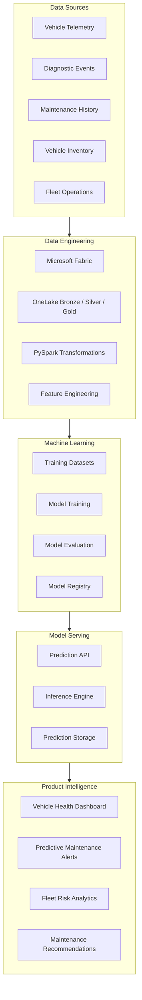
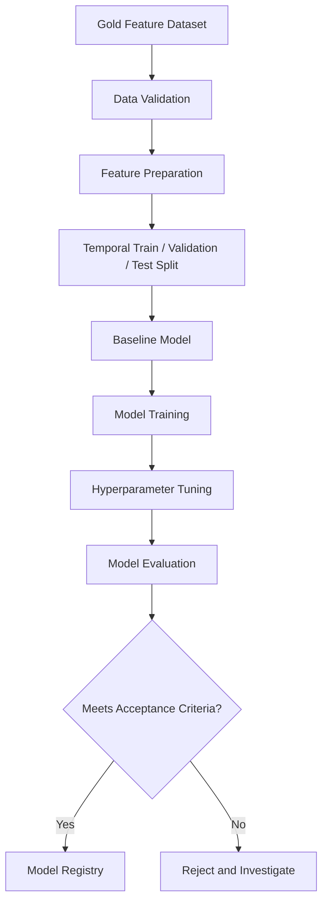

# AutoPulse AI — AI/ML and Predictive Maintenance Architecture

**Document ID:** AP-ML-012  
**Version:** 1.0  
**Status:** Proposed Design  
**Product:** AutoPulse AI  
**Industry:** Automotive and Fleet Management  
**Architecture:** Microsoft Fabric + OneLake + PySpark + Python + ML APIs

---

# 1. Purpose

This document defines the artificial intelligence and machine-learning architecture for AutoPulse AI.

The objective is to transform vehicle telemetry, diagnostic events, maintenance history, and fleet operational information into predictive and actionable intelligence.

The platform will support:

- Predictive vehicle maintenance.
- Vehicle health assessment.
- Anomaly detection.
- Maintenance risk prediction.
- Fleet performance intelligence.
- Maintenance cost forecasting.
- Explainable AI recommendations.
- Model monitoring and lifecycle management.

The architecture will be designed to support mixed vehicle categories and different fleet operating environments.

All predictive capabilities are proposed product features. Model selection, prediction targets, and performance expectations must be validated using suitable datasets.

# 2. AI/ML Product Objectives

The AI/ML platform should:

1. Identify potential vehicle failures before breakdowns.
2. Detect unusual vehicle operating behavior.
3. Estimate vehicle maintenance risk.
4. Identify recurring diagnostic patterns.
5. Analyze historical maintenance behavior.
6. Generate understandable vehicle health insights.
7. Support fleet-level risk prioritization.
8. Provide explainable predictions.
9. Monitor model accuracy and data drift.
10. Continuously improve models using validated feedback.

# 3. AI/ML Architecture Overview

The proposed architecture separates data engineering, model development, model serving, and business consumption.



# 4. AI/ML Use Cases

## 4.1 Predictive Maintenance

**Objective:** Estimate the likelihood of a vehicle requiring maintenance within a defined prediction horizon.

Potential inputs:

- Historical maintenance records.
- Vehicle mileage.
- Engine operating hours.
- Diagnostic trouble codes.
- Engine temperature patterns.
- Battery measurements.
- Vehicle usage patterns.
- Historical component failures.

Potential outputs:

- Maintenance risk score.
- Predicted maintenance category.
- Prediction horizon.
- Confidence or calibrated probability.
- Contributing factors.
- Recommended inspection priority.

Example:

| Vehicle | Risk Score | Risk Level | Suggested Action |
|---|---:|---|---|
| VEH-001 | 87 | High | Schedule inspection |
| VEH-002 | 42 | Medium | Monitor telemetry |
| VEH-003 | 12 | Low | Continue monitoring |

These values are illustrative, not actual predictions.

## 4.2 Vehicle Health Intelligence

**Objective:** Provide a consolidated view of vehicle condition.

Potential health dimensions:

- Engine health.
- Battery health.
- Diagnostic health.
- Usage patterns.
- Maintenance compliance.
- Telemetry reliability.

Proposed output:

```json
{
  "vehicle_id": "VEH-001",
  "health_score": 82,
  "health_status": "GOOD",
  "risk_level": "MEDIUM",
  "last_updated": "2026-11-12T12:00:00Z",
  "contributing_factors": [
    "Recent diagnostic event",
    "Increasing engine temperature trend"
  ]
}
```

Health scores must be derived from documented, validated scoring logic. They must not be presented as manufacturer-certified vehicle condition assessments.

## 4.3 Anomaly Detection

**Objective:** Identify unusual vehicle behavior and telemetry patterns.

Potential anomalies:

- Unexpected temperature increases.
- Unusual fuel consumption.
- Abnormal battery voltage patterns.
- Unexpected engine RPM fluctuations.
- Sudden changes in operating behavior.
- Unusual vehicle utilization.

Candidate algorithms:

- Isolation Forest.
- Local Outlier Factor.
- Statistical anomaly detection.
- Autoencoders.
- Time-series anomaly detection.

The initial MVP should prioritize interpretable statistical methods and Isolation Forest before introducing more complex models.

## 4.4 Maintenance Cost Forecasting

**Objective:** Estimate future maintenance expenditure for fleet planning.

Potential inputs:

- Historical maintenance expenditure.
- Vehicle age.
- Mileage.
- Vehicle category.
- Maintenance frequency.
- Service history.
- Operating intensity.

Potential outputs:

- Expected maintenance cost.
- Cost trend.
- Fleet-level maintenance forecast.
- Vehicle maintenance expenditure comparison.

Candidate models:

- Linear Regression.
- Random Forest Regressor.
- Gradient Boosting.
- XGBoost.

Forecasts should include an uncertainty range where the model supports reliable estimates.

## 4.5 Fleet Risk Intelligence

**Objective:** Identify vehicles requiring operational attention.

Potential outputs:

- Vehicles with high predicted maintenance risk.
- Vehicles with repeated diagnostic events.
- Vehicles with stale telemetry.
- Vehicles with overdue maintenance.
- Fleets with increasing maintenance expenditure.

This capability will combine ML predictions with deterministic business rules.

# 5. ML Data Architecture

The ML pipeline will consume validated Gold datasets from the Microsoft Fabric lakehouse.

## 5.1 Input Datasets

| Dataset | Purpose |
|---|---|
| gold.dim_vehicle | Vehicle attributes |
| gold.dim_fleet | Fleet information |
| gold.fact_vehicle_telemetry | Historical sensor data |
| gold.fact_vehicle_maintenance | Maintenance history |
| gold.fact_vehicle_alerts | Diagnostic and operational alerts |
| gold.fact_vehicle_utilization | Usage patterns |
| gold.ml_vehicle_features | Model-ready features |

## 5.2 Feature Dataset

Proposed dataset:

`gold.ml_vehicle_features`

Potential features:

| Feature | Description |
|---|---|
| vehicle_age | Vehicle age |
| mileage | Current mileage |
| operating_hours | Total operating hours |
| average_speed | Average observed speed |
| engine_temp_avg | Average engine temperature |
| engine_temp_max | Maximum observed temperature |
| diagnostic_event_count | Diagnostic events |
| days_since_maintenance | Days since last service |
| maintenance_count_90d | Maintenance events in 90 days |
| fuel_consumption_avg | Average fuel consumption |
| battery_voltage_avg | Average battery voltage |
| telemetry_missing_rate | Missing telemetry percentage |

Feature availability depends on the actual vehicle and sensor integrations.

# 6. Feature Engineering

Feature engineering converts raw observations into meaningful model inputs.

## 6.1 Aggregation Features

Examples:

- Average engine temperature over 24 hours.
- Maximum engine temperature over 7 days.
- Average fuel consumption over 30 days.
- Diagnostic event count over 90 days.
- Maintenance frequency over 12 months.

## 6.2 Time-Based Features

Examples:

- Days since last maintenance.
- Vehicle age in months.
- Days since last diagnostic event.
- Weekly usage trends.
- Monthly mileage growth.

## 6.3 Trend Features

Examples:

- Engine temperature change.
- Fuel consumption trend.
- Battery voltage variation.
- Diagnostic event frequency growth.

## 6.4 Rolling Window Features

Potential windows:

- 24 hours.
- 7 days.
- 30 days.
- 90 days.

The windows must be aligned with the prediction target and available historical observations.

## 6.5 Feature Engineering Example

```python
from pyspark.sql import functions as F
from pyspark.sql.window import Window

def create_vehicle_features(df):

    window_spec = (
        Window
        .partitionBy("vehicle_id")
        .orderBy("event_timestamp")
        .rowsBetween(-6, 0)
    )

    return (
        df
        .withColumn(
            "avg_engine_temperature",
            F.avg("engine_temperature").over(window_spec)
        )
        .withColumn(
            "avg_speed",
            F.avg("speed").over(window_spec)
        )
        .withColumn(
            "max_engine_temperature",
            F.max("engine_temperature").over(window_spec)
        )
    )
```

Production implementation must use event-time windows, appropriate time intervals, sensor-specific filtering, and leakage-safe feature generation. A seven-row window is not necessarily a seven-day window.

# 7. Predictive Maintenance Model Design

## 7.1 Prediction Problem

The initial predictive maintenance problem will be formulated as a supervised binary classification task.

Proposed target:

`maintenance_required_within_30_days`

Target definition:

- 1: A qualifying maintenance event occurs within 30 days after the prediction timestamp.
- 0: No qualifying maintenance event occurs within that period.

The qualifying maintenance event must be defined carefully.

Routine scheduled servicing, emergency repairs, and component failures may need separate prediction targets.

## 7.2 Training Dataset

Each training example should represent a vehicle at a specific prediction timestamp.

Example:

| Vehicle | Prediction Date | Features | Target |
|---|---|---|---|
| VEH-001 | 2026-01-01 | Historical telemetry | 1 |
| VEH-002 | 2026-01-01 | Historical telemetry | 0 |
| VEH-003 | 2026-01-01 | Historical telemetry | 1 |

Only information available at the prediction timestamp may be used as a feature.

## 7.3 Candidate Algorithms

| Algorithm | Purpose |
|---|---|
| Logistic Regression | Baseline classification |
| Random Forest | Nonlinear relationships |
| XGBoost | Gradient-boosted classification |
| LightGBM | Efficient gradient boosting |
| Neural Networks | Complex patterns where data supports them |

Recommended development order:

1. Logistic Regression baseline.
2. Random Forest.
3. XGBoost or LightGBM.
4. Advanced time-series models if justified.

Do not select the most complex model simply because it is more sophisticated.

# 8. Model Training Architecture

Training workflow:



## 8.1 Training Environment

Proposed technologies:

- Python.
- Pandas.
- NumPy.
- Scikit-learn.
- XGBoost.
- PyTorch where justified.
- Microsoft Fabric Notebooks.
- MLflow for experiment tracking and model lifecycle management, subject to the selected environment's capabilities.

## 8.2 Training Procedure

1. Retrieve validated feature datasets.
2. Validate target labels.
3. Check missing values.
4. Analyze class distribution.
5. Perform feature selection.
6. Split datasets chronologically.
7. Train baseline models.
8. Train candidate models.
9. Tune hyperparameters.
10. Evaluate against acceptance criteria.
11. Document model limitations.
12. Register approved model versions.

# 9. Model Evaluation Framework

Accuracy alone is insufficient for predictive maintenance.

## 9.1 Classification Metrics

| Metric | Purpose |
|---|---|
| Precision | How many predicted maintenance events were correct |
| Recall | How many actual maintenance events were identified |
| F1-score | Balance between precision and recall |
| ROC-AUC | Ranking performance across thresholds |
| PR-AUC | Performance under class imbalance |
| Confusion Matrix | Breakdown of prediction outcomes |

## 9.2 Business Evaluation

Also evaluate:

- Missed maintenance events.
- False maintenance alerts.
- Lead time before maintenance.
- Inspection workload.
- Maintenance cost impact.
- Fleet operational usefulness.

## 9.3 Model Acceptance

Before production deployment:

- Validate performance on unseen chronological data.
- Compare with a baseline.
- Check class imbalance.
- Review false positives and false negatives.
- Validate performance across vehicle categories.
- Evaluate probability calibration.
- Confirm no target leakage.
- Document known limitations.

Model acceptance thresholds will be established after dataset profiling and stakeholder validation.

# 10. Anomaly Detection Architecture

Anomaly detection will initially operate independently of the supervised maintenance model.

## 10.1 Initial Detection Methods

**Method 1: Statistical Rules**

Use:

- Moving averages.
- Standard deviation.
- Configurable thresholds.
- Rate-of-change analysis.

**Method 2: Isolation Forest**

Identify unusual combinations of telemetry features.

**Method 3: Time-Series Anomaly Detection**

Explore more advanced techniques when sufficient time-series data becomes available.

## 10.2 Anomaly Processing

```text
Telemetry
    |
    v
Data Validation
    |
    v
Feature Generation
    |
    v
Anomaly Detection
    |
    v
Anomaly Scoring
    |
    v
Severity Classification
    |
    v
Alert Management
```

An anomaly is not automatically evidence of a vehicle defect. It should trigger investigation or additional monitoring.

# 11. Vehicle Health Scoring Engine

The platform will provide a consolidated vehicle health score.

## 11.1 Proposed Dimensions

- Engine performance.
- Diagnostic activity.
- Battery condition.
- Maintenance compliance.
- Vehicle usage.
- Data reliability.

## 11.2 Initial Scoring Approach

Start with a transparent rule-based scoring system.

Example:

```python
def calculate_health_score(
    engine_score,
    diagnostic_score,
    battery_score,
    maintenance_score,
    usage_score
):

    score = (
        engine_score * 0.30
        + diagnostic_score * 0.25
        + battery_score * 0.15
        + maintenance_score * 0.20
        + usage_score * 0.10
    )

    return round(score, 2)
```

All input scores must be normalized to a common 0–100 scale.

The weights are illustrative and must be validated before use.

Missing or unreliable sensor information must not silently be interpreted as good vehicle health. The system should expose data coverage and confidence separately.

## 11.3 Proposed Health Categories

| Score | Category |
|---|---|
| 85–100 | Excellent |
| 70–84 | Good |
| 50–69 | Needs Attention |
| 0–49 | High Concern |

These thresholds are initial design assumptions, not engineering safety limits.

# 12. Model Explainability

Predictions must provide understandable explanations.

Potential techniques:

- SHAP.
- Feature importance.
- Local feature contribution.
- Rule-based explanations.

Example prediction response:

```json
{
  "vehicle_id": "VEH-001",
  "prediction_type": "maintenance_risk",
  "risk_probability": 0.87,
  "risk_category": "HIGH",
  "prediction_horizon_days": 30,
  "top_contributing_factors": [
    "Increasing engine temperature",
    "Repeated diagnostic events",
    "Extended period since maintenance"
  ],
  "model_version": "maintenance-risk-v1.0"
}
```

This is an illustrative response, not a validated model result.

Explainability must distinguish statistical association from proven mechanical causation.

# 13. Model Serving Architecture

Predictions will be exposed through backend APIs.

Proposed components:

- Model inference service.
- Prediction API.
- Model version management.
- Prediction storage.
- Monitoring.
- Authentication and authorization.

Potential deployment technologies:

- Python FastAPI.
- Docker.
- Azure Container Apps or another approved hosting environment.
- Microsoft Fabric for analytical data preparation.

Final hosting decisions depend on infrastructure, cost, latency, and integration requirements.

# 14. Prediction API Design

## 14.1 Vehicle Maintenance Risk

Endpoint:

`POST /api/v1/ai/maintenance-risk`

Request:

```json
{
  "vehicle_id": "VEH-001",
  "prediction_horizon_days": 30
}
```

Response:

```json
{
  "vehicle_id": "VEH-001",
  "risk_probability": 0.87,
  "risk_category": "HIGH",
  "model_version": "maintenance-risk-v1.0",
  "prediction_timestamp": "2026-11-12T12:00:00Z"
}
```

## 14.2 Vehicle Health

Endpoint:

`GET /api/v1/ai/vehicle-health/{vehicle_id}`

Response:

```json
{
  "vehicle_id": "VEH-001",
  "health_score": 82,
  "health_category": "GOOD",
  "data_coverage": 0.94,
  "last_updated": "2026-11-12T12:00:00Z"
}
```

## 14.3 Fleet Risk Summary

Endpoint:

`GET /api/v1/ai/fleet-risk/{fleet_id}`

Response:

```json
{
  "fleet_id": "FLEET-001",
  "total_vehicles": 100,
  "high_risk_vehicles": 12,
  "medium_risk_vehicles": 28,
  "low_risk_vehicles": 60,
  "generated_at": "2026-11-12T12:00:00Z"
}
```

## 14.4 API Requirements

All endpoints must support:

- Authentication.
- Organization-level authorization.
- Input validation.
- Error handling.
- Rate limiting.
- Request logging.
- Model version tracking.
- API versioning.

The API must not allow a user to request predictions for vehicles outside their authorized organization.

# 15. Prediction Storage

Proposed Gold or application-level tables:

```text
ai/
├── model_registry
├── model_experiments
├── model_evaluation_results
├── vehicle_health_scores
├── maintenance_risk_predictions
├── anomaly_detection_results
├── prediction_feedback
└── model_monitoring_metrics
```

Each prediction should retain:

- prediction_id
- vehicle_id
- organization_id
- prediction_type
- prediction_timestamp
- model_name
- model_version
- prediction_value
- risk_category
- confidence or calibrated probability
- feature_snapshot_reference
- explanation_reference

Avoid storing unnecessary sensitive raw telemetry in prediction records.

# 16. Model Monitoring

Production models require continuous monitoring.

## 16.1 Data Drift

Monitor changes in:

- Feature distributions.
- Vehicle types.
- Telemetry characteristics.
- Diagnostic event frequencies.
- Missing data rates.

## 16.2 Prediction Drift

Monitor:

- Prediction distribution.
- Risk category distribution.
- Prediction frequency.
- Unusual score changes.

## 16.3 Model Performance

When actual maintenance outcomes become available, measure:

- Precision.
- Recall.
- F1-score.
- PR-AUC.
- Calibration.
- False negative rate.
- False positive rate.

## 16.4 Model Retraining

Retraining may be triggered by:

- Significant data drift.
- Declining model performance.
- New vehicle categories.
- Changes in sensor characteristics.
- Accumulation of sufficiently labeled data.

Retraining must require validation and approval before production promotion.

# 17. MLOps and Model Lifecycle

Proposed lifecycle:

```text
Data Preparation
      |
      v
Feature Engineering
      |
      v
Experiment Tracking
      |
      v
Model Training
      |
      v
Model Evaluation
      |
      v
Model Registration
      |
      v
Deployment Approval
      |
      v
Production Inference
      |
      v
Monitoring
      |
      v
Retraining
```

## 17.1 Model Versioning

Example:

```text
maintenance-risk-v1.0
maintenance-risk-v1.1
maintenance-risk-v2.0

vehicle-anomaly-v1.0
vehicle-health-v1.0
maintenance-cost-v1.0
```

## 17.2 Model Registry Metadata

Track:

- Model name.
- Model version.
- Training dataset.
- Feature definitions.
- Training period.
- Evaluation metrics.
- Hyperparameters.
- Model artifacts.
- Approval status.
- Deployment timestamp.

# 18. AI/ML Security

Implement:

- Authenticated prediction requests.
- Authorized vehicle-level access.
- Protected model artifacts.
- Secure secrets management.
- Encrypted communications.
- Audit logging.
- Controlled training data access.
- Dependency vulnerability scanning.

Prevent unauthorized users from manipulating model inputs or accessing other organizations' prediction results.

# 19. Responsible AI

AutoPulse AI must communicate predictions responsibly.

Principles:

1. Predictions are estimates, not guarantees.
2. Anomalies do not prove mechanical failures.
3. Users should understand the factors behind predictions.
4. Uncertain predictions should be identified.
5. Poor-quality input data should reduce confidence or prevent prediction.
6. Model limitations must be documented.
7. Recommendations should not replace qualified mechanical inspections.
8. Models must be evaluated across vehicle categories.
9. Prediction thresholds must be configurable.
10. Users must be able to provide feedback on incorrect alerts.

# 20. Testing Strategy

## 20.1 Data Tests

- Feature completeness.
- Target label validity.
- Data leakage detection.
- Time-based split validation.
- Feature distribution checks.

## 20.2 Model Tests

- Baseline comparison.
- Classification metrics.
- Regression metrics.
- Probability calibration.
- Performance across vehicle categories.
- Model reproducibility.

## 20.3 API Tests

- Valid prediction request.
- Invalid vehicle ID.
- Unauthorized organization.
- Missing input.
- Model unavailable.
- Invalid prediction horizon.
- Prediction response validation.

## 20.4 Production Tests

- Model loading.
- Inference latency.
- Concurrent requests.
- Failure recovery.
- Model version rollback.
- Monitoring alerts.

# 21. Implementation Roadmap

## Phase 1 — ML Foundation

- Prepare synthetic vehicle datasets.
- Establish prediction problem.
- Define maintenance event labels.
- Create feature dictionary.
- Establish baseline evaluation metrics.

## Phase 2 — Feature Engineering

- Build vehicle-level features.
- Create time-window aggregations.
- Prepare historical maintenance features.
- Validate feature quality.
- Implement leakage-safe training datasets.

## Phase 3 — Predictive Model Development

- Train Logistic Regression baseline.
- Train Random Forest.
- Evaluate candidate models.
- Tune hyperparameters.
- Analyze false predictions.
- Document model limitations.

## Phase 4 — Anomaly Detection

- Implement statistical anomaly rules.
- Develop Isolation Forest.
- Generate anomaly scores.
- Validate detection results.
- Create anomaly datasets.

## Phase 5 — Vehicle Health Intelligence

- Implement initial rule-based health score.
- Define scoring dimensions.
- Calculate data coverage.
- Create vehicle health datasets.
- Validate score behavior.

## Phase 6 — Model Serving

- Create FastAPI service.
- Load approved model artifacts.
- Implement prediction endpoints.
- Store prediction results.
- Integrate organization-level authorization.

## Phase 7 — MLOps

- Track experiments.
- Version models.
- Implement monitoring.
- Detect data drift.
- Establish retraining workflow.
- Implement deployment approvals.

## Phase 8 — Product Integration

- Integrate vehicle health dashboard.
- Display maintenance risk.
- Display anomaly alerts.
- Provide prediction explanations.
- Capture user feedback.

# 22. MVP Scope

The first working ML implementation should focus on three capabilities.

### Capability 1: Vehicle Health Score

Use deterministic, transparent scoring rules with data-quality indicators.

### Capability 2: Telemetry Anomaly Detection

Implement statistical checks and Isolation Forest.

### Capability 3: Predictive Maintenance

Develop a supervised baseline only after sufficient labeled maintenance history is available.

Initially use synthetic data for pipeline development and demonstration.

Synthetic data must not be used to claim real-world predictive accuracy.

# 23. Open Decisions

The following decisions require further validation:

1. Availability of historical maintenance records.
2. Availability of labeled failure events.
3. Actual telemetry sources.
4. Vehicle-specific sensor availability.
5. Prediction horizons.
6. Maintenance event definitions.
7. Vehicle category-specific modeling.
8. Model hosting infrastructure.
9. Expected inference latency.
10. Model retraining frequency.
11. Business costs of false positives and false negatives.
12. Model acceptance thresholds.

# 24. Acceptance Criteria

This architecture is ready for implementation when:

- ML use cases are prioritized.
- Input datasets are documented.
- Feature definitions are established.
- Prediction targets are unambiguous.
- Training and evaluation methodology is documented.
- Leakage prevention is implemented.
- Model explainability is specified.
- Prediction APIs are defined.
- Model lifecycle is documented.
- Monitoring requirements are established.
- Security requirements are incorporated.
- MVP capabilities are agreed upon.

---

# 25. Next Deliverable

**13-security-and-access-control.md**

The next document will define:

- Application security architecture.
- Authentication and authorization.
- Multi-tenant organization isolation.
- Role-based access control.
- User and fleet permissions.
- API security.
- Data encryption.
- Secrets management.
- Audit logging.
- Threat modeling.
- Security testing.
- Production security requirements.

**End of Document.**
