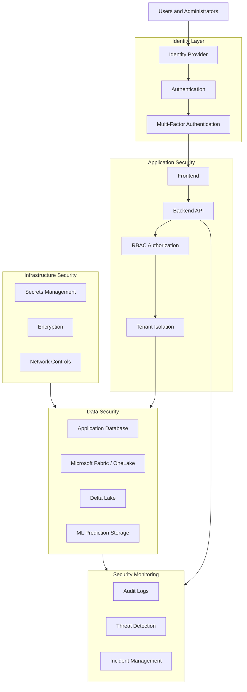
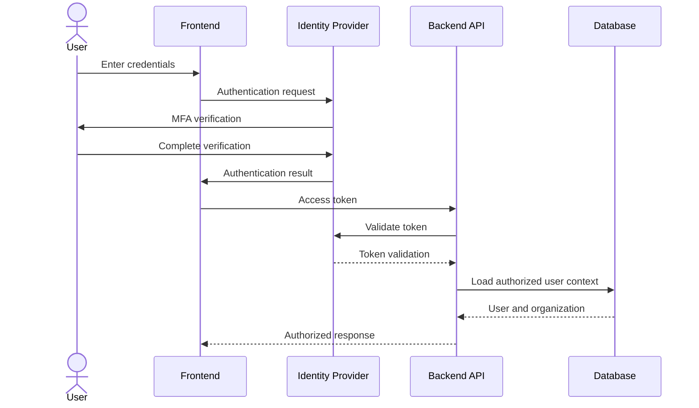
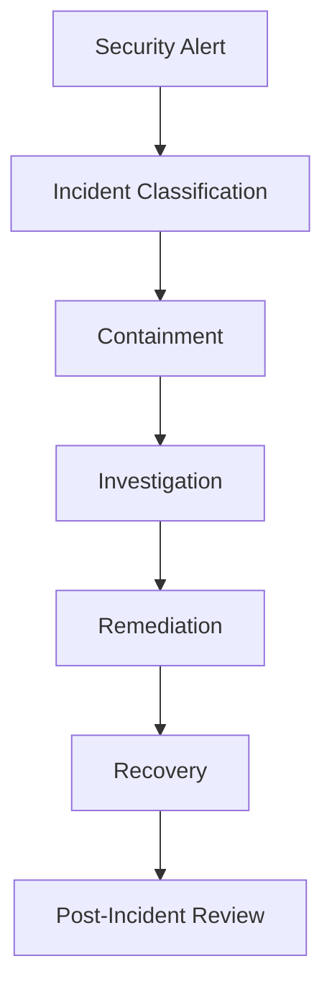

# AutoPulse AI — Security and Access Control Architecture

**Document ID:** AP-SEC-013  
**Version:** 1.0  
**Status:** Proposed Design  
**Product:** AutoPulse AI  
**Industry:** Automotive and Fleet Management

---

# 1. Purpose

This document defines the application security architecture, identity management, access control, data protection, and security governance requirements for AutoPulse AI.

The objective is to protect customer organizations, fleet information, vehicle telemetry, maintenance records, AI predictions, and operational data.

The architecture will follow security-by-design principles and support a multi-tenant SaaS application.

Core security objectives:

1. Protect customer information.
2. Prevent unauthorized organizational access.
3. Secure application authentication.
4. Enforce role-based permissions.
5. Protect APIs and backend services.
6. Secure databases and lakehouse datasets.
7. Encrypt sensitive information.
8. Maintain audit trails.
9. Protect AI models and predictions.
10. Support security monitoring and incident response.

# 2. Security Architecture Overview

AutoPulse AI will implement security across five layers.

1. Identity and authentication.
2. Application authorization.
3. API and service security.
4. Data and infrastructure security.
5. Monitoring and governance.



# 3. Multi-Tenant Architecture

AutoPulse AI will support multiple fleet organizations within one application.

Each organization must have isolated business data and authorized user access.

## 3.1 Tenant Structure

Proposed hierarchy:

```text
AutoPulse AI
    |
    +-- Organization A
    |       |
    |       +-- Fleet A1
    |       +-- Fleet A2
    |       +-- Users
    |       +-- Vehicles
    |       +-- Maintenance Records
    |
    +-- Organization B
    |       |
    |       +-- Fleet B1
    |       +-- Fleet B2
    |       +-- Users
    |       +-- Vehicles
    |       +-- Maintenance Records
    |
    +-- Organization C
            |
            +-- Fleet C1
            +-- Users
            +-- Vehicles
```

## 3.2 Tenant Identification

Every organization-specific record must contain an organization identifier.

Example:

```json
{
  "organization_id": "ORG-001",
  "fleet_id": "FLEET-001",
  "vehicle_id": "VEH-001"
}
```

The organization identifier must be derived from the authenticated and authorized user context.

Never trust an organization ID supplied directly by the frontend without verifying access.

## 3.3 Tenant Isolation Rules

- Users can access only authorized organizations.
- Fleet managers can access only assigned fleets.
- Vehicle records must belong to the correct organization.
- Maintenance records must follow vehicle ownership.
- AI predictions must inherit tenant restrictions.
- File uploads must be organization-scoped.
- API responses must not expose cross-tenant information.
- Background jobs must preserve tenant context.
- Exported reports must enforce the same permissions.

## 3.4 Tenant Isolation Strategy

For the initial MVP, use a shared application database with organization-level row isolation.

Recommended implementation:

- Mandatory organization identifiers.
- Tenant-scoped database queries.
- Database-level row security where supported.
- Centralized authorization middleware.
- Tenant-aware background processing.
- Automated cross-tenant security tests.

Consider dedicated databases or storage environments for customers with stronger isolation requirements.

# 4. Authentication Architecture

Authentication verifies the identity of a user.

Proposed authentication capabilities:

- Email and password authentication.
- Single Sign-On (SSO).
- Multi-Factor Authentication (MFA).
- Secure session management.
- Password recovery.
- Account verification.
- Session expiration.
- Account lockout and recovery.

## 4.1 Identity Provider

Potential identity providers:

- Microsoft Entra ID.
- Auth0.
- Amazon Cognito.
- Other standards-compliant OpenID Connect providers.

Recommended initial direction:

Evaluate Microsoft Entra ID if the application is deployed primarily within the Microsoft ecosystem.

The final provider must be selected after considering cost, customer requirements, and deployment architecture.

## 4.2 Authentication Protocols

Use established authentication standards:

- OAuth 2.0.
- OpenID Connect.
- Secure token-based authentication.

Avoid implementing custom authentication protocols.

## 4.3 Authentication Workflow



# 5. Role-Based Access Control (RBAC)

RBAC determines what an authenticated user can do.

## 5.1 Proposed User Roles

| Role | Description |
|---|---|
| Platform Administrator | Manages platform-wide configuration |
| Organization Owner | Manages an organization |
| Organization Administrator | Manages users and organizational resources |
| Fleet Manager | Manages assigned fleets |
| Fleet Operator | Monitors vehicles and operational activities |
| Maintenance Manager | Manages maintenance workflows |
| Data Analyst | Views approved analytical information |
| Read-Only User | Views permitted dashboards and records |

## 5.2 Permission Matrix

| Capability | Platform Admin | Org Admin | Fleet Manager | Operator | Analyst |
|---|---|---|---|---|---|
| Platform configuration | Yes | No | No | No | No |
| Organization settings | Yes | Yes | No | No | No |
| User management | Yes | Yes | No | No | No |
| Fleet management | Yes | Yes | Assigned | No | No |
| Vehicle viewing | Yes | Yes | Assigned | Assigned | Authorized |
| Vehicle editing | Yes | Yes | Assigned | Limited | No |
| Maintenance management | Yes | Yes | Assigned | Limited | No |
| AI predictions | Yes | Yes | Assigned | Assigned | Authorized |
| Analytics dashboards | Yes | Yes | Assigned | Assigned | Authorized |
| Data export | Controlled | Controlled | Controlled | No | Controlled |

Permissions must be enforced at the backend, not merely hidden in the user interface.

## 5.3 Permission Structure

Use granular permissions.

Examples:

```text
organization.read
organization.update
organization.users.manage

fleet.read
fleet.create
fleet.update
fleet.delete

vehicle.read
vehicle.create
vehicle.update
vehicle.delete

maintenance.read
maintenance.create
maintenance.update

analytics.read
analytics.export

ai.predictions.read
ai.predictions.manage

security.audit.read
```

The platform should support role-to-permission mappings and resource-level restrictions.

# 6. Application Authorization

Every protected backend endpoint must verify:

1. User authentication.
2. Account status.
3. Organization membership.
4. Assigned role.
5. Required permission.
6. Resource ownership.
7. Requested operation.

Example:

```python
def authorize_vehicle_access(
    user,
    vehicle,
    required_permission
):
    if not user.is_authenticated:
        return False

    if user.organization_id != vehicle.organization_id:
        return False

    if required_permission not in user.permissions:
        return False

    return True
```

This is illustrative pseudocode. Production authorization must also account for multiple organization memberships, assigned fleet scope, platform-level permissions, and trusted identity claims.

# 7. API Security Architecture

All application APIs must use secure communication and centralized authorization.

## 7.1 API Security Requirements

- HTTPS only.
- Token validation.
- Authorization middleware.
- Request validation.
- Rate limiting.
- Secure error handling.
- API versioning.
- Request size limits.
- Audit logging.
- Protection against injection attacks.

## 7.2 API Authentication

Use short-lived access tokens issued by the selected identity provider.

Validate:

- Token signature.
- Issuer.
- Audience.
- Expiration.
- Not-before time.
- Required scopes or claims.

Do not trust unsigned or improperly validated JWT payloads.

## 7.3 API Rate Limiting

Apply configurable rate limits.

Example initial policy:

| Endpoint Category | Proposed Limit |
|---|---|
| Authentication | Strict protection |
| Vehicle queries | 100 requests/minute |
| Analytics | 60 requests/minute |
| AI predictions | 30 requests/minute |
| File uploads | Size and frequency limits |

These values are starting assumptions and must be calibrated using performance tests and customer workloads.

## 7.4 API Error Handling

Do not expose:

- Database connection strings.
- Internal infrastructure details.
- Secret values.
- Stack traces.
- Internal model artifacts.
- Other customers' records.

Use consistent error responses.

Example:

```json
{
  "error": {
    "code": "FORBIDDEN",
    "message": "You do not have permission to access this resource."
  }
}
```

# 8. Database Security

The application database will contain organizational, fleet, vehicle, user, and operational information.

## 8.1 Database Security Requirements

- Organization-level data isolation.
- Least-privilege database accounts.
- Encrypted database connections.
- Secure credential management.
- Parameterized queries.
- Database access auditing.
- Backup protection.
- Controlled schema migrations.

## 8.2 Tenant-Aware Query Example

```sql
SELECT
    vehicle_id,
    fleet_id,
    vehicle_type,
    manufacturer,
    model
FROM vehicles
WHERE organization_id = :authorized_organization_id
AND vehicle_id = :vehicle_id;
```

The organization identifier must originate from verified authorization context.

Never rely exclusively on a frontend filter to enforce tenant isolation.

## 8.3 Database Constraints

Implement:

- Primary keys.
- Foreign keys.
- Unique constraints.
- Organization-scoped uniqueness where appropriate.
- Required-field constraints.
- Referential integrity.

# 9. Microsoft Fabric and OneLake Security

AutoPulse AI will use Microsoft Fabric and OneLake for analytical data processing.

Security must be enforced across lakehouse storage, notebooks, pipelines, SQL endpoints, and Power BI.

## 9.1 Fabric Security Requirements

- Workspace-level permissions.
- Appropriate lakehouse access controls.
- Restricted notebook execution.
- Secure pipeline identities.
- Controlled SQL Analytics Endpoint access.
- Power BI workspace permissions.
- Approved data-sharing mechanisms.
- Audit and monitoring.

## 9.2 Data Access Principles

Separate development, testing, and production environments.

Avoid giving every application user direct access to raw lakehouse data.

Use controlled data-serving layers and application APIs where appropriate.

## 9.3 Data Protection

Sensitive data must not be copied into development or testing environments without appropriate authorization and protection.

Use synthetic data for initial development.

# 10. AI/ML Security

The AI/ML components introduce additional security risks.

Protect:

- Training datasets.
- Feature datasets.
- Model artifacts.
- Prediction endpoints.
- Model registry.
- Prediction history.
- Model monitoring information.

## 10.1 AI Security Requirements

- Restrict model artifact access.
- Validate prediction input.
- Prevent unauthorized model downloads.
- Authenticate inference requests.
- Enforce organization-level prediction access.
- Log model version and inference activity.
- Validate externally supplied feature values.
- Protect against malicious or malformed input.

## 10.2 Prediction Access

A prediction must only be returned when the requesting user is authorized to access the corresponding vehicle and organization.

AI outputs must not bypass application authorization.

# 11. Encryption and Secrets Management

## 11.1 Encryption in Transit

Use TLS for:

- Browser-to-application communication.
- API communication.
- Database connections.
- External integrations.
- Internal service communication.

## 11.2 Encryption at Rest

Use platform-supported encryption for:

- Application databases.
- OneLake storage.
- Backup storage.
- Model artifacts.
- Uploaded files.
- Audit records.

Additional encryption or customer-managed keys may be considered where customer requirements justify them.

## 11.3 Secrets Management

Never hardcode:

- API keys.
- Database passwords.
- OAuth client secrets.
- Cloud credentials.
- Encryption keys.

Potential secret-management service:

Microsoft Azure Key Vault.

Use managed identities where supported.

Example environment configuration:

```text
DATABASE_HOST=<secret-reference>
DATABASE_NAME=<environment-config>
IDENTITY_CLIENT_ID=<managed-identity-reference>
EXTERNAL_API_KEY=<secret-reference>
```

Do not commit actual secrets to GitHub.

# 12. File Upload Security

AutoPulse AI will support vehicle and fleet data uploads.

All uploaded files must be treated as untrusted input.

## 12.1 Upload Validation

Validate:

- File extension.
- File signature and actual format.
- File size.
- Content structure.
- Schema.
- Record count.
- Encoding.
- Malware where appropriate.

## 12.2 Upload Security Controls

- Store uploads outside publicly accessible directories.
- Use organization-specific storage paths.
- Apply access permissions.
- Scan files where appropriate.
- Prevent path traversal.
- Reject unexpected formats.
- Avoid executing uploaded content.
- Maintain upload audit records.

# 13. Audit Logging

The application must maintain security-relevant audit events.

## 13.1 Auditable Events

- Successful login.
- Failed login.
- MFA changes.
- Password recovery.
- User creation.
- User deactivation.
- Role changes.
- Organization changes.
- Vehicle record changes.
- Data exports.
- File uploads.
- AI prediction requests.
- Administrative operations.
- Permission failures.

## 13.2 Audit Record Structure

Proposed table:

`security.audit_logs`

| Field | Description |
|---|---|
| audit_id | Unique audit event |
| user_id | Actor |
| organization_id | Organization context |
| action | Operation performed |
| resource_type | Affected resource |
| resource_id | Resource identifier |
| event_timestamp | Event time |
| source_ip | Request source, subject to privacy policy |
| outcome | Success or failure |
| correlation_id | Request tracking ID |
| details | Approved event metadata |

Never store passwords, access tokens, or secret values in audit logs.

Audit records should be protected against unauthorized alteration.

# 14. Threat Modeling

The security architecture must account for common application threats.

| Threat | Potential Impact | Mitigation |
|---|---|---|
| Broken access control | Cross-tenant data exposure | Backend authorization |
| SQL injection | Database compromise | Parameterized queries |
| Credential theft | Account compromise | MFA and secure sessions |
| Token misuse | Unauthorized API access | Token validation and expiration |
| Data leakage | Customer information exposure | Encryption and access controls |
| Malicious uploads | Application compromise | File validation and scanning |
| API abuse | Service disruption | Rate limiting |
| Privilege escalation | Unauthorized administration | Granular RBAC |
| Model theft | Intellectual property exposure | Artifact access controls |
| Insecure configuration | Infrastructure exposure | Configuration reviews |

## 14.1 Security Design Principle

Apply defense in depth.

No single security mechanism should be responsible for protecting sensitive information.

# 15. Secure Development Standards

Development practices must include:

- Secure coding guidelines.
- Dependency management.
- Code reviews.
- Static application security testing.
- Dependency vulnerability scanning.
- Secret scanning.
- Infrastructure configuration reviews.
- Protected GitHub branches.
- Controlled production deployments.

Suggested development tools:

- GitHub security features.
- Dependabot.
- CodeQL.
- Python security scanning tools.
- Container image scanning tools.

Tool selection depends on repository configuration and deployment environment.

# 16. Security Testing Strategy

## 16.1 Authentication Testing

- Invalid credentials.
- Expired sessions.
- Invalid tokens.
- MFA enforcement.
- Account lockout.
- Session revocation.

## 16.2 Authorization Testing

- Unauthorized vehicle access.
- Cross-organization access attempts.
- Unauthorized fleet access.
- Role escalation attempts.
- Unauthorized data exports.
- Unauthorized AI prediction access.

## 16.3 API Security Testing

- Missing authentication.
- Invalid JWT.
- Malformed requests.
- Injection attempts.
- Rate-limit enforcement.
- Excessive request sizes.

## 16.4 Data Security Testing

- Organization isolation.
- Unauthorized database access.
- Unauthorized file downloads.
- Lakehouse permission validation.
- Backup access controls.

## 16.5 Security Acceptance

No critical cross-tenant authorization vulnerability should remain unresolved before production release.

# 17. Incident Response

Define an incident response process.



Required capabilities:

- Incident identification.
- Severity classification.
- Access revocation.
- Credential rotation.
- Investigation.
- Evidence preservation.
- Customer communication where required.
- Recovery.
- Root-cause analysis.

Maintain a documented incident response procedure.

# 18. Privacy and Data Protection

The platform must minimize the collection and exposure of sensitive information.

Consider:

- Vehicle location privacy.
- Driver-related information.
- User account information.
- Customer commercial information.
- Retention and deletion requirements.
- Data export controls.
- Customer contractual obligations.
- Applicable privacy legislation.

Where personal information is processed, establish appropriate legal basis, transparency, retention, and user rights processes.

# 19. Security Implementation Roadmap

## Phase 1 — Identity Foundation

- Select identity provider.
- Configure authentication.
- Implement secure sessions.
- Enable MFA.
- Implement account lifecycle management.

## Phase 2 — Authorization

- Implement RBAC.
- Define permissions.
- Add organization membership.
- Implement fleet-level access.
- Add backend authorization middleware.

## Phase 3 — Multi-Tenant Isolation

- Add organization identifiers.
- Enforce tenant-scoped queries.
- Configure database access restrictions.
- Secure file storage.
- Test cross-tenant isolation.

## Phase 4 — API Security

- Configure HTTPS.
- Implement JWT validation.
- Add rate limiting.
- Validate requests.
- Standardize error responses.

## Phase 5 — Infrastructure Security

- Configure encryption.
- Establish secrets management.
- Restrict infrastructure access.
- Secure Fabric workspaces.
- Protect database backups.

## Phase 6 — Monitoring

- Implement audit logs.
- Configure security monitoring.
- Establish incident response.
- Add vulnerability scanning.
- Perform security testing.

# 20. MVP Security Scope

The first AutoPulse AI implementation must include:

1. Secure user authentication.
2. Organization registration.
3. Organization membership.
4. Role-based authorization.
5. Organization-level data isolation.
6. Secure API endpoints.
7. Protected file uploads.
8. Secrets management.
9. Basic audit logging.
10. Automated authorization tests.

Use synthetic data during early development.

Production customer data must not be used until appropriate access, security, and contractual requirements are established.

# 21. Open Security Decisions

The following decisions require confirmation:

1. Identity provider.
2. Authentication methods.
3. SSO requirements.
4. Database technology.
5. Tenant isolation model.
6. Hosting infrastructure.
7. Customer-managed encryption requirements.
8. Data retention policies.
9. Audit retention requirements.
10. Security compliance targets.
11. Incident response ownership.
12. Customer-specific access requirements.

# 22. Acceptance Criteria

The security architecture is ready for implementation when:

- Authentication architecture is selected.
- Roles and permissions are documented.
- Tenant isolation is defined.
- API authorization is established.
- Database security requirements are documented.
- Fabric access controls are defined.
- Secrets management is selected.
- Audit requirements are documented.
- Threat scenarios are identified.
- Security testing is planned.
- Incident response is documented.
- MVP security requirements are agreed upon.

---

# 23. Next Deliverable

**14-testing-and-quality-assurance-strategy.md**

The next document will define:

- Frontend testing.
- Backend testing.
- API testing.
- Database testing.
- Data pipeline testing.
- PySpark testing.
- AI/ML validation.
- Security testing.
- Performance testing.
- End-to-end testing.
- CI/CD quality gates.
- User acceptance testing.

**End of Document.**
