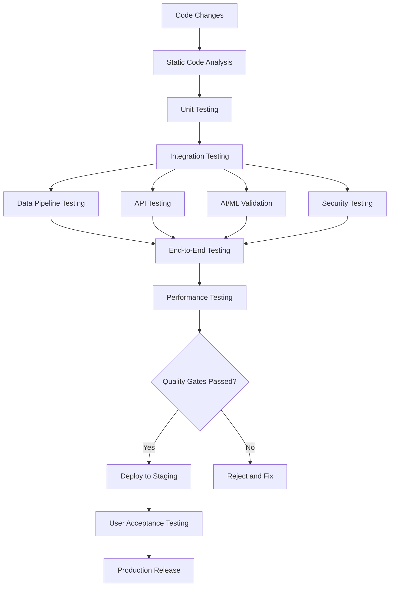
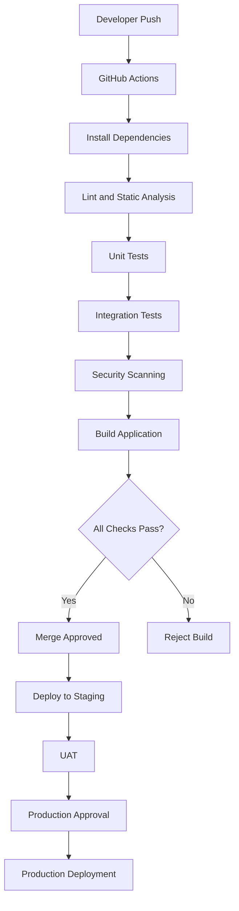

# AutoPulse AI — Testing and Quality Assurance Strategy

**Document ID:** AP-QA-014  
**Version:** 1.0  
**Status:** Proposed Design  
**Product:** AutoPulse AI  
**Industry:** Automotive and Fleet Management

---

# 1. Purpose

This document defines the testing and quality assurance strategy for AutoPulse AI.

The objective is to ensure that every application component operates correctly, securely, reliably, and consistently.

Testing will cover:

1. Frontend application.
2. Backend services.
3. REST APIs.
4. Database and data models.
5. Microsoft Fabric pipelines.
6. PySpark transformations.
7. Data quality.
8. AI/ML models.
9. Security and access control.
10. Performance and scalability.
11. End-to-end workflows.
12. Production deployment.

# 2. Testing Architecture

AutoPulse AI will follow a layered testing architecture.



# 3. Testing Levels

| Testing Level | Objective | Recommended Tools |
|---|---|---|
| Unit Testing | Validate individual functions | Pytest, Jest |
| Integration Testing | Validate component interactions | Pytest |
| API Testing | Validate backend endpoints | Pytest, Postman |
| Database Testing | Validate schema and queries | Pytest, SQL |
| Data Pipeline Testing | Validate ETL/ELT workflows | Pytest, Great Expectations |
| ML Testing | Validate predictive models | Scikit-learn |
| Security Testing | Identify vulnerabilities | OWASP ZAP, CodeQL |
| UI Testing | Validate frontend behavior | Playwright |
| Performance Testing | Evaluate load and response times | Locust |
| End-to-End Testing | Validate complete workflows | Playwright |

# 4. Frontend Testing

## 4.1 Scope

Test the following application modules:

- Login and registration.
- Organization onboarding.
- Fleet dashboard.
- Vehicle inventory.
- Vehicle details.
- Vehicle health dashboard.
- Predictive maintenance.
- Diagnostic alerts.
- Maintenance management.
- Analytics and reports.
- User management.
- Settings.

## 4.2 UI Test Cases

| Test ID | Scenario | Expected Result |
|---|---|---|
| UI-001 | Open login page | Login page loads |
| UI-002 | Submit valid credentials | User is authenticated |
| UI-003 | Submit invalid credentials | Appropriate error appears |
| UI-004 | Open fleet dashboard | Authorized fleet information appears |
| UI-005 | Search vehicle | Matching vehicle appears |
| UI-006 | Filter vehicle status | Correct results appear |
| UI-007 | Open vehicle details | Correct vehicle information appears |
| UI-008 | View maintenance alerts | Authorized alerts appear |
| UI-009 | Export report | Authorized report downloads |
| UI-010 | Access restricted page | Access is denied |

## 4.3 Responsive Testing

Validate the application across:

- Desktop.
- Laptop.
- Tablet.
- Mobile.

Test:

- Navigation.
- Dashboard layouts.
- Charts.
- Tables.
- Forms.
- Filters.
- Notifications.
- Modal windows.

## 4.4 Accessibility Testing

Validate:

- Keyboard navigation.
- Color contrast.
- Form labels.
- Screen reader compatibility.
- Focus indicators.
- Accessible chart descriptions.
- Meaningful error messages.

Target WCAG 2.2 AA where practical.

# 5. Backend Testing

## 5.1 Scope

Test backend components:

- Authentication services.
- Organization management.
- Fleet management.
- Vehicle management.
- Maintenance services.
- Alert services.
- Analytics services.
- AI inference services.
- User permissions.

## 5.2 Backend Test Cases

| Test ID | Scenario | Expected Result |
|---|---|---|
| BE-001 | Create organization | Organization is created |
| BE-002 | Register vehicle | Vehicle is stored |
| BE-003 | Retrieve vehicle | Correct record returned |
| BE-004 | Update vehicle | Authorized update succeeds |
| BE-005 | Delete vehicle | Deletion follows business rules |
| BE-006 | Invalid organization | Request rejected |
| BE-007 | Unauthorized user | Access denied |
| BE-008 | Missing required field | Validation error returned |
| BE-009 | Database unavailable | Controlled error returned |
| BE-010 | Duplicate vehicle identifier | Duplicate handled correctly |

## 5.3 Business Logic Testing

Validate:

- Organization membership.
- Fleet ownership.
- Vehicle assignment.
- Maintenance scheduling.
- Alert severity.
- Maintenance history.
- Vehicle status changes.
- Prediction visibility.

# 6. API Testing

## 6.1 API Modules

Test the following endpoint groups:

```text
/api/v1/auth
/api/v1/organizations
/api/v1/users
/api/v1/fleets
/api/v1/vehicles
/api/v1/telemetry
/api/v1/maintenance
/api/v1/alerts
/api/v1/analytics
/api/v1/ai
```

## 6.2 API Test Scenarios

| Test ID | Scenario | Expected Result |
|---|---|---|
| API-001 | Valid GET request | 200 response |
| API-002 | Valid POST request | 201 response |
| API-003 | Missing authentication | 401 response |
| API-004 | Insufficient permission | 403 response |
| API-005 | Invalid request body | 400 or 422 response |
| API-006 | Unknown resource | 404 response |
| API-007 | Excessive requests | Rate limit enforced |
| API-008 | Cross-tenant request | Access denied |
| API-009 | Invalid prediction horizon | Validation error |
| API-010 | Model unavailable | Controlled service error |

Actual HTTP status codes should follow a consistent API contract.

## 6.3 Example API Test

```python
def test_get_vehicle_requires_authentication(client):

    response = client.get(
        "/api/v1/vehicles/VEH-001"
    )

    assert response.status_code == 401
```

Additional tests should verify valid authorization and organization isolation.

# 7. Database Testing

## 7.1 Database Validation

Test:

- Table creation.
- Primary key constraints.
- Foreign key constraints.
- Unique constraints.
- Required fields.
- Data types.
- Indexes.
- Query correctness.
- Transaction behavior.
- Referential integrity.

## 7.2 Database Test Cases

| Test ID | Scenario | Expected Result |
|---|---|---|
| DB-001 | Insert valid vehicle | Record inserted |
| DB-002 | Insert duplicate primary key | Rejected |
| DB-003 | Invalid fleet reference | Rejected |
| DB-004 | Missing organization ID | Rejected |
| DB-005 | Update vehicle | Correct record updated |
| DB-006 | Query organization records | Only authorized records returned |
| DB-007 | Delete referenced vehicle | Business rules enforced |

## 7.3 Tenant Isolation Testing

Create test organizations:

- ORG-001.
- ORG-002.

Create vehicles belonging to each organization.

Verify that an ORG-001 user cannot retrieve, modify, or export ORG-002 records.

This must be tested through APIs, database access controls, background jobs, and analytical data access paths.

# 8. Data Engineering Testing

This section validates Microsoft Fabric, OneLake, and PySpark data workflows.

## 8.1 Pipeline Testing

Validate:

- Source ingestion.
- Schema detection.
- Schema validation.
- Data type conversion.
- Data standardization.
- Deduplication.
- Null handling.
- Data enrichment.
- Incremental processing.
- Error handling.
- Pipeline recovery.

## 8.2 Medallion Architecture Testing

### Bronze Layer

Verify:

- Source data preservation.
- Ingestion timestamps.
- Source identifiers.
- Original record counts.
- Raw schema retention.
- Failed ingestion tracking.

### Silver Layer

Verify:

- Standardized schemas.
- Valid data types.
- Duplicate removal.
- Missing value handling.
- Referential consistency.
- Transformation correctness.

### Gold Layer

Verify:

- Business calculations.
- Aggregated metrics.
- Dimensional relationships.
- Fleet KPIs.
- Vehicle analytics.
- Reporting consistency.

## 8.3 Data Pipeline Test Cases

| Test ID | Scenario | Expected Result |
|---|---|---|
| DP-001 | Valid source ingestion | Records loaded |
| DP-002 | Missing required column | Schema validation fails |
| DP-003 | Duplicate records | Duplicates handled |
| DP-004 | Invalid timestamps | Invalid records quarantined |
| DP-005 | Incremental ingestion | Only eligible new records processed |
| DP-006 | Pipeline interruption | Recovery or safe restart |
| DP-007 | Source reconciliation | Counts and values reconciled |
| DP-008 | Invalid business values | Records flagged |

## 8.4 PySpark Testing

Use Pytest and PySpark testing utilities.

Example:

```python
def test_vehicle_deduplication(spark):

    data = [
        ("VEH-001", 12000),
        ("VEH-001", 12000),
        ("VEH-002", 15000)
    ]

    df = spark.createDataFrame(
        data,
        ["vehicle_id", "mileage"]
    )

    result = df.dropDuplicates(["vehicle_id"])

    assert result.count() == 2
```

Test edge cases, null values, schema changes, and incorrect input formats.

# 9. Data Quality Testing

## 9.1 Data Quality Dimensions

| Dimension | Validation |
|---|---|
| Completeness | Required fields populated |
| Accuracy | Values within validated rules |
| Consistency | Matching values across datasets |
| Uniqueness | Duplicate records identified |
| Validity | Correct formats and domains |
| Timeliness | Data arrives within expected intervals |
| Integrity | Relationships are valid |

## 9.2 Example Rules

```text
vehicle_id must not be null

organization_id must not be null

mileage must be non-negative

event_timestamp must be valid

vehicle_id must reference an existing vehicle

maintenance_date must be valid

prediction_probability must be between 0 and 1
```

Do not apply generic sensor limits without confirming the applicable vehicle and sensor specifications.

## 9.3 Reconciliation Testing

Compare:

- Source record count.
- Bronze record count.
- Silver accepted record count.
- Silver rejected record count.
- Gold aggregated record count.

Document expected exclusions and transformation-related record changes.

# 10. AI/ML Testing

AI/ML components require separate validation from ordinary application functionality.

## 10.1 Predictive Maintenance Testing

Validate:

- Training data quality.
- Target label correctness.
- Feature consistency.
- Train/test separation.
- Data leakage prevention.
- Class imbalance.
- Prediction probability.
- Model reproducibility.

## 10.2 Model Evaluation Metrics

| Metric | Purpose |
|---|---|
| Precision | Correctness of positive predictions |
| Recall | Identification of actual maintenance events |
| F1-score | Balance of precision and recall |
| ROC-AUC | Classification ranking |
| PR-AUC | Imbalanced classification |
| Calibration | Reliability of predicted probabilities |
| Confusion Matrix | Prediction error distribution |

## 10.3 Model Test Cases

| Test ID | Scenario | Expected Result |
|---|---|---|
| ML-001 | Valid feature input | Prediction generated |
| ML-002 | Missing required feature | Validation error |
| ML-003 | Invalid feature value | Input rejected |
| ML-004 | Unseen vehicle category | Defined fallback behavior |
| ML-005 | Model unavailable | Controlled error |
| ML-006 | Model version changed | Version recorded |
| ML-007 | Data drift detected | Monitoring event generated |
| ML-008 | Prediction stored | Correct prediction record |

## 10.4 Anomaly Detection Testing

Validate:

- Normal telemetry patterns.
- Synthetic anomalous patterns.
- Missing telemetry.
- Extreme values.
- Sensor noise.
- Unusual time intervals.

Evaluate detection performance against labeled test examples.

## 10.5 Vehicle Health Score Testing

Validate:

- Score calculation.
- Weight configuration.
- Boundary conditions.
- Missing sensor values.
- Data coverage.
- Score consistency.
- Category assignment.

A low-quality or incomplete input must not automatically produce an excellent health score.

## 10.6 Model Monitoring Testing

Test:

- Data drift detection.
- Prediction drift detection.
- Model performance degradation.
- Model version rollback.
- Retraining approval.
- Prediction logging.

# 11. Security Testing

## 11.1 Security Test Areas

- Authentication.
- Authorization.
- Role escalation.
- Tenant isolation.
- SQL injection.
- Cross-site scripting.
- Cross-site request forgery where applicable.
- API abuse.
- File upload validation.
- Secrets exposure.
- Dependency vulnerabilities.

## 11.2 Security Test Cases

| Test ID | Scenario | Expected Result |
|---|---|---|
| SEC-001 | Invalid authentication token | Rejected |
| SEC-002 | Unauthorized organization access | Blocked |
| SEC-003 | Unauthorized role modification | Blocked |
| SEC-004 | Malicious file upload | Rejected or quarantined |
| SEC-005 | SQL injection payload | Safely handled |
| SEC-006 | Exposed secret detection | Build fails |
| SEC-007 | Expired token | Rejected |
| SEC-008 | Unauthorized prediction access | Blocked |

No critical security vulnerability should remain unresolved before production release.

# 12. Performance Testing

## 12.1 Performance Objectives

Evaluate:

- Dashboard loading time.
- API response time.
- Database query performance.
- Pipeline processing time.
- Model inference latency.
- Concurrent user behavior.
- Large fleet data handling.

## 12.2 Initial Performance Targets

These are proposed engineering targets, not measured results.

| Component | Initial Target |
|---|---|
| Standard API response | Under 500 ms at p95 |
| Dashboard initial load | Under 3 seconds |
| Vehicle search | Under 1 second |
| Cached vehicle health query | Under 1 second |
| Single model inference | Under 1 second |
| Standard report generation | Under 10 seconds |

Targets must be revised after benchmarking against realistic infrastructure and workloads.

## 12.3 Load Testing

Simulate:

- 10 concurrent users.
- 50 concurrent users.
- 100 concurrent users.
- 500 concurrent users.

Measure:

- Response times.
- Throughput.
- Error rate.
- CPU usage.
- Memory usage.
- Database utilization.

These are test scenarios, not promised platform capacity.

## 12.4 Stress Testing

Identify:

- Maximum sustainable workload.
- API bottlenecks.
- Database contention.
- Pipeline bottlenecks.
- Memory limitations.
- Failure recovery behavior.

# 13. End-to-End Testing

Test complete business workflows.

## Workflow 1: Organization Onboarding

1. Register organization.
2. Create administrator.
3. Configure organization profile.
4. Create fleet.
5. Invite users.
6. Verify permissions.

Expected result: Organization and its authorized users can access their assigned resources.

## Workflow 2: Vehicle Registration

1. Open vehicle inventory.
2. Add a vehicle.
3. Enter vehicle information.
4. Assign vehicle to fleet.
5. Save record.
6. Verify vehicle appears in dashboard.

Expected result: Vehicle is registered and correctly associated with its organization and fleet.

## Workflow 3: Telemetry Ingestion

1. Upload telemetry data.
2. Validate file format.
3. Ingest into Bronze.
4. Transform into Silver.
5. Generate Gold datasets.
6. Verify dashboard metrics.

Expected result: Valid records are processed and reconciled.

## Workflow 4: Predictive Maintenance

1. Retrieve vehicle features.
2. Validate feature completeness.
3. Execute model inference.
4. Generate maintenance risk.
5. Store prediction.
6. Display result in vehicle dashboard.
7. Record user feedback.

Expected result: An authorized user can inspect the prediction and its contributing factors.

## Workflow 5: Security Isolation

1. Authenticate as Organization A.
2. Request an Organization A vehicle.
3. Request an Organization B vehicle.
4. Attempt unauthorized updates.
5. Review audit logs.

Expected result: Organization A cannot access or modify Organization B resources.

# 14. User Acceptance Testing (UAT)

UAT validates whether the application satisfies business requirements.

## 14.1 UAT Participants

- Organization administrators.
- Fleet managers.
- Fleet operators.
- Maintenance managers.
- Data analysts.

## 14.2 UAT Scenarios

| Scenario | Acceptance Requirement |
|---|---|
| Fleet overview | User can understand fleet status |
| Vehicle search | User can find assigned vehicles |
| Vehicle health | User can inspect health indicators |
| Maintenance alerts | User can identify relevant alerts |
| Maintenance history | User can review service records |
| Analytics | User can understand operational KPIs |
| AI predictions | User can understand prediction limitations |
| Permissions | User sees only authorized information |

## 14.3 UAT Approval

Before release:

- Critical workflows must pass.
- Business requirements must be validated.
- Major defects must be resolved.
- Security isolation must pass.
- Stakeholders must approve the release.

# 15. Test Data Management

Use synthetic datasets for early development.

## 15.1 Synthetic Data Categories

Generate:

- Organizations.
- Fleets.
- Vehicles.
- Vehicle telemetry.
- Maintenance records.
- Diagnostic events.
- Vehicle utilization.
- Anomaly examples.
- Prediction examples.

## 15.2 Test Data Requirements

Include:

- Normal records.
- Missing values.
- Duplicate records.
- Invalid values.
- Outliers.
- Historical records.
- Multiple vehicle categories.
- Multiple organizations.

## 15.3 Data Protection

Never use real customer or driver information in development without appropriate authorization and protection.

Maintain separate datasets for development, testing, and production.

# 16. Automated Testing Framework

Recommended project structure:

```text
tests/
├── unit/
│   ├── test_vehicle_service.py
│   ├── test_fleet_service.py
│   ├── test_maintenance.py
│   └── test_health_score.py
│
├── integration/
│   ├── test_database.py
│   ├── test_authentication.py
│   └── test_services.py
│
├── api/
│   ├── test_vehicles_api.py
│   ├── test_fleets_api.py
│   └── test_ai_api.py
│
├── data/
│   ├── test_ingestion.py
│   ├── test_transformations.py
│   └── test_data_quality.py
│
├── ml/
│   ├── test_features.py
│   ├── test_predictions.py
│   ├── test_model_metrics.py
│   └── test_drift.py
│
├── security/
│   ├── test_rbac.py
│   ├── test_tenant_isolation.py
│   └── test_api_security.py
│
└── e2e/
    ├── test_onboarding.py
    ├── test_vehicle_workflow.py
    └── test_maintenance_workflow.py
```

# 17. CI/CD Quality Gates

Use GitHub Actions to automate quality checks.

## 17.1 Proposed CI Workflow



## 17.2 GitHub Actions Example

Create:

`.github/workflows/tests.yml`

```yaml
name: AutoPulse AI Tests

on:
  push:
    branches: [main]
  pull_request:
    branches: [main]

jobs:
  test:
    runs-on: ubuntu-latest

    steps:
      - name: Checkout repository
        uses: actions/checkout@v4

      - name: Set up Python
        uses: actions/setup-python@v5
        with:
          python-version: "3.11"

      - name: Install dependencies
        run: |
          python -m pip install --upgrade pip
          pip install pytest ruff
          if [ -f requirements.txt ]; then
            pip install -r requirements.txt
          fi

      - name: Lint
        run: ruff check .

      - name: Run tests
        run: pytest tests/ -v
```

This is a starting template. Adjust the Python version, dependency paths, and test directories to match the actual application repository.

Pin third-party GitHub Actions to reviewed commit SHAs before using the workflow in a production security-sensitive pipeline.

# 18. Defect Management

Classify defects by severity.

| Severity | Description | Response |
|---|---|---|
| Critical | Security breach or major system failure | Block release |
| High | Major functionality unavailable | Fix before release |
| Medium | Important functionality impaired | Fix or formally approve workaround |
| Low | Minor visual or usability issue | Prioritize in backlog |

Every defect should include:

- Defect ID.
- Description.
- Reproduction steps.
- Expected result.
- Actual result.
- Severity.
- Environment.
- Evidence.
- Resolution.
- Retest result.

# 19. Quality Metrics

Track:

| Metric | Purpose |
|---|---|
| Unit test coverage | Code-level test coverage |
| Integration pass rate | Component reliability |
| API test pass rate | Endpoint correctness |
| Data quality pass rate | Dataset reliability |
| Pipeline success rate | Data engineering reliability |
| Model evaluation metrics | Prediction performance |
| Security findings | Vulnerability management |
| Defect density | Software quality |
| Mean time to recovery | Operational resilience |
| UAT acceptance rate | Business readiness |

Coverage percentages alone do not demonstrate software quality. Critical workflows and failure scenarios must also be tested.

# 20. Implementation Roadmap

## Phase 1 — Testing Foundation

- Configure Pytest.
- Configure frontend testing.
- Establish test directory.
- Create synthetic test data.
- Define test naming conventions.

## Phase 2 — Core Application Testing

- Test authentication.
- Test organization management.
- Test fleet management.
- Test vehicle management.
- Test maintenance workflows.

## Phase 3 — Data Engineering Testing

- Test Fabric ingestion.
- Test Bronze/Silver/Gold transformations.
- Test PySpark functions.
- Test data quality.
- Test incremental processing.
- Test reconciliation.

## Phase 4 — AI/ML Testing

- Test feature engineering.
- Test model training.
- Test prediction endpoints.
- Test health scoring.
- Test anomaly detection.
- Test model monitoring.

## Phase 5 — Security Testing

- Test RBAC.
- Test tenant isolation.
- Test API authorization.
- Test secrets management.
- Perform vulnerability scanning.

## Phase 6 — Performance and UAT

- Run load tests.
- Validate response times.
- Test large datasets.
- Execute end-to-end workflows.
- Complete stakeholder UAT.

## Phase 7 — Release Readiness

- Resolve critical defects.
- Review test reports.
- Validate security.
- Approve staging release.
- Complete production release checks.

# 21. MVP Testing Scope

For the first AutoPulse AI MVP, prioritize:

1. Authentication and authorization tests.
2. Organization-level isolation.
3. Vehicle registration tests.
4. Telemetry ingestion tests.
5. Bronze/Silver/Gold transformation tests.
6. Data quality tests.
7. Vehicle health score tests.
8. Anomaly detection tests.
9. AI prediction API tests.
10. Dashboard end-to-end tests.

Advanced load testing and full-scale ML validation can follow as the application matures.

# 22. Acceptance Criteria

The testing architecture is ready for implementation when:

- Testing tools are selected.
- Test directory structure is established.
- Core business workflows are documented.
- API test cases are defined.
- Database constraints are tested.
- Data pipeline checks are established.
- ML evaluation requirements are documented.
- Security test cases are established.
- Performance targets are agreed upon.
- UAT scenarios are approved.
- CI quality gates are configured.
- Release approval criteria are documented.

---

# 23. Next Deliverable

**15-deployment-and-devops-architecture.md**

The next document will define:

- Application deployment architecture.
- Development, staging, and production environments.
- Frontend hosting.
- Backend deployment.
- Database deployment.
- Microsoft Fabric deployment.
- Docker containerization.
- GitHub Actions CI/CD.
- Infrastructure configuration.
- Environment variables and secrets.
- Logging and monitoring.
- Backup and disaster recovery.
- Production release strategy.
- Rollback procedures.

**End of Document.**
