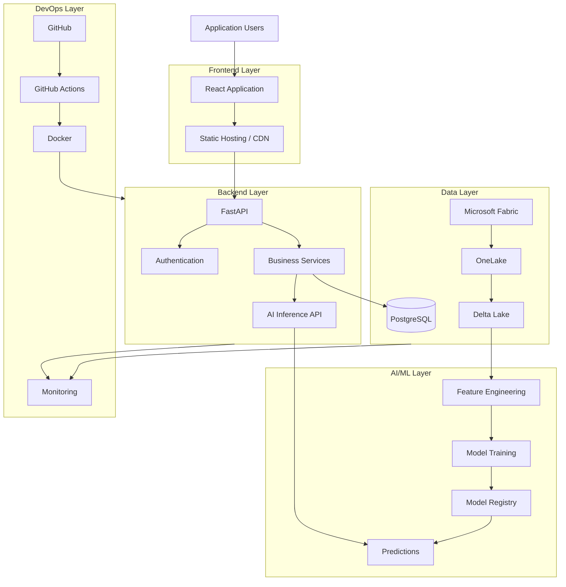
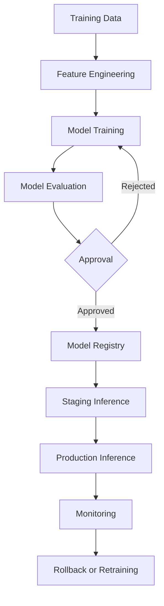

# AutoPulse AI — Deployment and DevOps Architecture

**Document ID:** AP-DEVOPS-015  
**Version:** 1.0  
**Status:** Proposed Design  
**Product:** AutoPulse AI  
**Industry:** Automotive and Fleet Management

---

# 1. Purpose

This document defines the infrastructure, deployment architecture, CI/CD pipelines, environment management, monitoring, and release strategy for AutoPulse AI.

The objective is to establish a repeatable deployment process from local development through production.

The platform must support:

- Reliable application deployment.
- Automated testing.
- Secure configuration.
- Scalable application services.
- Data pipeline deployment.
- AI model deployment.
- Production monitoring.
- Backup and recovery.
- Controlled application releases.

# 2. Deployment Architecture Overview

AutoPulse AI will use a modular cloud-based deployment architecture.

## 2.1 Proposed Technology Stack

| Layer | Proposed Technology |
|---|---|
| Frontend | React, TypeScript |
| UI Framework | Tailwind CSS |
| Backend | Python, FastAPI |
| API | REST, OpenAPI |
| Database | PostgreSQL |
| Data Engineering | Microsoft Fabric |
| Data Storage | OneLake, Delta Lake |
| Processing | PySpark, Spark SQL |
| AI/ML | Scikit-learn, PyTorch |
| Visualization | Power BI, Recharts |
| Containerization | Docker |
| CI/CD | GitHub Actions |
| Cloud Infrastructure | Microsoft Azure |
| Secrets | Azure Key Vault |
| Monitoring | Azure Monitor, Application Insights |
| Version Control | GitHub |

These are proposed implementation choices, not confirmed infrastructure selections.

# 3. High-Level Deployment Architecture



# 4. Environment Architecture

Maintain three separate environments.

## 4.1 Development

Purpose:
- Feature development.
- Local experimentation.
- API development.
- Database development.
- Synthetic data testing.
- Initial model experimentation.

Infrastructure:
- Local frontend.
- Local FastAPI server.
- Development PostgreSQL.
- Development Fabric workspace.
- Synthetic datasets.

## 4.2 Staging

Purpose:
- Integration testing.
- Release verification.
- Performance testing.
- Security testing.
- User acceptance testing.

Infrastructure:
- Staging frontend.
- Staging backend.
- Staging database.
- Staging data workspace.
- Staging model artifacts.

## 4.3 Production

Purpose:
- Real customer operations.
- Fleet monitoring.
- Vehicle analytics.
- Maintenance management.
- AI-powered decision support.

Infrastructure:
- Production frontend hosting.
- Production backend services.
- Production database.
- Production Fabric workspace.
- Production model-serving environment.
- Centralized monitoring.

## 4.4 Environment Separation

| Component | Development | Staging | Production |
|---|---|---|---|
| Frontend | Local | Hosted | Hosted |
| Backend | Local | Hosted | Hosted |
| Database | Development DB | Staging DB | Production DB |
| Fabric | Dev workspace | Test workspace | Production workspace |
| Data | Synthetic | Synthetic/test | Authorized production |
| AI models | Experimental | Validated | Approved |
| Secrets | Local secure config | Key Vault | Key Vault |

Never reuse production credentials in development.

# 5. Frontend Deployment

## 5.1 Frontend Architecture

The frontend will be a React and TypeScript application.

Proposed structure:

```text
frontend/
├── public/
├── src/
│   ├── assets/
│   ├── components/
│   ├── layouts/
│   ├── pages/
│   ├── features/
│   │   ├── dashboard/
│   │   ├── vehicles/
│   │   ├── fleets/
│   │   ├── maintenance/
│   │   ├── analytics/
│   │   └── alerts/
│   ├── services/
│   ├── hooks/
│   ├── context/
│   ├── routes/
│   ├── types/
│   └── App.tsx
├── package.json
└── vite.config.ts
```

## 5.2 Frontend Build

Development:

```bash
npm install
npm run dev
```

Production build:

```bash
npm run build
```

Preview:

```bash
npm run preview
```

## 5.3 Hosting Options

Potential hosting platforms:

- Azure Static Web Apps.
- Azure App Service.
- Azure Storage Static Website with CDN.

Recommended initial direction:

Evaluate Azure Static Web Apps for the frontend, with FastAPI hosted separately.

## 5.4 Frontend Deployment Requirements

- HTTPS.
- Environment-specific API configuration.
- Secure authentication.
- CDN delivery where appropriate.
- Error monitoring.
- Responsive layouts.
- Controlled production releases.

Do not embed private credentials in frontend environment variables.

# 6. Backend Deployment

## 6.1 Backend Architecture

Use FastAPI for application services.

Proposed structure:

```text
backend/
├── app/
│   ├── main.py
│   ├── api/
│   │   └── v1/
│   ├── core/
│   ├── config/
│   ├── models/
│   ├── schemas/
│   ├── services/
│   ├── repositories/
│   ├── middleware/
│   ├── security/
│   └── integrations/
├── tests/
├── requirements.txt
├── Dockerfile
└── .env.example
```

## 6.2 Backend Execution

Local development:

```bash
uvicorn app.main:app --reload
```

Production:

```bash
uvicorn app.main:app --host 0.0.0.0 --port 8000
```

Use an appropriate production worker configuration and concurrency strategy based on the selected hosting environment.

## 6.3 Backend Hosting Options

- Azure App Service.
- Azure Container Apps.
- Azure Kubernetes Service.

Recommended MVP direction:

Evaluate Azure Container Apps for containerized FastAPI services.

Use managed services where possible rather than introducing Kubernetes complexity prematurely.

# 7. Database Deployment

## 7.1 Database Architecture

PostgreSQL will serve as the proposed transactional application database.

It will store:

- Organizations.
- Users.
- Fleets.
- Vehicles.
- Maintenance records.
- Alerts.
- Application configuration.
- AI prediction metadata.
- Audit records.

Microsoft Fabric and OneLake will support analytical storage and processing.

Do not treat PostgreSQL and OneLake as interchangeable. Define the ownership and synchronization responsibilities of each system.

## 7.2 Database Deployment

Potential hosting:

Azure Database for PostgreSQL Flexible Server.

Deployment requirements:

- Private connectivity where appropriate.
- Database authentication.
- Encrypted connections.
- Automated backups.
- Schema migrations.
- Index management.
- Monitoring.
- Recovery testing.

## 7.3 Database Migration

Use Alembic for SQLAlchemy schema migrations.

Example:

```bash
alembic revision --autogenerate -m "initial schema"
```

Apply migrations:

```bash
alembic upgrade head
```

Production migrations must be reviewed and tested before execution.

# 8. Docker Containerization

Docker will provide consistent application environments.

## 8.1 Backend Dockerfile

Create:

`backend/Dockerfile`

```dockerfile
FROM python:3.11-slim

WORKDIR /app

ENV PYTHONDONTWRITEBYTECODE=1
ENV PYTHONUNBUFFERED=1

COPY requirements.txt .

RUN pip install --no-cache-dir -r requirements.txt

COPY app/ ./app/

EXPOSE 8000

CMD ["uvicorn", "app.main:app", "--host", "0.0.0.0", "--port", "8000"]
```

For production, run as a non-root user, pin dependencies, scan images, and use an approved base-image update process.

## 8.2 Frontend Dockerfile

Create:

`frontend/Dockerfile`

```dockerfile
FROM node:22-alpine AS build

WORKDIR /app

COPY package*.json ./

RUN npm ci

COPY . .

RUN npm run build

FROM nginx:alpine

COPY --from=build /app/dist /usr/share/nginx/html

EXPOSE 80

CMD ["nginx", "-g", "daemon off;"]
```

## 8.3 Docker Compose

Create:

`docker-compose.yml`

```yaml
services:

  backend:
    build:
      context: ./backend
    ports:
      - "8000:8000"
    env_file:
      - ./backend/.env
    depends_on:
      - database

  frontend:
    build:
      context: ./frontend
    ports:
      - "3000:80"
    depends_on:
      - backend

  database:
    image: postgres:16
    environment:
      POSTGRES_DB: autopulse
      POSTGRES_USER: autopulse_user
      POSTGRES_PASSWORD: ${POSTGRES_PASSWORD}
    volumes:
      - postgres_data:/var/lib/postgresql/data

volumes:
  postgres_data:
```

This is a local-development starting point. Production should use managed database infrastructure, secret injection, restricted networking, and persistent storage policies.

# 9. Microsoft Fabric Deployment

## 9.1 Fabric Environment Strategy

Create separate workspaces:

```text
AutoPulse-Development
AutoPulse-Staging
AutoPulse-Production
```

Each workspace should contain the approved resources for its environment.

## 9.2 Deployment Components

- Lakehouses.
- Notebooks.
- Data pipelines.
- Dataflows where appropriate.
- SQL Analytics Endpoints.
- Semantic models.
- Power BI reports.

## 9.3 Deployment Requirements

- Version-controlled notebooks.
- Documented pipeline configurations.
- Environment-specific connections.
- Managed identities or approved service principals.
- Restricted workspace permissions.
- Deployment validation.
- Controlled production promotion.

Use Fabric deployment pipelines or supported Git integration where appropriate.

Verify feature availability and licensing before selecting the deployment mechanism.

## 9.4 Data Promotion

```text
Development
    |
    v
Validation
    |
    v
Staging
    |
    v
UAT Approval
    |
    v
Production
```

Never automatically promote unvalidated transformations or models to production.

# 10. AI/ML Model Deployment

## 10.1 Model Lifecycle



## 10.2 Model Deployment Requirements

- Model versioning.
- Feature schema validation.
- Reproducible training.
- Model artifact storage.
- Inference API.
- Prediction logging.
- Model performance monitoring.
- Rollback capability.

## 10.3 Initial Model Deployment

Begin with one validated predictive maintenance model.

Do not deploy all potential AI capabilities simultaneously.

Start with a controlled inference API and synthetic data.

Model deployment must preserve model version, input metadata, and prediction traceability.

# 11. CI/CD Architecture

GitHub Actions will automate testing, building, and deployment.

## 11.1 CI Pipeline

Triggered by:

- Pull requests.
- Commits.
- Approved merges.

Steps:

1. Checkout source code.
2. Install dependencies.
3. Run linting.
4. Run unit tests.
5. Run integration tests.
6. Perform security scans.
7. Build frontend.
8. Build backend image.
9. Publish test results.

## 11.2 CD Pipeline

Steps:

1. Approve release.
2. Build versioned artifacts.
3. Deploy to staging.
4. Run smoke tests.
5. Execute UAT.
6. Approve production.
7. Deploy production.
8. Run post-deployment verification.

## 11.3 GitHub Actions Deployment Example

Create:

`.github/workflows/deploy.yml`

```yaml
name: AutoPulse AI Deployment

on:
  workflow_dispatch:

permissions:
  contents: read

jobs:
  build:
    runs-on: ubuntu-latest

    steps:
      - name: Checkout repository
        uses: actions/checkout@v4

      - name: Set up Python
        uses: actions/setup-python@v5
        with:
          python-version: "3.11"

      - name: Install backend dependencies
        run: |
          cd backend
          pip install -r requirements.txt

      - name: Run backend tests
        run: |
          cd backend
          pytest

      - name: Set up Node
        uses: actions/setup-node@v4
        with:
          node-version: "22"
          cache: npm
          cache-dependency-path: frontend/package-lock.json

      - name: Build frontend
        run: |
          cd frontend
          npm ci
          npm run build
```

This workflow is a build-and-test foundation, not a completed production deployment. Add authenticated image publishing, environment protection, staging deployment, and production approval after selecting the hosting platform.

Pin GitHub Actions to reviewed commit SHAs for production use.

# 12. Secrets and Configuration Management

## 12.1 Configuration Variables

Example:

```text
APP_ENV=development

DATABASE_URL=<secret-reference>

API_BASE_URL=<environment-specific-url>

IDENTITY_PROVIDER_URL=<identity-provider>

AZURE_KEY_VAULT_NAME=<vault-name>

FABRIC_WORKSPACE_ID=<workspace-reference>

MODEL_VERSION=<approved-model-version>
```

## 12.2 Secrets Management Rules

- Use Azure Key Vault for production secrets.
- Prefer managed identities.
- Never commit `.env` files.
- Maintain `.env.example`.
- Rotate credentials.
- Restrict secret access.
- Audit secret usage.

# 13. Monitoring and Logging

## 13.1 Monitoring Components

Monitor:

- Frontend availability.
- API availability.
- API response times.
- Database connections.
- Database performance.
- Pipeline failures.
- Fabric processing.
- AI inference latency.
- Model performance.
- Infrastructure health.

## 13.2 Recommended Tools

- Azure Monitor.
- Application Insights.
- Log Analytics.
- GitHub Actions monitoring.
- Microsoft Fabric monitoring capabilities.

## 13.3 Application Logging

Use structured logs.

Example:

```json
{
  "timestamp": "2026-11-12T12:00:00Z",
  "service": "autopulse-api",
  "level": "INFO",
  "event": "vehicle_prediction_requested",
  "organization_id": "ORG-001",
  "correlation_id": "REQ-001"
}
```

Do not log access tokens, passwords, sensitive customer information, or unrestricted telemetry payloads.

## 13.4 Alerting

Configure alerts for:

- API downtime.
- High error rates.
- Database connection failures.
- Pipeline failures.
- Storage capacity.
- Abnormal inference latency.
- Security incidents.

# 14. Backup and Disaster Recovery

## 14.1 Backup Strategy

Protect:

- Application database.
- Configuration.
- Model artifacts.
- Data pipelines.
- Notebooks.
- Application source code.
- Critical operational metadata.

## 14.2 Recovery Strategy

Document:

- Recovery Point Objective (RPO).
- Recovery Time Objective (RTO).
- Backup frequency.
- Backup retention.
- Restore procedures.
- Regional recovery requirements.

RPO and RTO values must be agreed with business stakeholders rather than assumed.

## 14.3 Recovery Testing

Periodically test:

1. Database restoration.
2. Configuration recovery.
3. Application redeployment.
4. Model artifact recovery.
5. Data pipeline recovery.
6. Access restoration.

A backup is not considered reliable until restoration has been tested.

# 15. Release Management

Use semantic versioning.

Example:

```text
AutoPulse AI

v0.1.0 - Initial application foundation
v0.2.0 - Organization and fleet management
v0.3.0 - Vehicle management
v0.4.0 - Telemetry ingestion
v0.5.0 - Vehicle analytics
v0.6.0 - Predictive maintenance
v0.7.0 - Maintenance workflows
v0.8.0 - Advanced analytics
v0.9.0 - Production hardening
v1.0.0 - Initial production release
```

These are proposed milestones, not completed releases.

Each release must include:

- Version.
- Change summary.
- New features.
- Bug fixes.
- Known limitations.
- Database migrations.
- Deployment instructions.
- Rollback instructions.

# 16. Rollback Strategy

If a deployment causes a critical issue:

1. Stop further promotion.
2. Identify the affected component.
3. Restore the previous application version.
4. Verify database compatibility.
5. Revert configuration if necessary.
6. Validate service availability.
7. Review monitoring data.
8. Document the incident.

Database migrations must have explicit rollback or forward-recovery procedures.

Do not assume that rolling back application code automatically reverses database changes.

# 17. Infrastructure as Code

Use Infrastructure as Code to make environments reproducible.

Potential tools:

- Terraform.
- Azure Bicep.

Manage:

- Application hosting.
- Database infrastructure.
- Network configuration.
- Storage.
- Identity resources.
- Key Vault.
- Monitoring resources.

Infrastructure changes must be reviewed and tested before production deployment.

# 18. Cost Management

Monitor infrastructure spending.

Cost categories:

- Frontend hosting.
- Backend compute.
- PostgreSQL.
- Microsoft Fabric capacity.
- OneLake storage.
- AI inference.
- Monitoring.
- Network transfer.

Implement:

- Development resource shutdown where possible.
- Capacity monitoring.
- Storage lifecycle policies.
- Query optimization.
- Budget alerts.
- Environment-specific resource sizing.

Do not provision production-scale infrastructure before workload requirements are established.

# 19. Deployment Implementation Roadmap

## Phase 1 — Local Foundation

- Configure frontend.
- Configure backend.
- Configure PostgreSQL.
- Create Dockerfiles.
- Configure Docker Compose.
- Verify local connectivity.

## Phase 2 — Cloud Foundation

- Select Azure subscription and resource group.
- Configure hosting.
- Provision database.
- Configure networking.
- Configure identity.
- Configure Key Vault.

## Phase 3 — Fabric Integration

- Create development workspace.
- Connect OneLake.
- Deploy lakehouse resources.
- Configure pipelines.
- Validate data access.

## Phase 4 — CI/CD

- Configure GitHub Actions.
- Add automated testing.
- Build Docker images.
- Configure container registry.
- Implement staging deployment.

## Phase 5 — AI Deployment

- Package approved model.
- Configure inference service.
- Implement model versioning.
- Test predictions.
- Configure monitoring.

## Phase 6 — Production Readiness

- Complete security review.
- Test backups.
- Perform recovery exercises.
- Validate performance.
- Complete UAT.
- Obtain release approval.

# 20. MVP Deployment Scope

The initial MVP should include:

1. React frontend.
2. FastAPI backend.
3. PostgreSQL database.
4. Docker-based local development.
5. GitHub Actions CI.
6. Development environment.
7. Staging environment.
8. Microsoft Fabric development workspace.
9. Basic application monitoring.
10. Secure configuration management.

Production deployment should follow only after application, data, security, and operational requirements have been validated.

# 21. Open Deployment Decisions

The following decisions remain open:

1. Final cloud hosting provider.
2. Azure subscription and budget.
3. Frontend hosting platform.
4. Backend hosting platform.
5. Container registry.
6. PostgreSQL hosting configuration.
7. Fabric licensing and capacity.
8. Identity provider.
9. Monitoring and alerting configuration.
10. Backup retention.
11. RPO and RTO targets.
12. Production scaling strategy.

# 22. Acceptance Criteria

The deployment architecture is ready for implementation when:

- Environment architecture is approved.
- Frontend hosting is selected.
- Backend hosting is selected.
- Database hosting is selected.
- Docker configuration is tested.
- Fabric workspace strategy is documented.
- AI deployment strategy is established.
- CI/CD pipeline is operational.
- Secrets management is configured.
- Monitoring is configured.
- Backup and recovery are tested.
- Rollback procedures are documented.
- Production release criteria are approved.

---

# 23. Next Deliverable

**16-final-implementation-roadmap.md**

The final AutoPulse AI design document will consolidate all previous design work into a complete executable implementation roadmap.

It will include:

- Product requirements.
- User personas and workflows.
- UI/UX implementation.
- System architecture.
- Database and ER design.
- API implementation.
- Data engineering.
- AI/ML development.
- Security.
- Testing.
- Deployment.
- Development milestones.
- GitHub execution checklist.
- MVP acceptance criteria.

**End of Document.**
