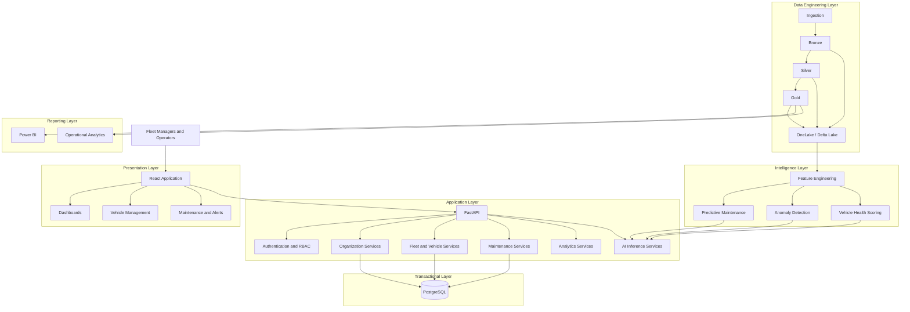

# AutoPulse AI — Final Implementation Roadmap

**Document ID:** AP-ROADMAP-016  
**Version:** 1.0  
**Status:** Proposed Implementation Plan  
**Product:** AutoPulse AI  
**Industry:** Automotive and Fleet Management

---

# 1. Executive Summary

AutoPulse AI is an automotive intelligence platform designed to help fleet operators monitor vehicle health, analyze fleet performance, manage maintenance activities, and identify potential vehicle failures through predictive analytics.

The platform will combine:

- Fleet and vehicle management.
- Vehicle telemetry ingestion.
- Data engineering.
- Data quality management.
- Predictive maintenance.
- Anomaly detection.
- Vehicle health scoring.
- Maintenance management.
- Operational analytics.
- AI-powered decision support.

The application will follow a modular architecture with a React frontend, Python backend, PostgreSQL transactional database, and Microsoft Fabric analytical environment.

The initial development will use synthetic data so that the complete application can be built and tested without depending on external automotive data providers.

# 2. Product Scope

## 2.1 Target Customers

Primary customers:

1. Fleet management companies.
2. Logistics organizations.
3. Transportation companies.
4. Commercial vehicle operators.
5. Vehicle leasing organizations.
6. Corporate fleet departments.

## 2.2 Vehicle Categories

The platform will support a mixed fleet:

- Passenger vehicles.
- Light commercial vehicles.
- Heavy commercial vehicles.
- Delivery vehicles.
- Trucks.
- Buses.
- Electric vehicles.

Vehicle-specific features and telemetry requirements will be configured according to supported data sources.

## 2.3 Data Strategy

Use two complementary data strategies.

### Strategy A: Synthetic Data

Generate realistic development datasets for:

- Organizations.
- Fleets.
- Vehicles.
- Telemetry.
- Maintenance.
- Diagnostic events.
- Vehicle utilization.
- Anomalies.
- Predictive maintenance.

### Strategy B: Real Data Integration

Design integration capabilities for:

- Vehicle telematics providers.
- Fleet management systems.
- OEM APIs.
- GPS and tracking systems.
- Maintenance management systems.
- Customer-provided CSV and Excel files.
- IoT and sensor platforms.

Real integrations will be implemented after provider availability, access permissions, and data contracts are confirmed.

# 3. Product Modules

The application will contain the following modules.

| Module | Primary Function |
|---|---|
| Authentication | Secure user access |
| Organization Management | Customer organization administration |
| Fleet Management | Fleet registration and organization |
| Vehicle Management | Vehicle inventory and information |
| Telemetry Management | Vehicle data ingestion |
| Vehicle Health | Vehicle condition monitoring |
| Predictive Maintenance | Failure risk prediction |
| Anomaly Detection | Unusual behavior identification |
| Maintenance Management | Maintenance scheduling and history |
| Alerts | Operational notifications |
| Analytics | Fleet performance reporting |
| AI Intelligence | Model inference and insights |
| Administration | Users, roles, and configuration |

# 4. Recommended Technology Stack

| Component | Technology |
|---|---|
| Frontend | React |
| Programming Language | TypeScript |
| Styling | Tailwind CSS |
| Backend | Python |
| API Framework | FastAPI |
| Application Database | PostgreSQL |
| ORM | SQLAlchemy |
| Database Migrations | Alembic |
| Data Engineering | Microsoft Fabric |
| Analytical Storage | OneLake |
| Data Format | Delta Lake |
| Processing | PySpark |
| Analytics | SQL, Spark SQL |
| Machine Learning | Scikit-learn |
| Deep Learning | PyTorch |
| Data Processing | Pandas, NumPy |
| Visualization | Recharts, Power BI |
| Testing | Pytest, Playwright |
| Containerization | Docker |
| CI/CD | GitHub Actions |
| Cloud | Microsoft Azure |
| Monitoring | Azure Monitor |

Technology selections are proposed defaults and should be confirmed before infrastructure provisioning.

# 5. System Architecture



# 6. GitHub Repository Structure

Recommended implementation structure:

```text
RKIntelligence-Lab/
│
├── index.html
│
├── docs/
│   ├── architecture/
│   ├── standards/
│   └── roadmap/
│
├── products/
│   │
│   ├── autopulse/
│   │   ├── README.md
│   │   │
│   │   ├── docs/
│   │   │   ├── 01-product-discovery.md
│   │   │   ├── 02-user-personas-and-journeys.md
│   │   │   ├── 03-functional-requirements.md
│   │   │   ├── 04-ui-ux-design.md
│   │   │   ├── 05-system-architecture.md
│   │   │   ├── 06-database-and-er-design.md
│   │   │   ├── 07-api-specification.md
│   │   │   ├── 08-data-engineering-architecture.md
│   │   │   ├── 09-data-quality-and-governance.md
│   │   │   ├── 10-ai-ml-architecture.md
│   │   │   ├── 11-security-and-access-control.md
│   │   │   ├── 12-testing-and-qa-strategy.md
│   │   │   ├── 13-deployment-and-devops.md
│   │   │   └── 16-final-implementation-roadmap.md
│   │   │
│   │   ├── frontend/
│   │   ├── backend/
│   │   ├── data-engineering/
│   │   ├── ml/
│   │   ├── database/
│   │   ├── data/
│   │   ├── tests/
│   │   ├── infrastructure/
│   │   └── scripts/
│   │
│   ├── finsight/
│   ├── edusphere/
│   ├── dermasense/
│   └── medicore/
│
└── .github/
    └── workflows/
```

Important: Preserve the actual filenames already created in your repository. The structure above is a proposed logical organization; reconcile document numbering and paths before moving or renaming existing files.

# 7. Database Implementation

## 7.1 Initial Database Entities

Create the following core entities.

| Table | Purpose |
|---|---|
| organizations | Customer organizations |
| users | Application users |
| organization_members | User memberships |
| roles | User roles |
| permissions | Application permissions |
| fleets | Fleet information |
| vehicles | Vehicle inventory |
| vehicle_types | Vehicle categories |
| telemetry_records | Telemetry metadata and records |
| maintenance_records | Maintenance history |
| maintenance_schedules | Planned maintenance |
| diagnostic_events | Vehicle diagnostic events |
| alerts | Operational alerts |
| vehicle_health_scores | Calculated health scores |
| ml_predictions | Model prediction metadata |
| audit_logs | Security and activity history |

## 7.2 Database Development Sequence

1. Configure PostgreSQL.
2. Configure SQLAlchemy.
3. Configure Alembic.
4. Create organization tables.
5. Create authentication-related tables.
6. Create fleet tables.
7. Create vehicle tables.
8. Create maintenance tables.
9. Create telemetry metadata tables.
10. Create alerts and prediction tables.
11. Add foreign keys and indexes.
12. Add tenant isolation controls.
13. Run database tests.

The detailed field definitions and relationships must follow the approved database and ER design document.

# 8. API Implementation

Develop REST APIs in the following sequence.

## 8.1 Authentication APIs

```text
POST /api/v1/auth/register
POST /api/v1/auth/login
POST /api/v1/auth/logout
GET  /api/v1/auth/me
POST /api/v1/auth/refresh
```

## 8.2 Organization APIs

```text
POST   /api/v1/organizations
GET    /api/v1/organizations
GET    /api/v1/organizations/{organization_id}
PUT    /api/v1/organizations/{organization_id}
```

## 8.3 Fleet APIs

```text
POST   /api/v1/fleets
GET    /api/v1/fleets
GET    /api/v1/fleets/{fleet_id}
PUT    /api/v1/fleets/{fleet_id}
DELETE /api/v1/fleets/{fleet_id}
```

## 8.4 Vehicle APIs

```text
POST   /api/v1/vehicles
GET    /api/v1/vehicles
GET    /api/v1/vehicles/{vehicle_id}
PUT    /api/v1/vehicles/{vehicle_id}
DELETE /api/v1/vehicles/{vehicle_id}
```

## 8.5 Telemetry APIs

```text
POST /api/v1/telemetry/upload
POST /api/v1/telemetry/ingest
GET  /api/v1/telemetry/{vehicle_id}
```

## 8.6 Maintenance APIs

```text
POST /api/v1/maintenance
GET  /api/v1/maintenance
GET  /api/v1/maintenance/{maintenance_id}
PUT  /api/v1/maintenance/{maintenance_id}
```

## 8.7 AI and Analytics APIs

```text
GET  /api/v1/analytics/fleet-overview
GET  /api/v1/analytics/vehicle-performance

GET  /api/v1/ai/vehicle-health/{vehicle_id}
GET  /api/v1/ai/predict-maintenance/{vehicle_id}
GET  /api/v1/ai/anomalies/{vehicle_id}
```

These are proposed endpoint contracts. Final request schemas, response schemas, authentication requirements, pagination, and error definitions must be established in the API specification before implementation.

# 9. Frontend Implementation

## 9.1 Main Application Screens

Build screens in this order.

### Screen 1: Authentication

- Login.
- Registration.
- Forgot password.
- Account verification.

### Screen 2: Main Dashboard

Display:

- Total vehicles.
- Active fleets.
- Vehicles requiring attention.
- Maintenance due.
- Critical alerts.
- Fleet utilization.
- Vehicle health distribution.
- Recent activities.

### Screen 3: Fleet Management

- Fleet listing.
- Fleet creation.
- Fleet details.
- Fleet assignment.
- Fleet performance.

### Screen 4: Vehicle Management

- Vehicle inventory.
- Vehicle registration.
- Vehicle details.
- Vehicle specifications.
- Vehicle history.
- Vehicle status.

### Screen 5: Vehicle Intelligence

- Health score.
- Telemetry trends.
- Diagnostic events.
- Maintenance risk.
- AI predictions.
- Explainability information.

### Screen 6: Maintenance Management

- Maintenance schedules.
- Maintenance history.
- Service records.
- Upcoming maintenance.
- Completed maintenance.

### Screen 7: Analytics

- Fleet utilization.
- Vehicle performance.
- Maintenance costs.
- Vehicle downtime.
- Operational trends.

### Screen 8: Alerts

- Critical alerts.
- Warning alerts.
- Informational alerts.
- Alert history.
- Alert acknowledgment.

### Screen 9: Administration

- Users.
- Roles.
- Permissions.
- Organization settings.
- Audit history.

# 10. Data Engineering Implementation

## 10.1 Medallion Architecture

Implement three data layers.

### Bronze

Responsibilities:

- Ingest source records.
- Preserve source information.
- Add ingestion timestamps.
- Track source identifiers.
- Record ingestion failures.

### Silver

Responsibilities:

- Standardize schemas.
- Normalize vehicle identifiers.
- Convert data types.
- Handle missing values.
- Deduplicate records.
- Validate business rules.
- Quarantine invalid records.

### Gold

Responsibilities:

- Fleet performance datasets.
- Vehicle health datasets.
- Maintenance analytics.
- Vehicle utilization.
- Predictive maintenance features.
- Operational KPIs.

## 10.2 Pipeline Implementation

Develop these pipelines:

| Pipeline | Purpose |
|---|---|
| PL-001 | Vehicle master ingestion |
| PL-002 | Fleet master ingestion |
| PL-003 | Telemetry ingestion |
| PL-004 | Diagnostic event ingestion |
| PL-005 | Maintenance ingestion |
| PL-006 | Silver transformation |
| PL-007 | Gold aggregation |
| PL-008 | Feature engineering |
| PL-009 | Data reconciliation |

## 10.3 Initial Data Sources

Begin with generated CSV and Parquet datasets.

Example:

```text
data/
├── raw/
│   ├── organizations.csv
│   ├── fleets.csv
│   ├── vehicles.csv
│   ├── telemetry.csv
│   ├── maintenance.csv
│   └── diagnostic_events.csv
│
├── processed/
│
├── synthetic/
│
└── reference/
```

Later, integrate approved real data providers.

# 11. AI/ML Implementation

Implement intelligence capabilities incrementally.

## Model 1: Vehicle Health Scoring

Objective:

Calculate an interpretable vehicle health indicator using available and validated information.

Potential features:

- Mileage.
- Vehicle age.
- Maintenance history.
- Diagnostic events.
- Available telemetry.
- Vehicle utilization.

Output:

- Health score.
- Health category.
- Contributing factors.
- Data completeness indicator.

The score must be calibrated against defined rules or validated outcomes, not arbitrary weights presented as established engineering facts.

## Model 2: Predictive Maintenance

Objective:

Estimate the likelihood of a defined maintenance or failure event within a specified prediction horizon.

Development sequence:

1. Define prediction target.
2. Establish event labels.
3. Generate or obtain suitable data.
4. Perform exploratory analysis.
5. Engineer features.
6. Split data appropriately.
7. Train baseline model.
8. Evaluate model.
9. Calibrate probabilities.
10. Register approved model.
11. Deploy inference API.
12. Monitor model performance.

## Model 3: Anomaly Detection

Objective:

Identify unusual vehicle telemetry behavior.

Potential approaches:

- Statistical anomaly detection.
- Isolation Forest.
- Local Outlier Factor.
- Autoencoders.

Evaluate false-positive and false-negative behavior before operational use.

## Model 4: Fleet Performance Analytics

Objective:

Identify:

- Vehicle utilization.
- Downtime.
- Maintenance patterns.
- Operational trends.
- Fleet efficiency.

Begin with SQL-based analytical metrics before introducing unnecessary ML complexity.

# 12. Security Implementation

Implement:

1. Secure authentication.
2. Role-based access control.
3. Organization membership.
4. Tenant isolation.
5. API authorization.
6. Database protection.
7. Secrets management.
8. Audit logging.
9. Secure file uploads.
10. Security testing.

Every customer organization must be isolated from other organizations.

Use synthetic data throughout initial development.

# 13. Testing Implementation

Create tests for:

- Frontend components.
- Backend services.
- API endpoints.
- Database constraints.
- Data transformations.
- Data quality.
- PySpark workflows.
- AI/ML predictions.
- Tenant isolation.
- Security.
- Performance.
- End-to-end workflows.

Use automated GitHub Actions workflows to execute tests on pull requests.

# 14. Deployment Implementation

Initial local environment:

```text
React Frontend
      |
      v
FastAPI Backend
      |
      v
PostgreSQL
```

Analytical environment:

```text
Synthetic / Approved Source Data
      |
      v
Microsoft Fabric
      |
      v
OneLake
      |
      v
Bronze / Silver / Gold
      |
      v
AI/ML and Power BI
```

Deployment sequence:

1. Local development.
2. Docker configuration.
3. Database setup.
4. CI automation.
5. Development deployment.
6. Staging deployment.
7. Integration testing.
8. Security review.
9. UAT.
10. Production readiness approval.

# 15. Development Phases

## Phase 1 — Project Foundation

Tasks:

- Create application folders.
- Configure Git.
- Configure Python environment.
- Configure Node.js.
- Configure React.
- Configure FastAPI.
- Configure PostgreSQL.
- Create initial application structure.

Deliverable:

A locally running frontend and backend connected to the database.

## Phase 2 — Authentication and Organization

Tasks:

- Implement user authentication.
- Implement organization registration.
- Implement membership management.
- Implement RBAC.
- Implement tenant isolation.

Deliverable:

A secure multi-organization application foundation.

## Phase 3 — Fleet and Vehicle Management

Tasks:

- Implement fleet CRUD operations.
- Implement vehicle CRUD operations.
- Add vehicle categorization.
- Add fleet assignments.
- Create vehicle detail screens.

Deliverable:

A functional fleet and vehicle management application.

## Phase 4 — Synthetic Data and Telemetry

Tasks:

- Generate synthetic vehicles.
- Generate telemetry.
- Generate maintenance records.
- Create ingestion scripts.
- Validate source schemas.
- Load records into Bronze.
- Transform records into Silver.
- Create Gold datasets.

Deliverable:

An operational data engineering pipeline.

## Phase 5 — Vehicle Analytics

Tasks:

- Create fleet KPIs.
- Create vehicle utilization metrics.
- Calculate maintenance indicators.
- Develop vehicle health scoring.
- Build analytics dashboards.

Deliverable:

An operational fleet intelligence dashboard.

## Phase 6 — AI/ML

Tasks:

- Define predictive maintenance target.
- Build feature engineering workflows.
- Train baseline models.
- Evaluate models.
- Build anomaly detection.
- Implement inference endpoints.
- Display predictions.

Deliverable:

An initial AI-powered fleet intelligence application.

## Phase 7 — Maintenance and Alerts

Tasks:

- Create maintenance schedules.
- Record service history.
- Generate maintenance alerts.
- Implement alert acknowledgment.
- Connect prediction outputs to maintenance workflows.

Deliverable:

An integrated maintenance management module.

## Phase 8 — Quality and Security

Tasks:

- Run automated tests.
- Test tenant isolation.
- Perform security scans.
- Validate data quality.
- Test model performance.
- Perform load testing.
- Resolve critical defects.

Deliverable:

A validated application candidate.

## Phase 9 — Deployment

Tasks:

- Configure Docker.
- Configure cloud hosting.
- Configure database hosting.
- Configure Fabric workspaces.
- Configure GitHub Actions.
- Implement monitoring.
- Validate backups.
- Complete UAT.

Deliverable:

A deployment-ready AutoPulse AI MVP.

# 16. Suggested Development Timeline

Indicative schedule for a focused individual development effort.

| Phase | Estimated Duration |
|---|---:|
| Project foundation | 3–5 days |
| Authentication and organization | 5–7 days |
| Fleet and vehicle management | 5–7 days |
| Synthetic data and telemetry | 5–7 days |
| Data engineering | 7–10 days |
| Analytics and dashboards | 5–7 days |
| AI/ML | 7–12 days |
| Maintenance and alerts | 4–6 days |
| Testing and security | 5–7 days |
| Deployment | 4–7 days |

These are planning estimates, not delivery commitments. Fabric setup, external integrations, and production security can extend the schedule.

# 17. MVP Definition

The first MVP must demonstrate a complete working business workflow.

## Required MVP Capabilities

- User authentication.
- Organization management.
- Fleet management.
- Vehicle registration.
- Synthetic telemetry ingestion.
- Data validation.
- Bronze/Silver/Gold processing.
- Vehicle health scoring.
- Initial predictive maintenance model.
- Fleet analytics dashboard.
- Maintenance history.
- Alerts.
- Role-based authorization.

## MVP Success Criteria

The MVP is considered successful when:

1. A user can create an organization.
2. An authorized user can create a fleet.
3. Vehicles can be registered and assigned.
4. Synthetic telemetry can be ingested.
5. Data can be validated and transformed.
6. Analytical datasets can be generated.
7. Vehicle health information can be displayed.
8. An evaluated ML model can produce predictions.
9. Maintenance information can be managed.
10. Users cannot access unauthorized organizational data.
11. Automated tests pass.
12. The application can be deployed to a controlled environment.

# 18. GitHub Development Workflow

Follow this development workflow:

```text
GitHub Repository
       |
       v
Create Feature Branch
       |
       v
Implement Feature
       |
       v
Run Local Tests
       |
       v
Commit Changes
       |
       v
Push to GitHub
       |
       v
Create Pull Request
       |
       v
GitHub Actions
       |
       v
Code Review
       |
       v
Merge to Main
```

Suggested branch names:

```text
main
develop
feature/authentication
feature/organization-management
feature/fleet-management
feature/vehicle-management
feature/telemetry-ingestion
feature/data-engineering
feature/vehicle-analytics
feature/predictive-maintenance
feature/maintenance-management
feature/deployment
```

Use small, focused commits.

# 19. Initial Development Checklist

## Project Foundation

- [ ] Create frontend directory.
- [ ] Create backend directory.
- [ ] Create database directory.
- [ ] Create data directory.
- [ ] Create ML directory.
- [ ] Create tests directory.
- [ ] Create infrastructure directory.
- [ ] Configure Python virtual environment.
- [ ] Configure React and TypeScript.
- [ ] Configure FastAPI.
- [ ] Configure PostgreSQL.
- [ ] Configure Docker.
- [ ] Configure GitHub Actions.
- [ ] Add README documentation.

## First Functional Milestone

- [ ] Run frontend locally.
- [ ] Run backend locally.
- [ ] Connect frontend to backend.
- [ ] Connect backend to PostgreSQL.
- [ ] Create first database migration.
- [ ] Implement health-check endpoint.
- [ ] Display backend connection status in frontend.
- [ ] Add initial automated tests.

## Second Functional Milestone

- [ ] Implement authentication.
- [ ] Implement organizations.
- [ ] Implement fleets.
- [ ] Implement vehicles.
- [ ] Add synthetic records.
- [ ] Create vehicle inventory screen.

# 20. Development Principles

Follow these principles throughout implementation:

1. Build modular components.
2. Keep frontend and backend responsibilities separate.
3. Use documented API contracts.
4. Use version-controlled database migrations.
5. Maintain reusable data transformations.
6. Separate transactional and analytical workloads.
7. Use synthetic data before real integrations.
8. Make AI predictions explainable.
9. Test every major feature.
10. Implement security from the beginning.
11. Document architectural decisions.
12. Avoid unnecessary infrastructure complexity.
13. Maintain reproducible development environments.
14. Never commit secrets or customer data.

# 21. Open Decisions Before Implementation

Confirm the following before final infrastructure and schema implementation:

- Final hosting and cloud budget.
- Authentication provider.
- PostgreSQL hosting.
- Fabric licensing and capacity.
- Telemetry format and frequency.
- Vehicle identification strategy.
- Prediction target and prediction horizon.
- Maintenance event definitions.
- External provider integration requirements.
- Production security and compliance requirements.

# 22. Final Design Acceptance

AutoPulse AI moves into implementation when:

- Product discovery is approved.
- Target personas are defined.
- Core user workflows are documented.
- UI/UX screens are approved.
- System architecture is approved.
- Database design is reviewed.
- API contracts are defined.
- Data engineering architecture is established.
- AI/ML requirements are defined.
- Security architecture is reviewed.
- Testing strategy is approved.
- Deployment architecture is documented.
- Development milestones are agreed upon.

---

# 23. Implementation Starting Point

**First implementation milestone: Project Foundation.**

Do not begin by building the entire application at once.

Start with:

1. Repository structure.
2. Python environment.
3. React frontend.
4. FastAPI backend.
5. PostgreSQL.
6. Docker.
7. Initial API connection.
8. Health-check endpoint.
9. GitHub Actions.

Once these components work together, proceed to authentication and organization management.

**End of Document.**
